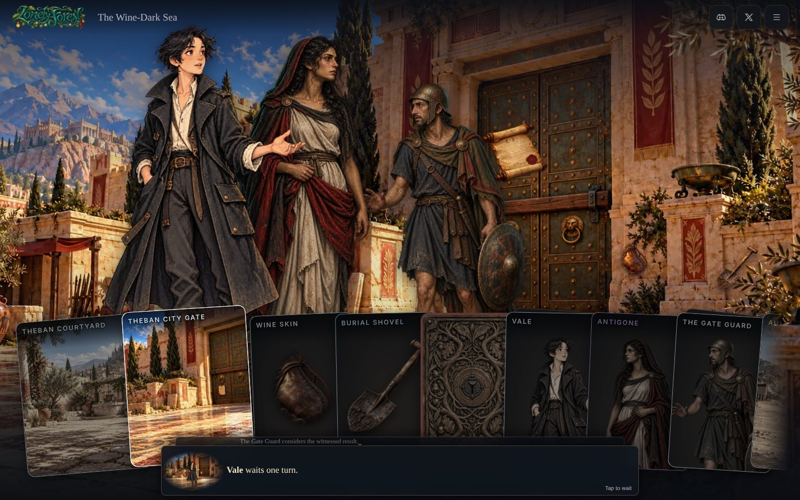

# CosyWorld

A persistent world played as cards. You choose a card, the world changes, and someone in the room may answer. The card, and the message the world writes for that play, are what happened. A spoken line can color the scene, and it can be wrong about the table.

CosyWorld is the engine. The game it runs is **Lonely Forest**: play it at **[lonelyforest.com](https://lonelyforest.com)**.

The same rules run for a solo table and for a shared one. A shared world stays on the server. Residents keep homes, wants, and trust while you are away. Further shores are world packs on the same table: a forest, a Greek coast, a hoppycat archive, and others named in [ARCHITECTURE.md](ARCHITECTURE.md).

How the system is put together is in [ARCHITECTURE.md](ARCHITECTURE.md). Five engineering choices, and why they were made, are in [DECISIONS.md](DECISIONS.md). The [shared-systems audit](docs/design/shared-systems-audit.md) records special rules, fallbacks and compatibility paths.

## Play locally

The live site is the game. A local server is that same program.

You need Node.js 24 or newer, npm, and a Rust toolchain. The development server runs under a Rust supervisor on Linux and macOS.

```sh
npm ci
npm run dev
```

`npm run dev` builds the server and serves http://127.0.0.1:3102/. On a Mac it also tries to open that URL. Use `npm run v2:status` and `npm run v2:stop` to inspect or stop the supervisor. Hosted dialogue reads `OPENROUTER_API_KEY`. With no key, the play is still saved and each voice that was due shows "…".

Dialogue from a model on your own machine:

```sh
python3 v2/local/prepare.py
npm run play:cards:local
```

`prepare.py` fetches a pinned local dialogue model (`gemma3:4b` or `gemma3:1b`). The play script then prints `http://127.0.0.1:3110/` and starts the game plus a local voice process. Model names and the loopback checks live in `v2/local/run.py`.

## For portfolio reviewers / engineers

CosyWorld is a solo and shared card world with a hard boundary between a deterministic rules core and a language model.

- One rules program serves the browser and the shared server. The server runs it in QuickJS, a C interpreter with no filesystem, network, clock, or randomness, inside a Rust process that owns IO and checks shared seats and room capacity. The layout is in [ARCHITECTURE.md](ARCHITECTURE.md).
- A card is journaled and reduced before anyone speaks. Generated speech is stored as speech. It is not the state the next card is dealt from. A line can contradict the table. Card text, the accepted action, and world messages are the account a replay agrees on.
- Shared worlds are a SQLite journal. Released rules bundles from `full-card-world/133` onward stay in the server so an old journal still reduces on the rules that wrote it. The app and rules versions are tracked independently. [App manifest](package.json) · [Pinned rules](v2/orchestrator-rust/src/card_shared/rules.json)
- A branch is held to 400 handwritten lines (`scripts/change-budget.json`). A change to the shared rules engine is a separate warning unless the pull request carries the `engine` label. Tests cover the rules, the journal, and the speech path.

[DECISIONS.md](DECISIONS.md) records the judgment behind those choices.

## Pictures of play



Captures come from the live site or a local server, never a generated stand-in. They go in `docs/play/` and are linked here.

1. The table at a place, with the hand visible: [`docs/play/table.jpg`](docs/play/table.jpg), from a local server at 1440 px. Its one spoken line is the test harness's stand-in, so it is not frame 3.
2. A card just played, with the world message the rules wrote.
3. A spoken line on that same beat, so the two layers can be told apart.
4. A shared room, or the list of worlds.

A short recording of one play, from card to world message to reply, is enough.

## Where the code lives

| Path                        | What it is                                        |
| --------------------------- | ------------------------------------------------- |
| `v2/card-game/`             | Browser client and the authored rules             |
| `v2/orchestrator-rust/`     | Shared worlds, the journal, and the model gateway |
| `v2/content/`, `v2/worlds/` | Sources for the mounted world packs               |
| `v2/local/`                 | Offline server and local dialogue                 |

License: MIT.
