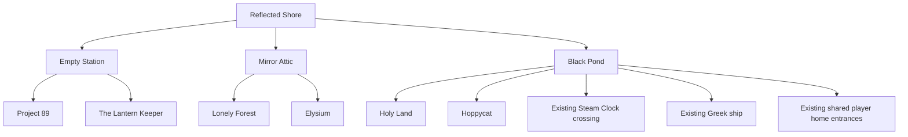

# Reflected Shore worldpack migration

Status: **Planning**. Groomed 26 October 2026.

Six named worlds can join the Reflected Shore through its station, attic, and
pond. Each first edition contains four locations, four avatars, and four item
subjects. The first journey is Shore → Lonely Forest → Shore. Its proof sets
the pattern for the other five packs.

**Accepted sequencing:** the creator will integrate this work after multiplayer
testing. Keep the research and art in
[draft PR 1182](https://github.com/cenetex/cosyworld/pull/1182) for that handoff.
Art approval and multiplayer evidence precede integration. The routes, opening
stories, and content adaptations below remain proposals.

This plan owns the future work under the [backlog policy](README.md). Promote
one bounded GitHub issue when its prerequisites and the creator's priority
decision are recorded. The creator controls integration and production release.

## Research and review record

The source review uses repository revision
`b160f898f566cedbf3f641a81fba7305f38a3759`. At implementation time, compare the
plan with the tested multiplayer revision and record any changes.

| Evidence | Preserved record |
| --- | --- |
| Six packs, one location, avatar, and item each | [18-image review](../../art-direction/worldpacks/review-trios/index.html) and [subject manifest](../../art-direction/worldpacks/review-trios/manifest.json) |
| Native model requests, seeds, versions, and output hashes | [Replicate receipts](../../art-direction/worldpacks/review-trios/replicate-receipts.json) |
| Other sample prompts and reference hashes | [Built-in image receipts](../../art-direction/worldpacks/review-trios/builtin-receipts.json) |
| Earlier background and avatar studies | [Style sheets](../../art-direction/worldpacks/README.md), [sample receipts](../../art-direction/worldpacks/samples/receipts.json), and saved request sheets beside them |
| Lonely Forest reference supplied by the creator | [Visual guide](../../art-direction/style-guide.md) and [world map](../../art-direction/world-map.md) |
| Elysium and Lantern Keeper style boards | [Saved references](../../art-direction/worldpacks/review-trios/references) |
| Pack and bridge contract | [Card packs](../../../v2/docs/card-packs.md) and [validator](../../../v2/card-game/pack-schema.mjs) |
| Shared-world authority, queues, homes, and replay | [Shared worlds](../../../v2/docs/card-table/shared-worlds.md) |

All 18 selected images await visual approval. Each is a review sample. Final
approval records the subject, file hash, sheet revision, and any required
correction. Earlier studies remain with their original receipts.

The creator selected these model families:

| World | Style direction | Model or reference |
| --- | --- | --- |
| Lonely Forest | Warm cottage, living oak, indigo shade, violet and mint dream openings | [immanencer/mirquo](https://replicate.com/immanencer/mirquo), [sheet](../../art-direction/worldpacks/lonely-forest.json) |
| Holy Land | Rough watercolor, searching pencil, open paper, limestone and linen | [ratimics/b43l](https://replicate.com/ratimics/b43l), [sheet](../../art-direction/worldpacks/holy-land.json) |
| Project 89 | Washed anime, teal shade, coral lamps, repaired surfaces | [ratimics/project89](https://replicate.com/ratimics/project89), [sheet](../../art-direction/worldpacks/project89.json) |
| Hoppycat | Painted storybook scenes and established character identities | Existing Hoppycat identity art and saved sample references |
| The Lantern Keeper | Carved woodcut, rain, amber lamps, cold surrounding woods | Saved woodcut board; future generation model to be selected |
| Elysium | Silver figures, black void, fine golden paths | Saved silver-and-gold board; future generation model to be selected |

The three native-model JSON sheets are drafts. Complete equivalent reusable
sheets for the other three packs after style approval. Add item prompt templates
alongside background and avatar templates. Review generated lettering, small
marks, identity, anatomy, framing, and small-card readability in the next pass.

## Source content and the four of each scope

These numeric IDs identify the authored source. The migration must keep an
explicit source-to-card ID map. Reflected Shore IDs keep their existing meaning.

| Pack and source | Four locations | Four avatars | Four items |
| --- | --- | --- | --- |
| Lonely Forest — [core](../../../v2/content/core) | 1 Cosy Cottage; 2 Rain-Soft Garden; 3 Moonlit Trail; 40 Old Oak Tree | 1001 Rati; 1002 Gust, with Whiskerwind naming for review; 1003 Skull; 1005 Oak | 2005 Story Button; 2002 Dewbright Button; 2007 Watch Bell; 2003 Wolfprint Charm |
| Holy Land — [the-holy-land](../../../v2/content/the-holy-land) | 704 Capernaum; 705 Sea of Galilee Shore; 706 Hillside of Teachings; 707 Bethsaida | 7002 Simon Peter; 7003 Andrew; 7004 James son of Zebedee; 7006 Philip | 7201 Mended Net Cord; 7203 Boatwright's Adze; 7206 Pearl of Great Price; 7208 Mustard Seed Pouch |
| Project 89 — [project89-operation-liberation](../../../v2/content/project89-operation-liberation) | 8900 Threshold Interface; 8901 Sector 89 Safehouse; 8902 89 Archives; 8903 Meme Farm 17 | 8950 Seraph; 8951 Mara Quell; 8952 Parzival; 8954 Iri Vale | 8970 Charged 89 Sigil; 8972 Memory Lantern; 8977 Loopbreaker Patch; 8978 Consciousness Capsule |
| Hoppycat — [hoppycat-archive](../../../v2/content/hoppycat-archive) | 770000 Halfway Tea Garden; 770007 Meraki Atelier; 770008 Goldfish Tank; 770009 Signal Jetty | 771008 Hoppy Cat; 771005 Mira Meraki; 771006 Glim Twice; 771103 staticwashere | 772008 Halfway Cup; 772005 Five-Finger Meraki Brush; 772006 Goldfish Loop Token; 772009 Return-Path Checklist |
| The Lantern Keeper — [the-lantern-keeper](../../../v2/content/the-lantern-keeper) | 801 Mothwood Path; 802 Saint Orra's Ruin; 803 Flooded Barrow; 804 Lantern Tower | 8301 Mara Wick; 8302 Pip Thistle; 8303 Moth-Eaten Knight; 8304 Rowan Vale | 8401 Keeper's Brass Key; 8402 Mothglass Lens; 8403 Dawn Oil; 8404 Keeper's Ember |
| Elysium — [elysium](../../../v2/content/elysium) | 652000 Void 001; 652001 Void 002; 652002 Void 003; 652004 Void 005 | 289553007952 Claude Fable; 39742904712 Claude Haiku; 162757305737 Claude Opus; 470082020438 Gemini Flash | First art subjects: void_wayfinder; listening_shard; quiet_ember; fold_satchel |

There are 72 review subjects across the six packs. Elysium's four item art
subjects are resolved forms. Its starting items remain the unique unresolved
markers 6520000, 6520001, 6520002, and 6520004. Preserve the existing six-outcome
identity table, including Living Spore and Impossible Thread. Approve the visual
coverage for those two outcomes when the Elysium slice is promoted.

Elysium avatar names above abbreviate authored labels. Exact actor identity and
model bindings belong to its source files. Preserve those records during
adaptation and check provider support when implementing the slice.

The [lonely-forest source directory](../../../v2/content/lonely-forest/pack.json)
currently owns character art; the selected world facts come from `core`.
The Shore's Pip (`moth`) and Lantern Keeper's Pip Thistle (`8302`) are separate
characters. Keep Vale, Iri Vale, and Rowan Vale distinct as well.

## Proposed connection map

The Shore is the shared home between journeys. Its three places teach three
kinds of crossing: the station holds journeys and time, the attic holds dreams
and identity, and the pond holds distant shores.

Each new link is two-way. The arrows above group destinations by their Shore
doorway. The boat, carriage, and mirror passage can be short travel scenes;
the first edition's four locations belong to the destination world.

| World | Proposed first discovery and arrival | First meeting | Proposed return response |
| --- | --- | --- | --- |
| Lonely Forest | Warm lamplight in the attic mirror reveals a blue cottage beneath an oak. Enter at Cosy Cottage. | Rati offers shelter; Skull watches the path. | Bring the Wolfprint Charm to the keeper for a conversation about protection. |
| Holy Land | Morning light on the pond reveals a fishing boat. Arrive at Galilee Shore. | Help Peter mend a net. | Mended Net Cord recalls the work shared there. |
| Project 89 | The station timetable gains destination 89. A carriage opens onto Threshold Interface. | Seraph receives the traveler; Mara questions the arrival. | The Memory Lantern reveals a fragment beside the timetable. |
| Hoppycat | A tea garden appears upside down in the pond. Accept Hoppy's invitation to Halfway Tea Garden. | Help make one impossible thing. | The Halfway Cup gives Pip a reason to share tea. |
| The Lantern Keeper | A distant lamp beyond the station door leads to Mothwood Path. | Pip Thistle brings news of the failing lantern. | The Mothglass Lens reveals faint marks around Shore lamps. |
| Elysium | A silver reflection in the attic holds a golden thread. Follow it to Void 001. | A resident recognises something the traveler has forgotten. | The Void Wayfinder responds to a place whose meaning has changed. |

The scenes are design briefs. Select exact legal plays and conditions in the
bridge slice. Morning light is scene art; any timing rule uses played time.
Show destination style inside the doorway, then use that style across the
destination scene. Preserve the Shore's own visual identity.

The journey rhythm is clue → small action → discovered route → visit → clear
return → changed response at home. A return response must cite completed play
and current item custody. The route remains discoverable after the first visit.
Choose the repeat-travel rule explicitly during the bridge work.

## Opening journeys and adaptations

| World | Proposed four-location route | First complete journey |
| --- | --- | --- |
| Lonely Forest | Cottage ↔ Garden ↔ Moonlit Trail; Garden ↔ Old Oak | Help the household, clear the path, earn the Wolfprint Charm, visit Oak, return to the keeper. |
| Holy Land | Hillside ↔ Capernaum ↔ Galilee Shore ↔ Bethsaida | Mend the net, return the adze, follow the teaching trail, return to the Shore. Bethlehem belongs to a later chapter. |
| Project 89 | Threshold ↔ Safehouse ↔ Archives ↔ Meme Farm 17 | Finish a bounded rescue introduction, then return with a memory. The full Operation Liberation arc continues in a later slice. |
| Hoppycat | Tea Garden ↔ Atelier ↔ Signal Jetty ↔ Goldfish Tank ↔ Tea Garden | Adapt the existing make-one-impossible-thing quest into a complete four-place visit. |
| The Lantern Keeper | Mothwood ↔ Saint Orra's Ruin ↔ Flooded Barrow ↔ Tower | Follow the failed lights, help the keeper, restore the tower, return. Move Mara's briefing and the failing-lantern clue from source location 800 to 801 for this edition, with explicit editorial approval. |
| Elysium | Void 005 ↔ Void 002 ↔ Void 001 ↔ Void 003 | Scout a path, meet a resident, resolve a marker once, return. Preserve the relation between scouting, discovered paths, and item identity. |

Each adaptation needs a requirement audit. Record which source quest steps,
actors, items, and locations it uses. Revise steps that need later content into
an approved four-place ending. Preserve the source campaign alongside the
adapted edition and record each intentional difference.

## Existing mechanics and proposed work

The reviewed card table mounts `badger-forest` and `greek-drama`. Two bell rings
at the pond reveal the Steam Clock clearing. Covering and uncovering the lit
lamp twice calls the Greek ship under its authored conditions. The shared cast
adds seven home entrances at the pond, tied to each person's signature item.

The bridge validator already accepts a connection between a hub place and a
pack place. Bridge data owns source and destination, conditions, signals,
travel wording, scenery, and optional transport. Pack data owns its places,
people, objects, and internal routes. Extend those general contracts as needed.

Multiplayer adds choices that the travel story must settle:

| Question | Proposed treatment to prove |
| --- | --- |
| Who learns a destination? | Separate the world's route state from each avatar's knowledge. Record the chosen visibility rule before implementation. |
| Who advances a ritual? | Define which player's completed plays count and whether a second player can help. Test interleaved actions and shared turn costs. |
| What remains after discovery? | Keep durable discovery separate from a temporary signal window. Choose the known route's repeat-travel rule. |
| What happens when a room is full? | Respect the shared service's room capacity and show a clear waiting or retry path. |
| Who crosses together? | Each player chooses their travel. Declare resident travel permissions and preserve item custody. |
| How does a player return? | Provide a reachable return under spent fuel, moved items, other players' actions, reload, and reconnect. |
| How does the Shore remember? | Derive return responses and discovery traces from committed events. Record any new persistent state in replay. |

The first unlock must be possible with resources reachable before entering the
pack. Earned souvenirs can deepen later visits. The new routes must coexist
with the attic's existing paths, the two mounted packs, and shared home access.

## Multiplayer evidence before integration

The creator's requested gate is multiplayer testing. Attach the tested revision,
test environment, date, and evidence to the eventual integration PR. Recheck
the following on that revision:

- Two signed-in players join the same saved world, act, travel, and see the
  same committed results. A later arrival sees the correct world state.
- Room limits, action queues, avatar claims, and consent remain correct when
  actions overlap. Retries preserve exactly one item transfer or reward.
- Disconnect, reconnect, reload, and server restart preserve places, custody,
  discoveries, quest progress, and avatar claims.
- Journal replay from the seed agrees with the live state. Browser and server
  rules agree on the same action sequence.
- Existing Steam Clock, Greek ship, attic paths, and shared home entrances
  work through a complete outward and return journey.
- Desktop and phone play show readable choices and a clear route home.

Record art approval separately from multiplayer results. After both gates,
the creator can choose the first integration slice. `cosyworld.fly.dev` remains
the automatic testing target. Shipping a version to `lonelyforest.com` is a
separate, deliberate release decision.

## Bounded delivery slices

Each row is future work to promote after its prerequisites. The proof column
becomes the acceptance checklist of its GitHub issue.

| Slice | Prerequisites | Deliverable and acceptance proof |
| --- | --- | --- |
| WP 0 — Approve the six art directions | Creator review of the preserved gallery | Record approval or revisions for each style and each of the 18 samples. Complete six sheets with background, avatar, and item prompts; pin models, reference identities, and receipts. |
| WP 1 — Set the Shore bridge contract | Multiplayer evidence and creator decision to proceed | Record discovery scope, ritual ownership, repeat visits, return rules, travel consent, and room-capacity behavior. Demonstrate the existing crossings and homes under those decisions. |
| WP 2 — Build the Lonely Forest visit | WP 0 for Lonely Forest; WP 1 | Add four places, four avatars, four items, source-ID mapping, and the attic bridge. Prove cottage → garden → oak → Shore, plus the trail, from a fresh and an upgraded save. Record the charm's earned return response. |
| WP 3 — Prove that visit in shared play | WP 2 | Two players complete the journey with shared custody, late arrival, full rooms, interleaved signals, retry, reconnect, restart, and journal replay. Save desktop and phone evidence. |
| WP 4H — Add Holy Land | WP 3; Holy Land art approval | Deliver the four-place net-and-teaching visit and distinct pond crossing. Prove it alongside the Greek ship and existing home entrances. |
| WP 4P — Add Project 89 | WP 3; Project 89 art approval | Deliver the four-place rescue introduction and station connection. Preserve actor identity, consent, and the source campaign's later ending. |
| WP 4C — Add Hoppycat | WP 3; Hoppycat art approval | Deliver the four-place loop and impossible-thing quest. Preserve established character identity and prove a return through the tea invitation. |
| WP 4L — Add The Lantern Keeper | WP 3; Lantern art and briefing-move approval | Deliver the four-place lantern journey and station connection. Validate every quest reference after the 800 → 801 briefing adaptation. |
| WP 4E — Add Elysium | WP 3; Elysium art approval and full outcome coverage | Deliver the four-node scouting journey and attic connection. Preserve exact actor bindings, all six marker outcomes, and stable resolved identity across replay. |
| WP 5 — Use approved sheets for future art | WP 0; one proven pack integration | Route generation through the pack's approved sheet revision. Preserve model inputs, identity references, hashes, raw output, correction lineage, and approval on each published asset. |
| WP 6 — Qualify the complete six-pack edition | All five WP 4 slices and their individual shared-play proofs | Prove all 24 locations, 24 avatars, and 24 selected item subjects; validate all bridges together, save upgrades, shared replay, public assets, and desktop/phone journeys on the testing site. Present the exact revision for the creator's release decision. |

The five WP 4 slices are independent after WP 3. Promote them in the order the
creator chooses. WP 5 can follow the first approved integration.

Every pack slice includes provenance, source-to-card IDs, an entry and return
bridge, save compatibility, approved art, public asset registration, generated
pack data, and the shared engine bundle where its inputs change. Apply the
current contribution policy's checks to the files touched. Keep evidence with
the PR that introduces each behavior.

## Related planning

- [Generated World Core](generated-world-core.md) owns the general rules and
  shared runtime sequence.
- [World Topology and Composition Joins](world-topology-and-composition-joins.md)
  preserves earlier composition research and classic-world route proposals.
- [Community Art Evolution](community-art-evolution.md) owns the wider media
  generation work.
- Issues [1155](https://github.com/cenetex/cosyworld/issues/1155),
  [1157](https://github.com/cenetex/cosyworld/issues/1157), and
  [1158](https://github.com/cenetex/cosyworld/issues/1158) supply related planning
  on pack publishing, shared discovery, and crossing vocabulary. Their bodies
  contain earlier runtime assumptions; use the tested revision as the source
  for implementation decisions.
