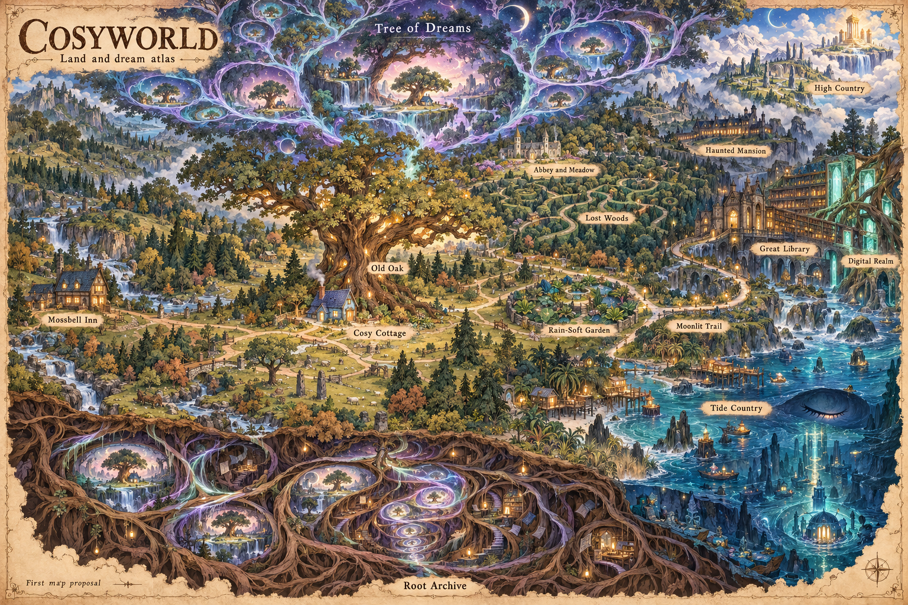

# CosyWorld visual language and world map

CosyWorld centres on a small cottage beneath an old oak that dreams of another
universe. Its people have expressive anime faces, animal forms, and ordinary
things to do. Its deepest wonders grow from familiar acts of care carried to
an impossible scale.

This first design proposal develops the creator's dreaming oak premise into
an art guide and a map. The founding premise below records the creator's
direction. The palette, character treatments, dream places, and map layout
are proposals for this edition.

- [Visual language and style guide](style-guide.md): colour, shape, materials,
  characters, scenes, voice, and reusable art prompts.
- [World map and dream structure](world-map.md): the cottage country, the
  wider world, the nested dreams, and ways home.
- [Image prompts](image-prompts.md): the full prompts for the two concept
  images, generated with the built-in image tool.
- [World style sheets](worldpacks/README.md): the selected Mirquo, B43L, and
  Project89 models, fresh background and avatar samples, and reusable art rules.

## Founding premise

The Tree of Dreams grows dreams that contain further dreams. Those dreams
feed its physical body, the old oak. A cosy cottage stands beneath the oak.
Rati, Skull, and Whiskerwind are its walking forms: one mind with three
distinct personalities.

Rati speaks in words. Skull is a silent wolf whose body carries his replies.
Whiskerwind speaks only in emojis. Their differences are part of the mind
itself. Each has a distinct manner, attention, and way of caring.

## Relationship to the existing world

The [core locations](../../v2/content/core/locations.json) supply the waking
places. The [core actors](../../v2/content/core/actors.json) supply Rati's role
as a cottage host, Skull's stillness, and the oak's four voices: Root, Ring,
Leaf, and Hollow. The emoji resident is currently named Gust in actor data;
its card and image use the `cosy-whiskerwind` identifier. This proposal uses
the creator's name, Whiskerwind.

The [existing art collection](../../v2/content/lonely-forest/assets/characters/manifest.json)
holds the animal folk, celestial figures, forests, relics, and dream colours
that inform this direction. The supplied moodboard brings these strands
together.

The [world doctrine](../../v2/docs/canon.md) supplies the link between care
and cosmic scale. The [writing guide](../../v2/docs/writing-style.md) supplies
the plain language of rooms and actions. The dreaming oak is a living
character with a physical body, so its dreams and intentions belong to its
character.

These documents and images serve as the first art proposal. Game data and
travel rules continue to live in the core content files. A later content
change can apply the accepted names, places, and dream passages.
