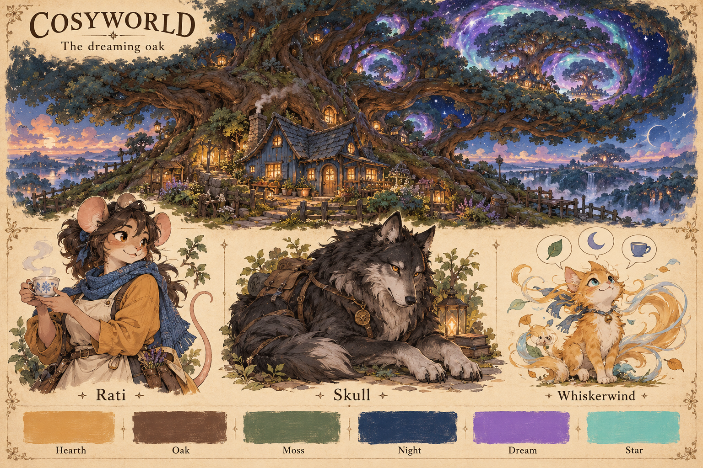

# CosyWorld visual language and style guide

The world should feel close enough to touch and large enough to unsettle.
A small blue cottage sits beneath an old oak. Tea, wet boots, fur, books,
and worn wood give each scene weight. Through a branch or a reflection,
another universe becomes visible.

This is the first art proposal for the [dreaming oak premise](README.md).
Its working phrase is **a warm home inside an endless dream**.

## The visual language

### One form can exist at several scales

Use the oak's branching shape as the shared form of the world. A branch
becomes a river bend, a path fork, a vein in a leaf, or a trail of stars.
A tree ring becomes a cup rim, an iris, a pond, or an opening into a dream.
A window becomes a small square of warmth at every scale.

Keep a recognisable feature across each repeat. A branch with one broken
tip can appear in a teacup crack and a constellation. The viewer should
notice the family resemblance before learning its cause.

### Give warmth a physical source

Light comes from a hearth, a window, a lamp, or sunlight on a real surface.
Paint its effect on fur, bark, glazed pottery, and damp stone. Small chores
make the setting lived in: a scarf drying by the fire, a repaired stool,
a neat stack of cups beside a much larger visitor's bowl.

The cottage is the emotional centre. Its roof, round window, chimney, and
low door should stay easy to recognise across art styles and dream depths.

### Give the impossible one clear shape

Choose one main break in reality for each scene. A tree contains a sky.
A library shelf continues through a doorway. An ocean curves around an eye.
Let the rest of the scene provide scale and solid detail.

At home, the impossible invites curiosity. A chosen journey into a dream
reveals its weight: another cottage in the canopy has already set the table
for the same guest, and the next cottage has done the same.

### Use anime expression and painted surfaces

Faces and poses carry emotion quickly. Use clear eyes, strong brows where
the anatomy allows them, readable ears, and deliberate hands or paws.
Place clean lines around a face, a hand, and a key prop. Let fur, leaves,
clouds, and distant stone have softer painted edges.

Animal folk, mousefolk with human features, celestial figures, and strange
creatures share the same light and material detail. Their bodies can differ
widely. The painting language makes them belong to one world.

### Let small acts carry the vast scale

Cosmic horror grows from care taken beyond a familiar limit. A host keeps
a place for every version of a guest. A library preserves every unfinished
thought. An old oak watches the door from three pairs of eyes.

Warmth remains useful at every depth. A light, a name, a cup, or a held paw
can help someone find a way home. The scene can hold comfort and unease
at the same time.

## Colour

| Colour | Hex | Main use |
| --- | --- | --- |
| Warm paper | `#F2E7D2` | Field notes, light cloth, page ground |
| Hearth honey | `#E6AD60` | Fire, windows, welcome, reflected warmth |
| Worn oak | `#71513C` | Bark, furniture, paths, leather |
| Moss | `#617755` | Living ground, leaves, wool, daily life |
| Night indigo | `#243653` | Evening air, deep shadows, distant water |
| Dream violet | `#9566D6` | Nested dreams, repetition, changing scale |
| Star mint | `#73D9CB` | Contact with another universe, living dream light |
| Coal | `#25262F` | Skull's fur, ink, deepest grounded shapes |

For an ordinary scene, begin with roughly two thirds earth and paper tones,
one quarter cool shade, and a small area of light. Dream colours occupy a
few important details. At greater dream depth, violet and mint can spread
through the environment while a patch of hearth honey remains clear.

Colour carries meaning alongside shape. A dream threshold has an open,
repeating outline. A known road has a continuous line. A return point has a
window shape. Their forms remain useful in greyscale.

## Shape and material

| Subject | Shape | Surface |
| --- | --- | --- |
| Home | Low roof, round window, broad base, hand-sized tools | Worn blue paint, slate, wool, glazed clay |
| Old oak | Wide crown, heavy trunk, exposed roots, uneven forks | Deep bark, moss, polished knots, rain grooves |
| Animal folk | Clear ears, muzzle, tail, hands, personal posture | Painted fur, useful clothes, visible repairs |
| Celestial people | Long gestures, layered wings, calm balance | Feather, pale stone, worn gold, lit edges |
| Relics | One simple outer shape, one strange inner detail | Brass, dark glass, pearl, carved wood |
| Dreams | Repeated arches, rings within rings, branches within branches | Familiar matter with changing scale or light |

The blue of the cottage can vary with the light. Keep its worn paint and
amber window as stable marks. The oak stays a broad, old, living tree. Its
age appears in uneven growth, thick roots, and healed breaks.

Relics should suggest a hand that can use them. Give a round silver object
a thumb rest, a seam, or a worn spot. Give a cosmic umbrella a real handle
and careful stitching. Each object has one clear action and one strange
question.

## The shared mind

The Tree of Dreams is the dreaming form. The old oak is its waking body.
Rati, Skull, and Whiskerwind are three walking forms with distinct
personalities. The shared mind applies to this founding trio. Other
residents have their own selves and relationships.

The proposed daily rhythm is simple: each form pays attention to different
things, carries those experiences home, and adds them to the next dream.
They may disagree because each personality values something different.
An answer from one remains true to that personality.

Show the link through a small shared action. All three glance toward the
same branch. Rati puts down a cup just as Skull raises his head. Whiskerwind
answers with a leaf before a leaf reaches the floor. Use these moments
sparingly enough to make recognition matter.

Root, Ring, Leaf, and Hollow remain the oak's four speaking voices. They
are ways the rooted body speaks. Rati, Skull, and Whiskerwind are the three
walking personalities.

## Character guide

### Rati

Rati gives the mind a spoken voice and a home to tend. Keep her established
role as the cottage's capable host. This visual proposal uses adult
mousefolk features, rounded ears, dark hair, expressive eyes, a blue scarf,
an apron, and ochre cloth. Her hands usually have something useful to do.

Her silhouette is upright and busy. Her movement is quick and exact.
Her humour comes from practical attention: wet boots, a cracked cup, a
guest who arrived from a very inconvenient moon.

Speech example: “Tea first. Then tell me which moon followed you home.”

### Skull

Skull gives the mind physical presence, patience, and watchfulness. He is
a large charcoal wolf with a strong chest, a silver muzzle, and a heavy
tail. His four paws keep his silhouette grounded. Small changes in his
ears, gaze, and weight carry the performance.

His stillness gives other characters room to be expressive. A long look
can be funny. A single step toward a door can matter. Use the name Skull
as his identity; his design centres on a living wolf.

Emote example: “Skull moves his paw onto the loose floorboard.”

Skull's replies use physical actions. Any written account of his movement
belongs to the narrator.

### Whiskerwind

Whiskerwind gives the mind play, sudden feeling, and symbols. The first
visual proposal follows the existing golden catlike art: a small body,
bright eyes, long whiskers, and a tail with a wind-like curl. Catlike form
is an art proposal; emoji speech is part of the creator's premise.

Use clear poses and short bursts of two to five emojis. Let a pause,
repeated symbol, or shift in order carry the joke. The same small set of
emojis can gain meaning through shared events.

Speech example: “🌧️🐾🏠☕”

Speech example after the oak wakes: “🌳👁️🌌”

For accessible presentation, give the speech bubble a plain label such as
“Whiskerwind shows rain, paw prints, a house, and tea.” That description
belongs to the interface. Whiskerwind's visible speech remains emojis.

## Three scene depths

| Depth | What the viewer sees | Light and scale |
| --- | --- | --- |
| Home | The cottage, garden, daily work, a glimpse of stars through leaves | Warm local light, familiar distances, clear way home |
| Threshold | A repeated landmark, a second sky in water, a branch that crosses a doorway twice | Two light sources, a visible passage, one changed scale |
| Deep dream | A town inside an acorn, a library of sleeping seas, a feast for every version of one guest | Wide strange space, a small warm return point, precise repeated forms |

Entry into deeper scenes is a deliberate choice. Show the crossing and
the way back. The same visual rule applies underwater, above the clouds,
and within the tree: a warm point helps the traveller keep their bearings.

## Composition and motion

For places, use a wide view with three readable layers: something close,
the main landmark, and a distant question. Put the cottage or another
human-scale object beside the impossible feature so size has meaning.

For portraits, let the character fill most of the frame. Show the face,
the main gesture, and one useful prop. Let the background establish light
and place. Keep eyes, ears, hands, and tails within a safe crop.

For groups, use contrast in posture. Rati is upright and active. Skull is
low and steady. Whiskerwind makes small arcs around them. Their eyelines
can briefly converge when the shared mind becomes visible.

Motion follows material: cloth settles, paws carry weight, leaves turn,
and steam rises. Dream motion repeats a simple gesture at another scale.
A branch bends; the river shown within it bends a moment later.

## Type and symbols

Use a readable book serif for map names and chapter titles. Use a plain
sans serif for actions and small labels. Sentence case suits everyday
copy. Give a place name room to sit beside its landmark.

The core marks are a branch fork, a broken ring, a lit window, and a trail
of three small dots. A branch means connection. A broken ring means a
dream crossing. A window means home or shelter. Three dots mark traces
left by the shared mind. These are proposed art marks, with their names
shown in every map legend.

## Words that match the art

Describe a concrete change and let the image carry the feeling. A room
can have twelve chairs and thirteen shadows. A cup can hold a reflection
of the wrong moon. A character can respond to either with a useful act.

Room example: “Three cups stand beside the kettle. An oak root passes
through the wall below the window.”

Threshold example: “The pond holds a second sky. A ladder reaches from
the bank to its lowest star.”

Deep dream example: “Every table has a cup with Rati's thumbprint. The
nearest one is still warm.”

Buttons use direct actions: “Open the door”, “Follow the root”, “Return
to the cottage”. Keep world explanations in discoveries, relationships,
and the creator's guide. Residents can hold different beliefs about the
tree's purpose.

## Reusable art prompt

> Paint [subject] in CosyWorld, a whimsical cosmic horror world with
> anthropomorphic characters and expressive anime faces. Use a clear
> silhouette, painted fur and wood, useful clothes, and one familiar
> object for scale. Light the scene with [physical warm light source]
> and [cool ambient light]. Earth colours dominate. Violet and mint
> gather around [one impossible detail]. Repeat [oak shape] at [second
> scale]. Place [warm return point] within the composition. Show
> [specific action or pose]. Frame it as [portrait, scene, or map].

For the cottage, the impossible detail is a second universe visible in
the oak canopy. For a relic, it may be a room within a bead of glass.
For a character, it may be a shared oak pattern reflected in the eyes.

The [full image prompts](image-prompts.md) record the first two examples.

## Review each new image

1. Identify the main silhouette at a small size.
2. Find the real source of warm light.
3. Name the ordinary act that gives the scene life.
4. Point to the one main impossible detail.
5. Trace the repeated oak shape across two scales.
6. Check the character's face, hands, paws, and established identity.
7. Check the scene depth and the visible way home.
8. Read every map label at its intended display size.
