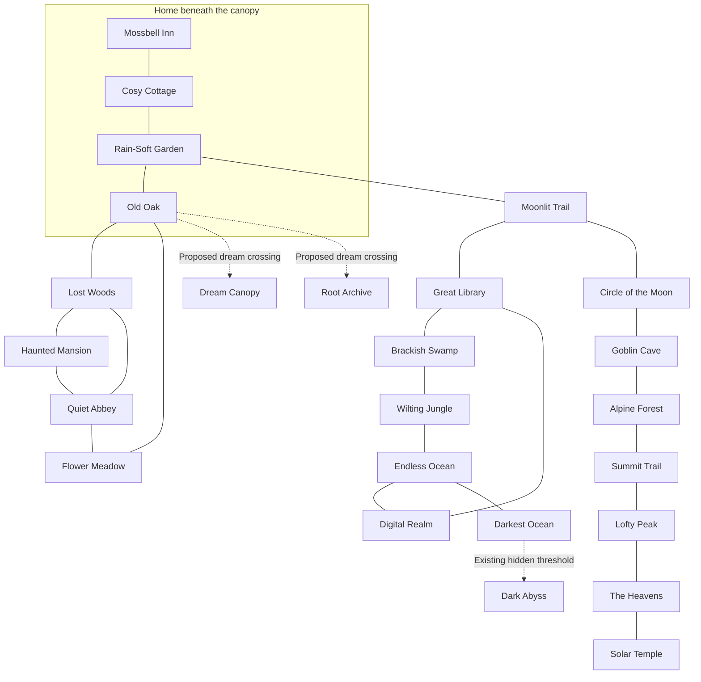
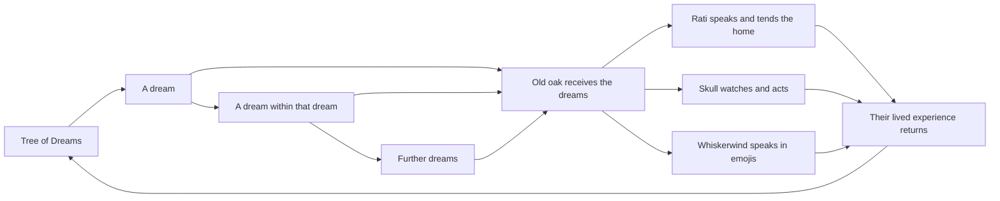

# CosyWorld world map and dream structure

The old oak and its cottage form the centre of the map. Waking roads lead
through the surrounding country. The canopy and roots open into dreams
that can contain further worlds. The map shows both kinds of space, with
a clear way to tell a walk from a dream crossing.

The illustration is a first composition proposal. The location list and
route diagram below give the more exact structure for future art and
content work. Compass placement in the painting serves the composition;
the [core exits](../../v2/content/core/exits.json) define current travel.

## How to read the map

A continuous earth-coloured line marks a waking path. An open ring marks
a proposed dream crossing. Violet or mint branches show the flow of dreams.
A lit window marks a place of shelter or a return point. Names and line
shapes carry the same meaning as colour.

Distance near the cottage is measured by walks and landmarks. Dream depth
is measured by crossings: a dream, a dream within it, then a dream within
that one. Each crossing keeps a remembered route to its parent place.

The oak's canopy covers the cottage and garden as one home landscape.
The cottage room, garden, and old oak remain separate places for play.
The established walk from cottage to garden to oak fits under that same
wide canopy.

## The waking country

| Area | Places | Visual identity and reason to visit |
| --- | --- | --- |
| Home | Cosy Cottage, Rain-Soft Garden, Old Oak | Blue timber, amber windows, broad roots. Meet the three personalities, tend the home, and begin a journey. |
| West road | Mossbell Inn | Slate roof, four lit guest windows, a boot rack. Hear news and welcome travellers. |
| Near woods | Moonlit Trail, Lost Woods, Flower Meadow | Silver paths, repeating forks, patches of sun. Follow tracks, find a route, and notice the first repeats. |
| Old houses | Quiet Abbey, Haunted Mansion | Pale arches and a leaning house with many warm windows. Read old accounts and discover hospitality stretched across many lives. |
| High Country | Circle of the Moon, Goblin Cave, Alpine Forest, Summit Trail, Lofty Peak, The Heavens, Solar Temple | Moonstone, pine, cold rock, clouds, worn gold. Visit craftspeople and celestial residents; see the tree from above. |
| Great Library | Great Library | Brass ladders, wood shelves, pools of lamplight. Compare accounts of the same dream. |
| Tide Country | Brackish Swamp, Wilting Jungle, Endless Ocean, Darkest Ocean, Dark Abyss | Wet green, dark blue, pearl lamps. Follow the water from reeds to deep hospitality. |
| Digital Realm | Digital Realm | Clear green doors, light grids, tangible roots. Meet another form of the world's order. |

High Country, Tide Country, Home, Near woods, and Old houses are grouping
labels for this map proposal. The individual place names come from the
existing core content. “Abbey and Meadow” is a compact label in the painting
for Quiet Abbey and Flower Meadow.

The wider country can contain animal folk, celestial beings, bright city
visitors, strange armour, and ordinary tools. Shared light, materials, and
oak patterns give these varied places a common visual language.

## Waking routes

Each solid link below represents a pair of walking exits in the current
core content. The arrows into dream places are proposed passages. The
Dark Abyss has a separate threshold defined in the hidden-exit content.

The waking graph has loops. A traveller can return through a second route
in the woods or around the library, coast, and Digital Realm. Later art
should keep those loops readable.

## The dream structure

The creator's premise gives the Tree of Dreams a real role: it generates
dreams within dreams and feeds them to the old oak. The following cycle is
a proposed way to express that premise through places and character scenes.

Rati, Skull, and Whiskerwind are one mind with distinct personalities.
Their actions give the oak a life beyond its roots. The next dream carries
traces of those actions: a cup placed by Rati, a route guarded by Skull,
or a symbol chosen by Whiskerwind.

For this proposal, a nested dream inherits one clear detail from its
parent and changes one relation. A cup becomes a lake. Its crack becomes
a road. The small house beside that road has a cup on the table. The
repeat is legible, while each place offers its own people and choices.

## Proposed dream places

| Place | Entrance and depth | What makes it distinct | Way home |
| --- | --- | --- | --- |
| Dream Canopy | A chosen crossing at a hollow above the cottage; first dream | Each branch holds a sky with its own weather. A distant oak carries the same broken branch. | Follow the blue cottage window visible through the leaves. |
| Root Archive | A chosen crossing beneath the old oak; first dream | Rings of worn wood hold rooms from earlier dreams. Each room has one object brought home by the trio. | Follow the root marked by Rati's blue thread. |
| Acorn Sea | An acorn found within Dream Canopy; second dream | A whole sea lies inside its shell. Boats use the oak's branching pattern in their sails. | Return to the harbour beneath the acorn's stem. |
| The Waiting House | A room reached through Root Archive; second dream | A host has laid a place for every version of the visitor. The same repaired cup appears on each table. | Pass through the door with the one hand-sized brass handle. |
| The Other Sky | A further crossing inside a nested dream; deeper dream | A different universe has begun to form. A small warm window gives it a familiar point of scale. | Keep the last doorway in sight and return through the same ring. |

Dream Canopy and Root Archive are shown in the first atlas through the
canopy and the root cutaway. Acorn Sea, The Waiting House, and The Other
Sky are proposed detail maps for later work.

“Tree of Dreams” names the dreaming form itself. “Dream Canopy” names a
place someone could enter within that form. The physical oak remains the
same being at the centre of the waking map.

## A first journey

Rati lays out three cups. Skull turns toward the garden. Whiskerwind
shows “🍃🌙☕”. A leaf drops through the window with a small moon visible
inside it.

The traveller follows the garden path to the old oak. A hollow shows the
same cottage from above. At the crossing, the warm window stays visible.
The traveller can return to tea or enter Dream Canopy.

Inside the dream, one branch carries a sea. On its shore stands a house
with three cups on the table. One cup has a blue thread tied to its handle.
The traveller brings the thread home. Rati uses it to mend her scarf.
In the next dream, a blue path crosses that sea.

This example gives the loop a visible result: dream, journey, return,
small change at home, then a changed dream.

## Details for the next drawing pass

Keep the cottage roof and the oak's broken branch consistent in every
repeat. Keep the west road to Mossbell Inn and the east path to the garden
easy to follow. Give the library and coast enough space to show their loop.
Mark each entry to a dream with an open ring and a readable place name.

Draw the home cluster at room and garden scale in a separate detail map.
Draw a second detail map for the first two dream crossings. These closer
views can carry small objects, residents, and exact travel choices while
the world atlas keeps the broad shape clear.
