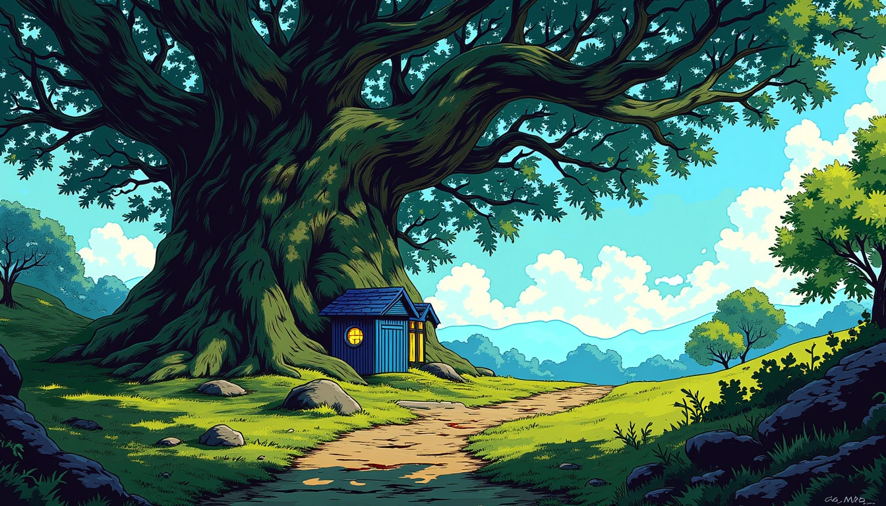
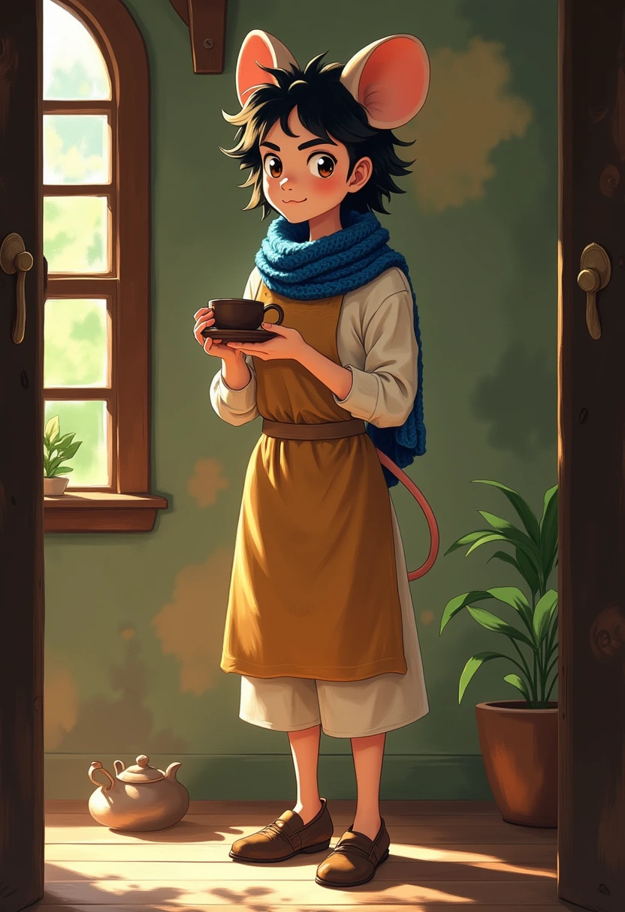
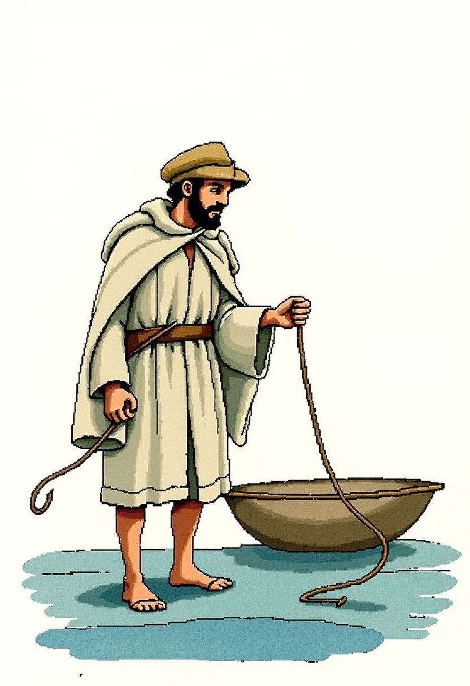
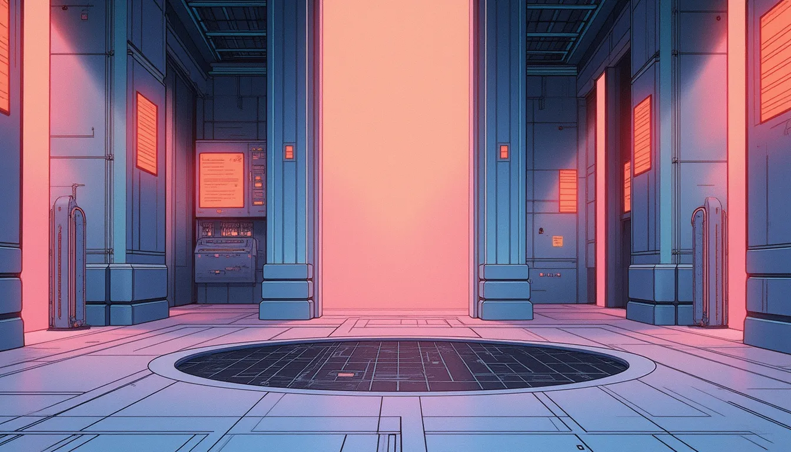
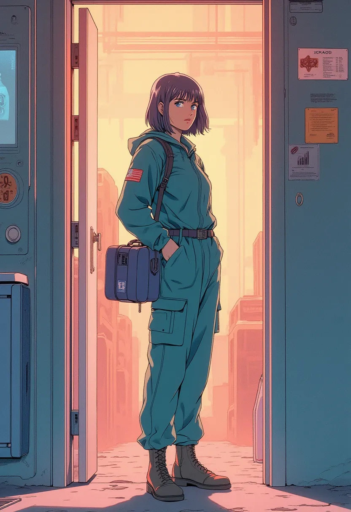

# World style sheets

These sheets define the proposed art rules for future backgrounds and avatars.
The creator selected the three Replicate models on 26 October 2026. Each sheet
includes a palette, materials, light, composition, identity rules, reusable
prompts, and exact model settings. The samples await visual approval.

Open [the visual sheets](index.html) in a browser. The JSON files hold the same
rules in a form that a future generator can read.

The [six-pack art review](review-trios/index.html) shows one location, one avatar,
and one item from every pack. Its 18 selected images have full-size links and
saved prompts. Lonely Forest, Holy Land, and Project89 use the selected native
Replicate models. Hoppycat, Lantern Keeper, and Elysium use the built-in image
tool with the existing identity art and proposed style boards. Each sample
awaits approval.

The [Reflected Shore migration backlog](../../archive/backlog/reflected-shore-worldpack-migration.md)
preserves the four-of-each content plan, proposed crossings, and delivery checks.
The creator will integrate after multiplayer testing and art approval.

| World         | Style source                                                   | Sheet                                    |
| ------------- | -------------------------------------------------------------- | ---------------------------------------- |
| Lonely Forest | [immanencer/mirquo](https://replicate.com/immanencer/mirquo)   | [lonely-forest.json](lonely-forest.json) |
| Holy Land     | [ratimics/b43l](https://replicate.com/ratimics/b43l)           | [holy-land.json](holy-land.json)         |
| Project 89    | [ratimics/project89](https://replicate.com/ratimics/project89) | [project89.json](project89.json)         |

## Lonely Forest

A warm home inside an endless dream. A little blue cottage stands beneath a
great living oak. Wool, bark, clay, moss, and warm windows give the world weight.
Violet and mint openings reveal dreams within dreams. The creator's attached
art matches the existing [visual guide](../style-guide.md) and
[world map](../world-map.md); those remain the composition and character guides.

The sample background shows Mirquo's strong outlines and saturated cool shade.
The target palette keeps more warm earth and paper tones. Review the canopy's
dream opening, evening light, and the small corner mark before publication.
Rati's adult proportions, long dark hair, scarf, apron, and teacup should follow
the supplied character guide. Future identity studies also cover Skull and
Whiskerwind.

This sheet calls the pinned `immanencer/mirquo` model directly. The older batch
tool loads Mirquo as weights through `black-forest-labs/flux-dev-lora`. Keep each
route's model and inputs in its receipt. The native endpoint uses
`guidance_scale`.

## Holy Land

Rough watercolor, searching pencil, and open paper give the journey its look.
Use limestone, olive leaves, linen, wool, clay, and working boats. Keep prompts
short: the trigger and style on the first line, the subject on the second.

These samples show the model's flat shapes and drawn outlines. The rough-paper
palette remains a target for approval. Peter's role and net cord come from the
pack; his clothes and face are proposed visual details.

## Project 89

Continue the [washed anime direction](../../archive/classic/v2/docs/project-89-art-direction.md).
Use teal shade, coral lamps, rose-lavender midtones, repaired surfaces, and clear
anime silhouettes. The background sample is Threshold Interface. Mara Quell is
an authored quartermaster; the sample proposes her appearance.

The raw samples contain lettering on walls, clothes, and equipment. Their next
art pass should produce plain surfaces while preserving the model's style.
Keep these samples in style review until that pass is approved.

For Proxim8 avatars, use the approved NFT image as the identity reference. Begin
with a square master and preserve its face, hair, eyes, headset, clothes, and
collection traits. The sheet's tall Mara sample is an authored character study.

## Future generation

1. Choose the approved sheet revision and authored subject.
2. Fill its background or avatar prompt with the subject's facts.
3. Keep identity references separate from style references. Record their roles,
   order, and file hashes. Preserve the approved character's appearance.
4. Call the pinned model with the sheet's defaults, aspect ratio, and seed.
5. Keep the raw output and a receipt. Record the sheet revision, subject,
   model revision, full inputs, references, prediction ID, and output hash.
6. Review composition, identity, anatomy, surfaces, and small-size readability.
   Record corrections as separate outputs with their own model and parent hash.
7. Publish the approved output. Keep the earlier receipt with its original art.

The [sample receipts](samples/receipts.json) preserve the actual requests and
raw output hashes. `style_sha256` identifies the draft sheet at request time;
`request_sheet` links to an exact saved copy. The draft may gain review notes
after a request. Every approved style change
gets a new sheet revision; each published image stays tied to its own revision.

The native models were checked through Replicate's API on 26 October 2026.
All three use `guidance_scale`, `dev`, 28 steps, one output, one megapixel,
and the enabled safety checker. Exact scales, seeds, and versions live in the
sheets and receipts. Samples are raw provider WebP files.

## Other worlds and approval

Elysium's silver-and-gold void, Lantern Keeper's amber woodcut, and Hoppycat's
painted storybook concept remain available for review. Hoppycat's existing
approved art and its locked identity references remain the basis of its sheet.
Model selection for new samples in these three worlds is a later decision.

Approval covers each world's style and reference samples separately. The next
implementation step can connect approved sheets to the shared generation path.
Testing continues on `cosyworld.fly.dev`; production releases to
`lonelyforest.com` remain deliberate.
