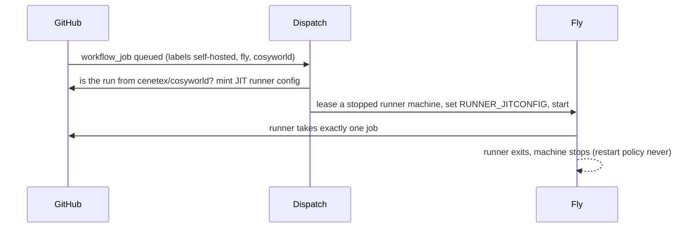

# Self-hosted CI runners on Fly.io

The `Rust build and tests` CI job can run on Fly Machines instead of
GitHub-hosted runners. Each machine keeps a volume of Cargo state, so a run
compiles only what changed. The 10 GB Actions cache no longer has to hold it.
Tracking issue: #1563 (phase 2 of #1551).

## How it works



- `infra/ci-runners/` holds the runner image (`ghcr.io/actions/actions-runner`
  plus a C toolchain and Node 24) and the `cosyworld-ci-runners` Fly app. Each
  machine mounts its own 50 GB volume at `/cache`. `CARGO_HOME`,
  `RUSTUP_HOME`, `CARGO_TARGET_DIR`, and the npm and Playwright caches live
  there. A machine runs one job at a time, so the shared target dir is never
  written by two builds at once. The entrypoint clears `/cache/target` when the
  volume passes 85 %. It stops a runner that gets no job within 10 minutes.
- `infra/ci-runners/dispatch/` is the `cosyworld-ci-dispatch` app. It is
  dependency-free Node that verifies the webhook signature and keeps a wait
  list of queued Fly jobs. It starts one stopped machine per waiting job and
  retries every 30 s while all machines are busy. Machine leases keep two
  dispatches from claiming the same machine.
- The runner app lives on its own Fly private network, so jobs cannot reach
  the production apps over `.internal` addresses. Runner machines hold no
  secrets. Their only credential is the single-use JIT config, and the job has
  consumed it by the time job code runs.

## Public repository safety

This repository is public. Fork pull requests must never run on these runners.
Anyone can open one, and a fork can edit `ci.yml` to request the Fly labels.
Two checks enforce this:

1. `ci.yml` chooses the Fly labels only for `push` events and for pull
   requests whose head repository is `cenetex/cosyworld`.
2. The dispatcher looks up every queued run. It refuses any run whose
   `head_repository` is not `cenetex/cosyworld`, so a fork's job waits and
   then times out without a runner.

Keep **Settings → Actions → General → Fork pull request workflows** set to
require approval for all outside collaborators.

## Toggle and fallback

Set the repository variable `FLY_RUNNERS` to `on` to use Fly. Any other value,
or no variable, keeps `ubuntu-latest`. GitHub cannot move a queued job to
another runner. If the Fly runners are down, set the variable to `off` and
re-run the queued jobs. While the variable is `on`, the `Smoke-test binary`
job saves main's daily Cargo cache in place of the Rust test job.

To move another job, copy the `runs-on` expression from the `runtime` job. Mark
its `actions/cache` steps `if: runner.environment == 'github-hosted'`. Jobs
that build Docker images need `dockerd` added to the image; Fly Machines are
full VMs, so Docker runs inside them without privileged containers.

## Owner setup

Agents created the `cosyworld-ci-runners` app and its first volume. They did
not create these credentials:

1. **GitHub App** (preferred over a PAT). Under cenetex **Settings →
   Developer settings → GitHub Apps → New**:
   - Repository permissions: **Administration: Read and write** (needed for
     `generate-jitconfig`) and **Actions: Read-only**.
   - Webhook URL: `https://cosyworld-ci-dispatch.fly.dev/webhook`. Choose a
     random webhook secret (`openssl rand -hex 32`). Subscribe to **Workflow
     job** events.
   - Install the app on `cenetex/cosyworld` only. Note the App ID, the
     installation ID from the installation URL, and a generated private key.
   - A fine-grained PAT with the same two repository permissions also works.
     Set `GITHUB_TOKEN` instead of the three `GITHUB_APP_*` secrets, and add a
     repository webhook for **Workflow jobs** with the same URL and secret.
2. **Fly token scoped to the runner app only**:
   `fly tokens create deploy -a cosyworld-ci-runners`.
3. **Dispatcher**:

   ```sh
   cd infra/ci-runners/dispatch
   fly apps create cosyworld-ci-dispatch
   fly secrets set -a cosyworld-ci-dispatch \
     GITHUB_WEBHOOK_SECRET=... FLY_API_TOKEN=... \
     GITHUB_APP_ID=... GITHUB_APP_INSTALLATION_ID=... \
     GITHUB_APP_PRIVATE_KEY="$(cat app-private-key.pem)"
   fly deploy --ha=false
   ```

4. **Runner image** (already deployed once): `cd infra/ci-runners && fly
   deploy --ha=false` after changing the image. The machine starts, finds no
   JIT config, and stops, so `fly deploy` reports a state-change timeout. That
   is expected. Jobs can reach this app's own Machines API through the
   `/.fly/api` proxy, so they could start or stop other runner machines. They
   cannot reach any other app.
5. Open a same-repo PR with `FLY_RUNNERS=on`. Compare the `Rust build and
   tests` time with the hosted run. Check
   `fly logs -a cosyworld-ci-dispatch`.

## Cost

Fly bills running machines per second. Prices are for `iad`
([Fly pricing](https://fly.io/docs/about/pricing/)), and GitHub-hosted
runners cost nothing for this public repository.

| Item | Rate | Monthly estimate |
| --- | --- | --- |
| Runner, `performance-8x` 16 GB | $0.344/h while a job runs | 100 runs/day × 6–10 min: **$100–170** |
| Cache volume, 50 GB per machine | $0.15/GB | $7.50 per machine |
| Stopped machine root filesystem | $0.15/GB | under $1 per machine |
| Dispatcher, `shared-cpu-1x` 256 MB, always on | | about $2 |

Begin with one machine. That costs about $10 a month fixed, plus usage.
Concurrent jobs wait for it. Each extra machine (`fly scale count N -a
cosyworld-ci-runners`, which also creates its volume) adds about $8.50 fixed.
Usage stays roughly the same, because it scales with job minutes, not machine
count. Ask the owner before going past one machine.

## Sources

- GitHub: [ephemeral runners and `workflow_job` webhooks](https://github.blog/changelog/2021-09-20-github-actions-ephemeral-self-hosted-runners-new-webhooks-for-auto-scaling/),
  [JIT runner REST API](https://docs.github.com/en/rest/actions/self-hosted-runners#create-configuration-for-a-just-in-time-runner-for-a-repository),
  [self-hosted runner security on public repositories](https://docs.github.com/en/actions/security-for-github-actions/security-guides/security-hardening-for-github-actions#hardening-for-self-hosted-runners).
- Fly: [Machines API](https://fly.io/docs/machines/api/machines-resource/),
  [pricing](https://fly.io/docs/about/pricing/),
  [custom private networks](https://fly.io/docs/networking/custom-private-networks/).
