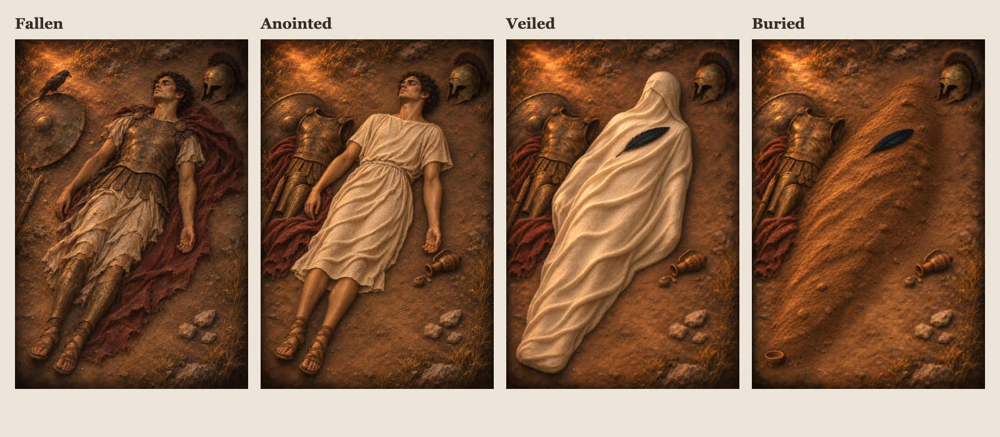
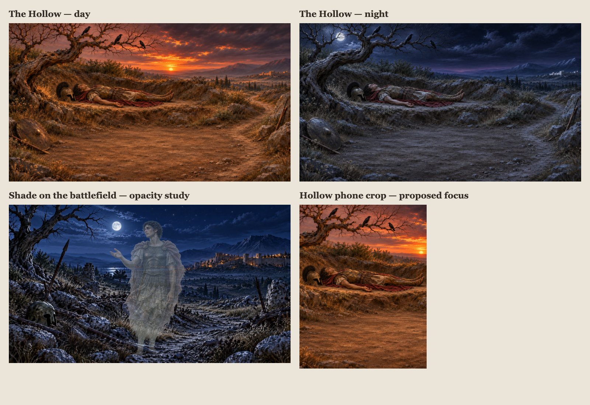
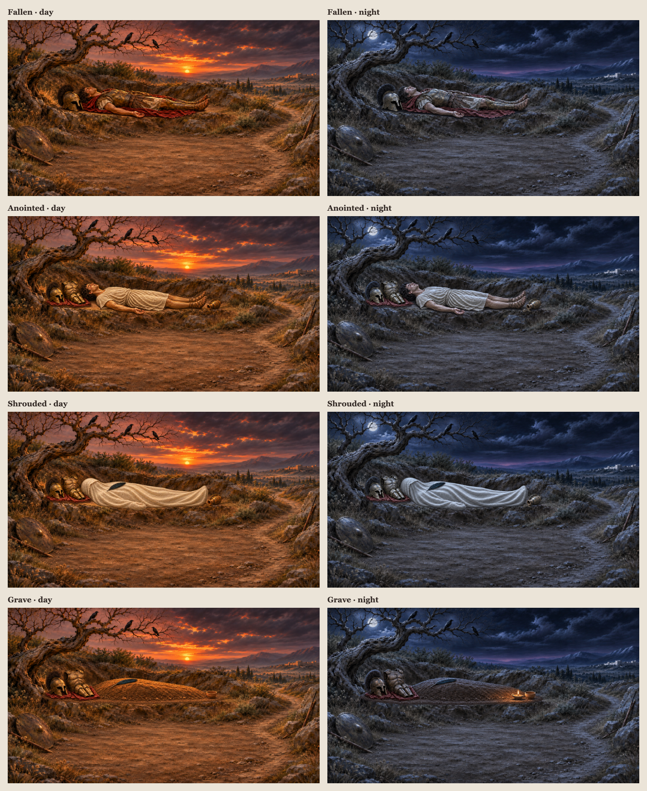

# Polynices burial art design

Design studies for [issue #2290](https://github.com/cenetex/cosyworld/issues/2290).
The owner asked for a cohesive burial set and then chose a single perfectly
formed raven feather for the shroud and grave on 2026-11-04.

## The shared direction

The sequence is a visible act of care: fallen, anointed, veiled, and buried.
Four states give the oil its own clear effect. Each card shares one high camera,
one body position, the same helmet, shield, stones, and light direction.

Polynices is a young adult with black curls and features close to Antigone.
His bronze armour has a small leaf decoration and two round shoulder fittings.
His muted red cloak, helmet with a dark crest, and open resting hand establish
his identity. The standing shade carries that same face and costume.

The bent olive, sheltered shelf, right-hand path, and distant Thebes anchor the
Hollow. The lower middle stays open for the separate cast. Day uses amber and
earth umber; night uses blue-grey moonlight. The grave's night version will add
one small clay lamp.

## Current design studies

| Step | Main visual change | Selected study |
| --- | --- | --- |
| Fallen | Dust-dulled armour, closed eyes, open hand, crow on shield | [Fallen](fallen-card-study.png) |
| Anointed | Clean face and hands, plain linen, armour set beside him, empty oil jug | [Anointed](anointed-card-study.png) |
| Veiled | Full bone-white shroud with a careful face fold and one raven feather | [Veiled](veiled-feather-study.png) |
| Buried | Low long mound, helmet marker, small cup, the same raven feather | [Buried](grave-feather-study.png) |

The feather is complete and neatly formed, deep black with a soft blue-green
sheen. It lies on the chest in the veiled card and over the same part of the
grave. This is the owner's chosen symbol of care. The bent olive remains part
of the place.

The removed armour and folded cloak stay beside the shield through the later
states. The existing oil jug is reused, with its stopper beside it. A future
white-ground flask should replace that same vessel consistently across the set
if selected.

- [Hollow day](hollow-day-refined-study.png): the selected master study.
- [Hollow night](hollow-night-study.png): an edit of that daytime master.
- [Polynices' shade](shade-study.png): a gentle pleading face, open hand,
  pale moonlit colour, faded rose cloak, and fading feet.
- [Prompts](prompts.json) and [file checks](validation.json): full source records.

## Production plan

Use one empty Hollow for each light, then place a transparent burial layer on
its shelf. Each state shares the same backdrop. The lower middle stays open
for the cast. Use the card studies as references for the care states.

| Group | Final files | Target |
| --- | --- | --- |
| Hollow | empty day and night; matching body-state layers | 2 opaque WebPs and 8 RGBA layers, common 1672 × 941 canvas |
| Body cards | fallen, anointed, veiled, grave | 4 RGBA WebPs, 1024 × 1536, full painted vignette |
| Shade | polynices-shade.png | 1 RGBA PNG, 1024 × 1536 |
| Optional vessel | oil-lekythos.png | 1254 × 1254 RGBA PNG |

The wheat sack remains the separate immediate asset in #2290. Patroclus is in
[PR #2289](https://github.com/cenetex/cosyworld/pull/2289).

## Review and finishing

The four card states, day/night views, and shade overlay were reviewed together.
The phone study uses a proposed horizontal focus of 28% so the body and helmet
stay within the crop. Live placement still needs the game viewport review.

The generated shade has clear background alpha and a fade through its feet.
Its face and torso samples are near opaque (253/255). The review places that
source at 65% opacity to show the intended translucent look. Production needs
to put that see-through treatment into the final asset or its existing figure
rendering. The full alpha measurements are in the file checks.

These are design studies. Production finishing covers final alignment, the
shade's body opacity, exports, and game asset registration. The generated edits
preserve the composition visually; fine
texture varies between images.

The source PNGs are preserved byte for byte. All generation used the built-in
image tool. Earlier olive-sprig studies and the first day study remain as source
history. The selected versions above carry the owner's raven-feather change.

Checks: PNG sizes and hashes, shade alpha samples, visual full-width and phone
reviews, `git diff --check`, and `npm run check:version`.

## Buried Hollow and transparent layers

The owner asked for the Hollow after burial and a body/grave cutout option.
The completed day and night paintings show the shallow mound beneath the bent
olive. His helmet marks the head. The armour rests on his folded red cloak,
one perfect raven feather lies on the mound, and a small cup stands at its foot.
At night, a small clay lamp lights that end of the grave.

- [Buried day painting](hollow-buried-day-study.png) and
  [buried night painting](hollow-buried-night-study.png).
- [Empty day Hollow](hollow-empty-day-study.png) and
  [empty night Hollow](hollow-empty-night-study.png).
- Fallen cutouts: [day](polynices-fallen-cutout.png) and
  [night](polynices-fallen-night-cutout.png).
- Anointed cutouts: [day](polynices-anointed-cutout.png) and
  [night](polynices-anointed-night-cutout.png).
- Shrouded cutouts: [day](polynices-shrouded-cutout.png) and
  [night](polynices-shrouded-night-cutout.png).
- Grave cutouts: [day](polynices-grave-cutout.png) and
  [night](polynices-grave-night-cutout.png).
- [Interactive layer review](layers.html), [prompts](layer-prompts.json), and
  [source and alpha checks](layer-validation.json).

All eight cutouts have true alpha and at least 79% fully clear pixels. Their full
landscape padding keeps the objects on the burial shelf. The review stretches
each full canvas over one common 1672 × 941 frame. Source sizes vary by up to
two pixels in width and one in height; final exports should use the common
canvas. Each day/night
pair keeps its visual placement. Final stage placement still needs review in
the game. The separate opaque paintings show the intended light and mood.

The anointed and shrouded sources share one placement adjustment in the viewer:
scale to 83%, then move 40 pixels right and 70 pixels down in the common frame.
This brings their head and feet into line with the fallen layer. Both lights
use the same adjustment. The source PNGs retain their generated pixels.

The anointed figure wears clean linen with a soft oil sheen on his face and
hands. His armour rests beside his head and the small oil jug lies at his feet.
The next layer covers him fully in linen and puts one raven feather on his chest.
The viewer shows all four states in both lights, plus the empty backdrops.
All ten selections were checked. All twelve layer-set additions used the built-in
image tool. Source PNGs are preserved byte for byte.

## Shipping exports

The game files are in `v2/card-game/assets/greek-drama/` (#2301). Each of the
eight `polynices-hollow-{fallen,anointed,veiled,buried}-{day,night}.webp`
backdrops flattens one cutout onto the empty Hollow of the same light, at the
layer review's placement. The veiled state uses the shrouded cutout and the
buried state the grave cutout; the finished buried paintings stay reference.
`polynices-shade.webp` is the shade study with its see-through look baked in:
alpha falls from 88% at the head to 45% at the feet, and the colour lifts 10%
toward moonlit grey. It faces left.

`node v2/scripts/build-polynices-hollow-art.mjs` rebuilds them and writes
`polynices-hollow-provenance.json` with source and output hashes; `--check`
fails on any difference.

## Hand-card exports

The burial sequence uses the selected studies in the hand as well as the
wide Hollow paintings on the stage. The card files live in
`v2/card-game/assets/greek-drama/`.

| Burial state | Hand-card image |
| --- | --- |
| Fallen | `polynices-fallen.webp` |
| Anointed | `polynices-anointed.webp` |
| Veiled | `polynices-veiled.webp` |
| Buried | `polynices-grave.webp` |

Use the same saved burial state for the hand card and the Hollow backdrop
when the burial pack lands. The Funeral Oil item uses `oil-lekythos.png`.
