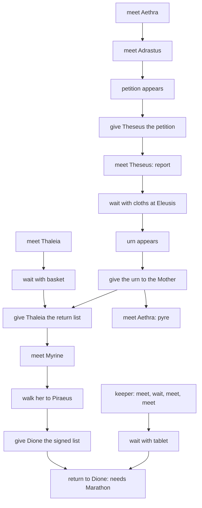
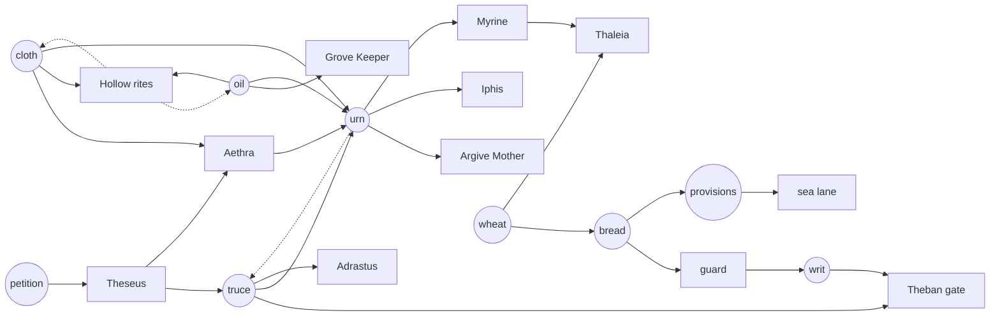

# The Open Door as interlocking puzzles

Status: design for owner mark-up, 2026-11-11. Nothing is built. The first
worked example of pack content made from wants, things and live locks. It
builds on the [quest and gate audit](quest-audit-2026-11-11.md) (G1 to G25),
[companions and quests](companions-and-quests.md) (decisions 1 to 23) and
[hearth factions](hearth-factions.md) law 1 (rival wants, one-of-each things,
no clock). Data: `v2/content/greek-drama/card-world.json` (G) and
`v2/worlds/greek-drama/card-bridge.json` (GB) at `f1c5a9751`. It assumes PR
#2703 has landed: no burial flag on Attica, its residents wander from the
start (dwell), and the harbor to Piraeus lane opens on the provisions alone.

## A. Diagnosis

A new world's Greek pack has 34 gates. Only 3 open on a physical thing being
present: the Theban gate on the guard holding the writ, and two sea lanes on
the provisions aboard. 25 open on a story flag alone, set by a Talk, Meet,
Wait or Give. The Open Door is about 19 such steps in one order (G:3645 to
G:4620): meet Aethra, meet Adrastus, petition Theseus, hear the truce report,
lay cloths, give the urn, hear the pyre, return the list to Thaleia, Myrine
walks, report to Dione. 12 of its things have one reader, or readers only
inside its own chain. 11 of the 19 residents have no want. Ismene, Iphis, the
Bard and the Agora Neighbor are needed by nothing. The ending
(`greek-open-door-return-dione`, G:4298) needs the Marathon Record, which a
new world cannot reach. PR #2703 also left six of these residents (Aethra,
Adrastus, Theseus, Thaleia, the Grove Keeper and the Marathon keeper) as plain
open cards; the owner wants every one locked again on its own want. The one
part of the pack that already works is the bread: one loaf, wanted by the
guard, the provisions and Patroclus, and its wheat goes home to Piraeus.

**The rule this rework follows: every lock and every want reads where things
and people are now. Storylines meet only by sharing things.**

## B. The cast as wants

Each resident has one want, in the existing want vocabulary
(`world/want-words.mjs`: hold, talk with, go to, give, bring, lay, eat, meet;
locks are worded by `world/lock-goals.mjs` from `item_near`, `item_at` and
`holding`). No want needs a new kind. "Locked on" is the resident's own box:
`requires` plus `sealed`, read live (`world/boxes.mjs:104`). Every box starts
locked in a new world. Lock and want are separate layers: the lock is how the
person opens to you, the want is what Talk tells you after.

| Resident | Home | Locked on (live) | Want, as worded | Conflicts or leans on |
| --- | --- | --- | --- | --- |
| Aethra | Eleusis | Funeral Cloth near Eleusis | meet Theseus at Eleusinian Sanctuary | cloth is Antigone's too; Theseus's home is the Agora |
| Theseus | Agora | Mothers' Petition near the Agora | hold the Mothers' Petition | Aethra wants him at Eleusis; Ismene wants him |
| Adrastus | Eleusis | Herald's Truce near Eleusis | hold the Herald's Truce | the urn and the Theban guard need the same truce |
| An Argive Mother | Eleusis | Funeral Urn near Eleusis | hold the Funeral Urn | Iphis wants it carried away |
| Iphis | Eleusis | Funeral Urn near Eleusis | bring the Funeral Urn to Piraeus Quays | the Argive Mother wants to keep it |
| Myrine of Argos | Eleusis | Funeral Urn near Eleusis | go to Piraeus Quays | Thaleia waits for her |
| Thaleia | Piraeus | Sack of Wheat at Piraeus | meet Myrine at Piraeus Quays | the wheat is Dione's bread |
| The Grove Keeper | Colonus | Funeral Oil near Colonus | lay the Funeral Oil in Colonus Grove | the oil is Antigone's and the urn's |
| Ismene (idle) | Theban sanctuary | none (Thebes, unchanged) | talk with Theseus | Theseus is in Athens; escort |
| The Bard (idle) | harbor | none (unchanged) | talk with Adrastus | none; flavour |
| The Agora Neighbor (idle) | Agora | none | eat the Courtyard Bread | a fourth claim on the one loaf |

Unchanged: Dione, the guard, Myrto, Creon, Antigone, the Shade, Patroclus.
The Chorus Elder (no want) is left to a Theban pass; the Marathon keeper stays
out of new worlds.

Sources. In _Suppliant Women_ Aethra is held at Demeter's altar by the
mothers' boughs and sends for Theseus, who refuses Adrastus and is persuaded;
Thebes refuses the dead, Theseus recovers them, they are burned, and the
children carry the ashes. Iphis is Evadne's father and, as I recall,
Eteoclus's; verify before a description says so. Our readings, not the play:
Adrastus wanting the truce, Iphis carrying the ashes, Ismene seeking Theseus
(_Oedipus at Colonus_ ends with the daughters asking him about their father's
grave), the Bard seeking Adrastus (who speaks over the dead). This page does
not decide whether Polynices is among Theseus's dead; no text should say so.

## C. The things

Each gets `home` and `absentReturn`. A reader is a lock, a want or a recipe.

| Thing | Home | Starts | Readers after the rework |
| --- | --- | --- | --- |
| Mothers' Petition (`greek-burial-petition`) | Eleusis | lying at Eleusis | Theseus's lock; Theseus's want (and his trade price) |
| Herald's Truce (`greek-olive-branch`) | Theban Courtyard (new home) | held by Theseus | Theseus's trade; the urn recipe; the Theban gate (guard holds it); Adrastus's lock; Adrastus's want |
| Funeral Cloth (`greek-funeral-cloth`) | Eleusis | Theban sanctuary | Shroud and Antigone's want at the Hollow; the urn recipe; Aethra's lock |
| Funeral Oil (`greek-oil-flask`) | Colonus | Theban courtyard | Anoint and Antigone's want; the urn recipe; the Grove Keeper's lock and want |
| Funeral Urn (`greek-ash-urn`), made | Eleusis | locked at Eleusis | the Argive Mother, Iphis and Myrine's locks; the Mother's and Iphis's wants |
| Sack of Wheat (`greek-wheat`) | Piraeus | held by Dione | Dione's bread; Thaleia's lock |
| Courtyard Bread, made | courtyard | locked | the guard; the provisions; Patroclus; the Agora Neighbor |
| Burial Shovel | gate | gate | Bury (unchanged) |

Six keys have readers in two storylines: the truce, cloth, oil, urn (through
Iphis to the quay), wheat and bread. The petition alone has readers only in
its own storyline, both on Theseus; it is a plea and is read by the one it is
addressed to.

**Merged into an existing thing:** Clean Burial Cloths (G:2318) into the
Funeral Cloth, the same linen under two names. Quay Basket into the Sack of
Wheat: the quay's grain is the wheat whose home is Piraeus.

**Dropped:** Return List, Pyre Account and Refuge Tablet (report items for
Dione's table); Grove Cup and Honey (G:2390, read only by Wait steps; the rite
stays in the keeper's words as the earlier tale); Shelter Blanket (G:2418,
read only at Marathon; it stays with the rumour). Household Token and Burial
Account are Theban, left to a Theban pass. No new item is needed.

**The truce's new home** is Thebes: it is the Theban herald's word that Thebes
gives up the dead (G:2212). Spent at Eleusis it goes home onto Dione's table,
one step from the gate guard.

## D. The doors

Every condition below exists in `pack-rules.mjs` today. All are live.

| Lock | Opens while | Kind |
| --- | --- | --- |
| Theban gate (G7) | the guard holds Creon's Writ **or** the Herald's Truce (`any` of two `holding`) | person holding a thing; two keys from two storylines |
| The Funeral Urn | made by Aethra from the cloth, the oil and the truce, given to her or laid at Eleusis, with Aethra at home | made-thing recipe; held by a person standing at her altar |
| Eight resident boxes | each as in B: a thing near or at a place | live presence; re-lock is withdrawal |
| Sacred Way, Eleusis to the Agora (G4) | always: the gate and its flag are removed | a road between districts reads no story |
| Polynices' Hollow (G6) | unchanged (the Shade's word; owner-kept) | the night lock the burial kit passes through |
| Harbor to Piraeus lane (G11) | the provisions lie on deck (unchanged) | thing present |
| Patroclus (G14) | unchanged (owner-kept, includes the burial flag) | the one kept cross-story flag, by owner decision |

The four required shapes:

- **Held open by a person standing somewhere.** The urn is made only while
  Aethra stands at Eleusis (the recipe's "maker at home"). She stands there
  because her want is to meet Theseus there, and the Greek residents walk home
  to sleep from turn 30 to 47 (`world-life.json:8`); by day she may wander one
  place off.
- **Made-thing recipe.** The urn, worded by the recipe text: "Aethra consumes
  the Funeral Cloth, the Funeral Oil and the Herald's Truce".
- **Day/night.** The Shade's hours (G:1965) gate the Hollow, which the kit
  passes through before it comes home to Attica (puzzle 2); Aethra's night at
  home is the second.
- **Capacity and one-of-each.** Three hands (README:802): the urn needs three
  things, the first crossing leaves two hands beside the provisions (puzzle 5),
  and one truce has three takers (puzzle 3).

No road between towns gets a gate; the Long Walls and Cithaeron stay plain.

## E. Five puzzles

### 1. The king and the altar (a two-way want)

**Set-up.** Theseus is locked until the Mothers' Petition is near the Agora.
The petition lies at Eleusis. Aethra is locked until the Funeral Cloth is near
Eleusis; open, she wants to meet Theseus there. Theseus holds the Herald's
Truce and, open, wants the petition; he trades the truce for it by his values.

**Why it interlocks.** Each of the two wants the other: the petition draws
Theseus's attention, his person is Aethra's want. Aethra's own lock is the
burial's cloth.

**Orders.** Both start by carrying the petition up the Sacred Way, which opens
Theseus. (a) Give it to him in the Agora: he trades the truce at once; Aethra
stays unsatisfied until Theseus trusts the traveler enough to walk with them
(trust 2; the gift is one step of it). Quick now, Aethra later. (b) Keep it
and invite him: the trip goes where his want goes, so he comes without trust
(README:1503); give it to him at the altar. Both satisfied in one visit, for a
round trip and Theseus away from the Agora a half day, so he trades the truce
at Eleusis.

**Learned from.** The petition's description names the city's answer it waits
for; Theseus's Talk once open; Aethra's description (boughs across her knees).

**No softlock.** Nothing is consumed. The petition and Theseus can be moved by
the ordinary verbs; Theseus walks home on his own.

### 2. Two dead, one kit (the borrowed oil)

**Set-up.** The cloth (home Eleusis) and oil (home Colonus) start in Thebes.
Antigone needs both laid in the Hollow, behind the Shade's midnight word. The
urn needs both at Eleusis. The Grove Keeper opens when the oil comes near
Colonus and wants it lying in his grove. Aethra opens when the cloth is near
Eleusis.

**Why it interlocks.** Each rite sends the kit home to the other storyline.
Anoint and Shroud return the oil to the grove and the cloth to Eleusis, which
opens the keeper and Aethra with no flag. The urn returns the oil to the grove
too. Taking the oil from the grove for the Hollow re-locks the keeper until it
comes back.

**Orders.** (a) Bury first: gate, midnight Talk, three rites; the kit comes
home to Attica and the keeper and Aethra open by themselves. Cheapest for the
urn. (b) Urn first, by sea: carry cloth and oil to Eleusis (puzzle 5), make the
urn; then borrow both back over Cithaeron for the Hollow, closing the keeper
and Aethra while they travel. Longer, and the grove stands empty for a while.

**Learned from.** The cloth's text ("linen from the looms at Eleusis") and the
oil's ("pressed from the Colonus olives") name their homes. Antigone and the
Shade name the Hollow; the keeper's Talk names the oil.

**No softlock.** Used kit goes home, never retires; the shovel stays in the
Hollow. Every state has the kit in a reachable place.

### 3. One truce, three hands

**Set-up.** The truce opens Adrastus (near Eleusis) and is his want (hold). It
is one of the urn's three. Held by the guard, it opens the Theban gate. Spent
in the urn it goes home to Dione's table, one step from the guard.

**Why it interlocks.** Three storylines contest one thing: the mothers' rite,
Adrastus's claim, and the Theban road.

**Orders.** (a) Urn first: the truce lands on Dione's table; give it to the
guard and the land road opens for Antigone and for anyone without bread; or
carry it back to Adrastus. (b) Adrastus first: he holds it, satisfied; to make
the urn the traveler must Ask, Trade or Threaten (a threat for an item costs 3
trust, README:1503) and Adrastus closes when it leaves Eleusis. (c) Guard
first, carried home by the free ship: the gate opens without a second loaf;
taking it back for the urn shuts the gate again unless the writ is with him
too. Each order costs a trust, a trip or an open road somewhere else.

**Learned from.** The truce's text (Thebes gives up the dead); the guard's
Talk (he stands aside for an order from the palace); Adrastus's Talk.

**No softlock.** The truce is never retired. If the guard keeps it, he can be
traded with or fought, and the sea home is free.

### 4. One urn, two mourners

**Set-up.** The urn, once made, opens the Argive Mother, Iphis and Myrine. The
Mother wants to hold it; Iphis wants to carry it to Piraeus. Myrine wants to go
to Piraeus; Thaleia, once the wheat is home on her quay, wants to meet Myrine
there.

**Why it interlocks.** There is no state that satisfies both mourners. The
choice is the content. Iphis's walk shares the road and the companion slot
with Myrine's.

**Orders.** (a) Give the urn to the Mother: Eleusis settles; Iphis waits.
(b) Give it to Iphis and walk him to Piraeus (the trip serves his want); the
Mother stays unsatisfied and closes when the urn leaves Eleusis. (c) Either,
then reverse it later by Ask, Trade or Threaten; a threat or a fight costs that
mourner's trust and the next reading of the room. Myrine can go in either
order, alone at dwell pace or as a companion.

**Learned from.** The urn's text (her son's name beside it); each mourner's
Talk.

**No softlock.** The urn is never consumed. A satisfied Iphis later walks home
toward Eleusis with it at his own pace; the world carries it back.

### 5. Three hands, one loaf (the first crossing)

**Set-up.** Attica is reached first only from Thebes, and both ways need the
one bread: the guard's price for the decree, or an ingredient of the
provisions. The provisions must be laid on deck; the traveler has three hands.

**Why it interlocks.** The bread is Theban; what it opens is Attican; the wheat
it leaves behind goes home to Piraeus, where it opens Thaleia.

**Orders.** (a) Land: bread, decree, writ; walk with cloth, oil and shovel
(full hands) to the Hollow, or with cloth and oil over Cithaeron to Eleusis.
(b) Sea: provisions, cloth and oil aboard (full hands), lay the provisions,
sail; the guard then cannot be fed. The land road opens later by a second loaf
(wheat back from Piraeus by the free ship, water jar from the well) or by the
truce (puzzle 3). Each order spends the loaf on one road.

**Learned from.** The guard's and Myrto's Talk; the wheat's text (from the
grain quays at Piraeus); the "too many items" button label.

**No softlock.** Every way home is free (harbor to pond, Piraeus to harbor).
The guard can be fought. The loaf, wheat and jar always go home.

## F. What finishing means

There is no ending step and no report. A district settles when its things are
at rest, and each settlement is an object somewhere you can walk to. The
record on Dione's table is the Herald's Truce itself: after the urn it comes
home there, Thebes's word that the dead were given up.

| Settled state | Who is satisfied | Where the things lie |
| --- | --- | --- |
| The altar | Theseus, Aethra, the Mother, the Keeper | petition with Theseus, urn with the Mother, oil in the grove, cloth at Eleusis, truce on Dione's table |
| The road | as above, but Adrastus or the guard instead of the table | truce with Adrastus at Eleusis, or with the guard (gate open) |
| The quay | Theseus, Aethra, Iphis, Myrine, Thaleia, the Keeper | urn with Iphis at Piraeus, Myrine on the quay, wheat at home there |

It comes undone by ordinary acts, each a withdrawal: oil taken for a burial
closes the keeper, the cloth carried off closes Aethra, the wheat carried to
Dione closes Thaleia, the truce moved shuts a road or a person. A re-opened box
pays no XP again.

## G. Before and after

Today's chain (main, after PR #2703):

The rework (arrows: needed by; dashed: goes home to):

| Check | Before | After |
| --- | --- | --- |
| Every key has 2 or more readers | no: 12 things with one reader | yes: 8 keys, each 2 to 5; 6 across storylines |
| 2 or more valid orders | no: one order | yes: every puzzle has 2 or 3 |
| A cycle in who wants what | no | yes: Aethra and Theseus; and kit, Hollow, grove, urn |
| A scarcity conflict | no (inside the Open Door) | yes: one truce three takers, one urn two mourners, one loaf |
| No step is a bare wait or meet | no: 15 of the 22 released steps are Meet or Wait | yes: every step moves a thing or a person |
| Longest forced chain is 4 or less | no: 19 | yes: petition, truce, urn, mourner (4) |
| No gate reads another story's progress | no: burial flag, Marathon flag | yes, except Patroclus (owner-kept) |
| Always a way home | yes | yes |

## H. Build plan

Pack data only, in order; each bumps the pack revision and rebuilds the
generated outputs. Alpha saves may break; no migration.

1. **Delete the chain** (about 350 lines removed, 20 added). Remove the 16
   released `greek-open-door-*` and 6 `greek-homecoming-*` choices (and their
   unreleased Marathon siblings), every Open Door flag in `requires`, Myrine's
   `journey` and `travels: false`, the Sacred Way gate, the dropped props and
   their couplets. Tests: rewrite `test/helpers/open-door.mjs` and
   `card-open-door`; delete `card-homecoming-reports`,
   `card-greek-homecoming-play`, `card-homecoming-upgrade`,
   `card-open-door-provisions`; update `card-greek-drama`, `card-athens-gates`,
   `card-show-every-lock` and the two Open Door smokes. Docs: `OPEN-DOOR.md`
   becomes a pointer here; trim the Greek README.
2. **Wants and locks** (about 120 lines). Add the wants and resident locks in
   B, homes and `absentReturn` in C, and Theseus's and the guard's values for
   the petition and truce. New tests on a synthetic world: each resident box
   opens and re-closes with its thing (live, not latched).
3. **The urn and the truce** (about 60 lines). Make the urn a `locked` thing
   by Aethra; move the truce's home to the courtyard; add the truce to the
   Theban gate's `any`. Tests: both orders of puzzles 2 and 3 from a new world,
   using real plays; the gate shuts when the truce leaves the guard and no writ
   is there.
4. **Idle residents** (about 20 lines). Ismene, the Bard and the Agora
   Neighbor's wants. Can ride PR 2.

Tests survive story changes: rule tests on synthetic worlds, one end-to-end
per puzzle with real plays, no recorded saves.

Verify before PR 1 (not checked): a sealed resident's `item_near` lock stays
live at `sealed.at` while the resident has wandered; the guard's both-ways bar
lifts on the same `any`; Invite accepts when the trip carries what the
resident wants; a made thing unlocks with its maker asleep at home.

**Rules changes that would deepen it later** (the data version works without
them; each is a batched `engine` change): `actor_present {actor, place}`, so
Aethra's lock reads her at the altar and Theseus's reads Adrastus come to
plead; residents carrying toward their wants (Iphis walks the urn himself,
Antigone carries the kit); an item home that is a person (the truce home to
Theseus); item and place wants (decisions 13, 14: the grove wants the oil).

## I. Open questions for the owner

1. **May the truce open the Theban gate?** It gives a second key from Attica
   and is the strongest interlock here. Recommended: yes.
2. **Truce home: Dione's table or the Agora?** The table makes it the record
   and puts it beside the guard; the Agora keeps it Athenian. Recommended: the
   table.
3. **Iphis or Myrine as the urn's second mourner?** Iphis is from the play;
   Myrine is original and already walks to Piraeus. Recommended: Iphis, with
   Myrine as Thaleia's passenger. Alternative: Myrine carries the urn and Iphis
   is dropped from new worlds.
4. **Drop the Grove Cup and Honey?** Recommended: yes; the keeper's want is the
   oil, the old rite stays in his words. Alternative: keep the honey as his
   lock.
5. **Remove the Sacred Way gate?** Recommended: yes, a road between districts.
   Alternative: live on the petition near Eleusis or the Agora (audit G4).
