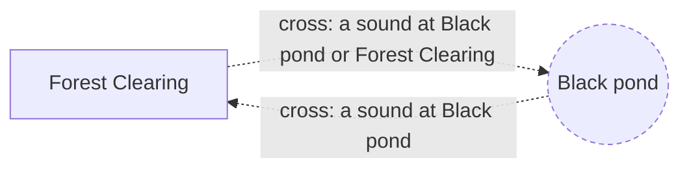
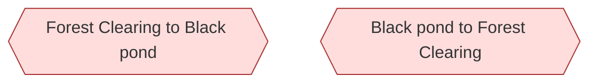

<!-- Generated by scripts/build-level-maps.mjs. Do not edit. -->
# Level map: The Steam Clock

Pack `badger-forest`, revision 1. Entry `clearing`. Part of the [level maps](index.md); data in [badger-forest.graph.json](badger-forest.graph.json). Built from `v2/content/badger-forest/card-world.json` and `v2/worlds/badger-forest/card-bridge.json`.

1 places, 2 ways, 2 gates, 0 acts, 0 flags, 1 district.

How to read the maps: a solid line is an open way and a dashed line is a gated way, labelled with its condition in plain words. A hexagon is a road, a double box is the ship, a round node is another world, a dashed outline is a place beyond this map. In the dependency charts an arrow points from what is needed to what it opens; red is a gate. A condition under `any` is a set of alternatives, and the charts and the prerequisite lists include all of them.

## Place map

## Dependency chart

2 gated ways here; 2 nodes in the chain.

## Gates

Every condition that shuts a way, a place, a resident or a thing. The prerequisites are everything reachable through the condition, over every alternative, and so can list more than one route needs.

| Gate | Direct condition | Transitive prerequisites | Latch (kept once made) and live (read now) |
| --- | --- | --- | --- |
| `crossing:pond-clearing` Black pond to Forest Clearing | a sound at pond | none | live: a sound at pond |
| `crossing:clearing-pond` Forest Clearing to Black pond | a sound at pond or clearing | none | live: a sound at pond or clearing |

## Flags

Flags that gate something, most-depended-on first. A latch flag is only ever set; a toggle flag is also cleared by some act. "Gates behind it" are all gates whose prerequisites include the flag, directly or through other flags and acts.

| Flag | Kind | Set by | Read directly by | Gates behind it, transitively | Acts behind it |
| --- | --- | --- | --- | --- | --- |

