<!-- Generated by scripts/build-level-maps.mjs. Do not edit. -->
# Level map: The Wine-Dark Sea

Pack `greek-drama`, revision 24. Entry `greek-harbor`. Part of the [level maps](index.md); data in [greek-drama.graph.json](greek-drama.graph.json). Built from `v2/content/greek-drama/card-world.json` and `v2/worlds/greek-drama/card-bridge.json`.

49 places, 109 ways, 57 gates, 50 acts, 28 flags, 8 districts.

How to read the maps: a solid line is an open way and a dashed line is a gated way, labelled with its condition in plain words. A hexagon is a road, a double box is the ship, a round node is another world, a dashed outline is a place beyond this map. In the dependency charts an arrow points from what is needed to what it opens; red is a gate. A condition under `any` is a set of alternatives, and the charts and the prerequisite lists include all of them.

## Place map

The districts and the roads between them.

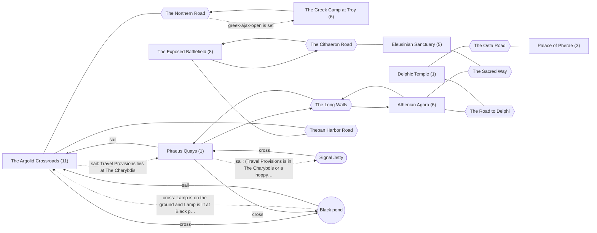

### The Argolid Crossroads

Places: `greek-argive-farm`, `greek-argolid-road`, `greek-argos-palace`, `greek-argos-sanctuary`, `greek-argos-tomb`, `greek-corinth`, `greek-egypt-tomb`, `greek-harbor`, `greek-mycenae-palace`, `greek-troezen`, `greek-troy-beach`.

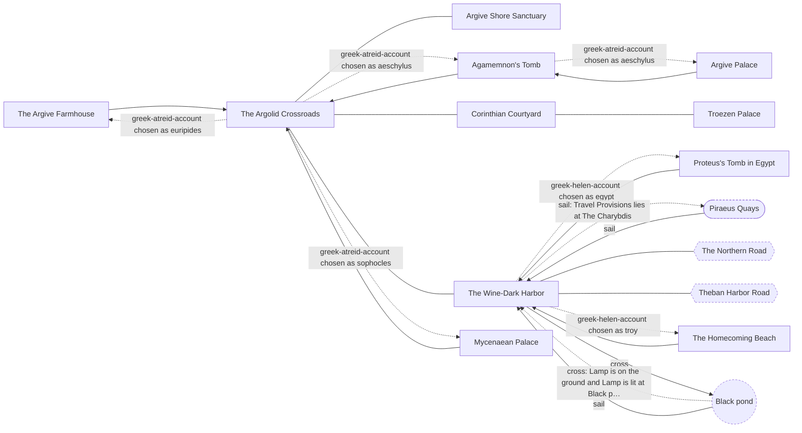

### Athenian Agora

Places: `greek-acropolis`, `greek-assembly`, `greek-athens`, `greek-demos-house`, `greek-festival`, `greek-thinkery`.

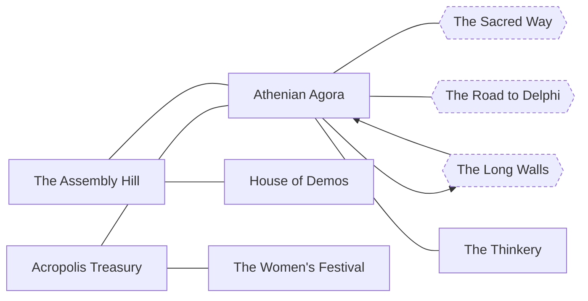

### The Exposed Battlefield

Places: `greek-aulis`, `greek-battlefield`, `greek-courtyard`, `greek-gate`, `greek-palace`, `greek-polynices-hollow`, `greek-sanctuary`, `greek-well`.

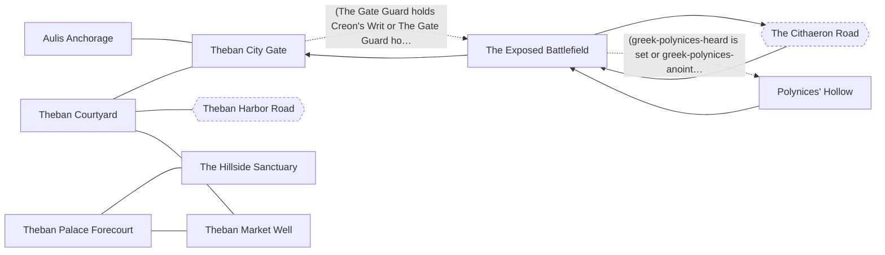

### Delphic Temple

Places: `greek-delphi`.

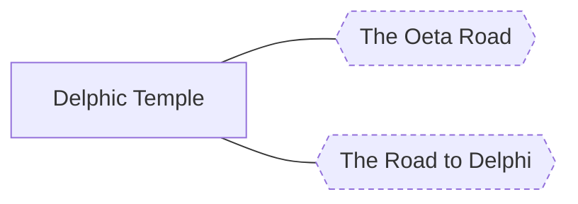

### Eleusinian Sanctuary

Places: `greek-acharnae`, `greek-attic-farm`, `greek-colonus`, `greek-eleusis`, `greek-marathon`.

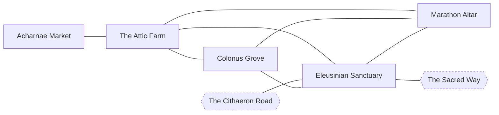

### The Greek Camp at Troy

Places: `greek-ajax-grave`, `greek-ajax-household`, `greek-ajax-landing`, `greek-greek-camp`, `greek-trojan-camp`, `greek-troy`.

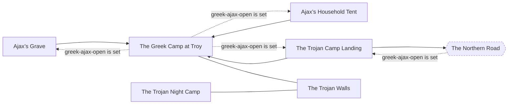

### Palace of Pherae

Places: `greek-pherae`, `greek-thetis`, `greek-trachis`.

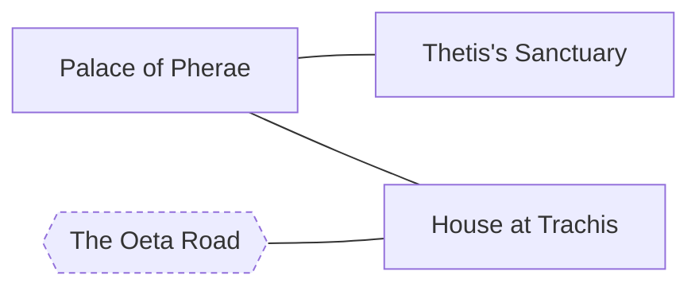

### Piraeus Quays

Places: `greek-piraeus`.

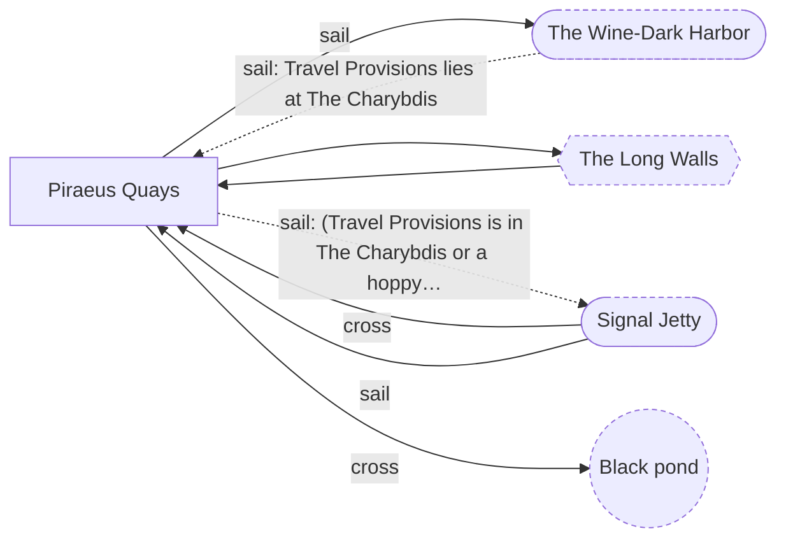

## Dependency chart

### The Argolid Crossroads

8 gated ways here; 29 nodes in the chain.

```mermaid
flowchart TD
  n_act_greek_atreid_aeschylus["Follow the tomb account · Aeschylus"]
  n_act_greek_atreid_euripides["Follow the farmhouse account · Euripides"]
  n_act_greek_atreid_sophocles["Follow the palace account · Sophocles"]
  n_act_greek_helen_egypt["Follow Helen's Egyptian account"]
  n_act_greek_helen_troy["Follow Helen's Trojan account"]
  n_choice_greek_atreid_account_aeschylus("atreid-account=aeschylus")
  n_choice_greek_atreid_account_euripides("atreid-account=euripides")
  n_choice_greek_atreid_account_sophocles("atreid-account=sophocles")
  n_choice_greek_helen_account_egypt("helen-account=egypt")
  n_choice_greek_helen_account_troy("helen-account=troy")
  n_crossing_pond_greek_harbor{{"Black pond to The Wine-Dark Harbor"}}
  n_item_cloth(["cloth"])
  n_item_greek_atreid_record(["Record of the House of Atreus"])
  n_item_greek_bread(["Courtyard Bread"])
  n_item_greek_figs(["Dried Figs"])
  n_item_greek_helen_accounts(["Helen’s Account Tablet"])
  n_item_greek_provisions(["Travel Provisions"])
  n_item_greek_water_jar(["Water Jar"])
  n_item_greek_wheat(["Sack of Wheat"])
  n_item_greek_wine_skin(["Wine Skin"])
  n_item_lamp(["lamp"])
  n_lane_greek_ship_greek_harbor_greek_piraeus{{"The Wine-Dark Harbor to Piraeus Quays by sea"}}
  n_place_greek_argos_palace{{"Argive Palace appears"}}
  n_route_greek_argolid_road_greek_argive_farm{{"The Argolid Crossroads to The Argive Farmhouse"}}
  n_route_greek_argolid_road_greek_argos_tomb{{"The Argolid Crossroads to Agamemnon's Tomb"}}
  n_route_greek_argolid_road_greek_mycenae_palace{{"The Argolid Crossroads to Mycenaean Palace"}}
  n_route_greek_argos_tomb_greek_argos_palace{{"Agamemnon's Tomb to Argive Palace"}}
  n_route_greek_harbor_greek_egypt_tomb{{"The Wine-Dark Harbor to Proteus's Tomb in Egypt"}}
  n_route_greek_harbor_greek_troy_beach{{"The Wine-Dark Harbor to The Homecoming Beach"}}
  n_act_greek_atreid_aeschylus --> n_choice_greek_atreid_account_aeschylus
  n_act_greek_atreid_euripides --> n_choice_greek_atreid_account_euripides
  n_act_greek_atreid_sophocles --> n_choice_greek_atreid_account_sophocles
  n_act_greek_helen_egypt --> n_choice_greek_helen_account_egypt
  n_act_greek_helen_troy --> n_choice_greek_helen_account_troy
  n_choice_greek_atreid_account_aeschylus --> n_place_greek_argos_palace
  n_choice_greek_atreid_account_aeschylus --> n_route_greek_argolid_road_greek_argos_tomb
  n_choice_greek_atreid_account_aeschylus --> n_route_greek_argos_tomb_greek_argos_palace
  n_choice_greek_atreid_account_euripides --> n_route_greek_argolid_road_greek_argive_farm
  n_choice_greek_atreid_account_sophocles --> n_route_greek_argolid_road_greek_mycenae_palace
  n_choice_greek_helen_account_egypt --> n_route_greek_harbor_greek_egypt_tomb
  n_choice_greek_helen_account_troy --> n_route_greek_harbor_greek_troy_beach
  n_item_cloth --> n_crossing_pond_greek_harbor
  n_item_greek_atreid_record --> n_act_greek_atreid_aeschylus
  n_item_greek_atreid_record --> n_act_greek_atreid_euripides
  n_item_greek_atreid_record --> n_act_greek_atreid_sophocles
  n_item_greek_atreid_record --> n_route_greek_argolid_road_greek_argive_farm
  n_item_greek_atreid_record --> n_route_greek_argolid_road_greek_argos_tomb
  n_item_greek_atreid_record --> n_route_greek_argolid_road_greek_mycenae_palace
  n_item_greek_bread --> n_item_greek_provisions
  n_item_greek_figs --> n_item_greek_provisions
  n_item_greek_helen_accounts --> n_act_greek_helen_egypt
  n_item_greek_helen_accounts --> n_act_greek_helen_troy
  n_item_greek_helen_accounts --> n_route_greek_harbor_greek_egypt_tomb
  n_item_greek_helen_accounts --> n_route_greek_harbor_greek_troy_beach
  n_item_greek_provisions --> n_lane_greek_ship_greek_harbor_greek_piraeus
  n_item_greek_water_jar --> n_item_greek_bread
  n_item_greek_wheat --> n_item_greek_bread
  n_item_greek_wine_skin --> n_item_greek_provisions
  n_item_lamp --> n_crossing_pond_greek_harbor
  n_place_greek_argos_palace --> n_route_greek_argos_tomb_greek_argos_palace
  classDef gate fill:#fdd,stroke:#a33
  class n_crossing_pond_greek_harbor,n_lane_greek_ship_greek_harbor_greek_piraeus,n_place_greek_argos_palace,n_route_greek_argolid_road_greek_argive_farm,n_route_greek_argolid_road_greek_argos_tomb,n_route_greek_argolid_road_greek_mycenae_palace,n_route_greek_argos_tomb_greek_argos_palace,n_route_greek_harbor_greek_egypt_tomb,n_route_greek_harbor_greek_troy_beach gate
```

### The Exposed Battlefield

2 gated ways here; 20 nodes in the chain.

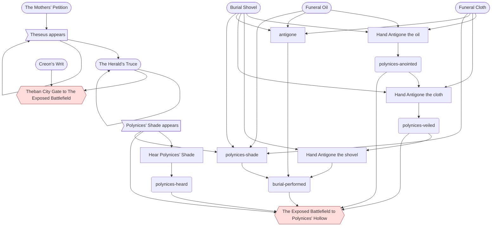

### The Greek Camp at Troy

3 gated ways here; 5 nodes in the chain.

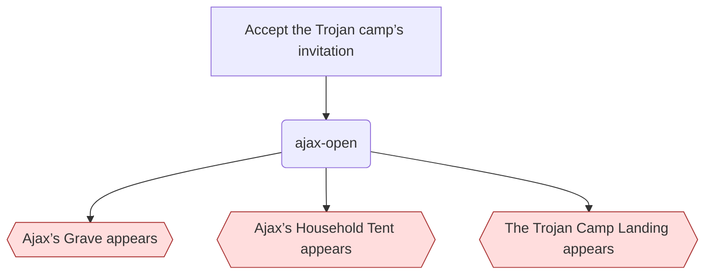

### Piraeus Quays

2 gated ways here; 8 nodes in the chain.

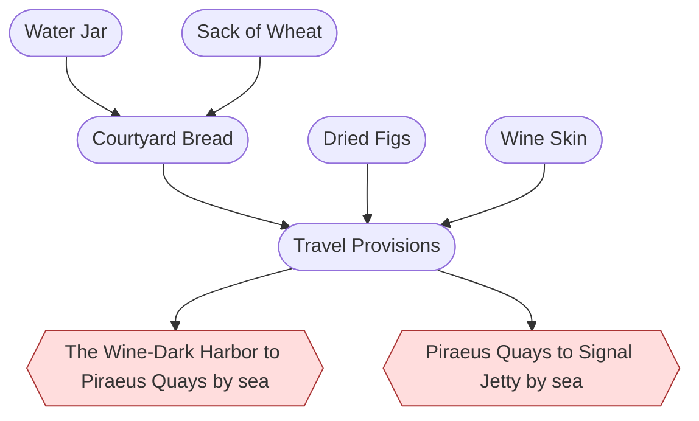

## Gates

Every condition that shuts a way, a place, a resident or a thing. The prerequisites are everything reachable through the condition, over every alternative, and so can list more than one route needs.

| Gate | Direct condition | Transitive prerequisites | Latch (kept once made) and live (read now) |
| --- | --- | --- | --- |
| `place:greek-argos-palace` Argive Palace appears | greek-atreid-account chosen as aeschylus | choices: `greek-atreid-account=aeschylus` items: `greek-atreid-record` acts: `greek-atreid-aeschylus` | latch: greek-atreid-account chosen as aeschylus |
| `place:greek-argos-tomb` Agamemnon's Tomb appears | greek-atreid-account chosen as aeschylus | choices: `greek-atreid-account=aeschylus` items: `greek-atreid-record` acts: `greek-atreid-aeschylus` | latch: greek-atreid-account chosen as aeschylus |
| `place:greek-mycenae-palace` Mycenaean Palace appears | greek-atreid-account chosen as sophocles | choices: `greek-atreid-account=sophocles` items: `greek-atreid-record` acts: `greek-atreid-sophocles` | latch: greek-atreid-account chosen as sophocles |
| `place:greek-argive-farm` The Argive Farmhouse appears | greek-atreid-account chosen as euripides | choices: `greek-atreid-account=euripides` items: `greek-atreid-record` acts: `greek-atreid-euripides` | latch: greek-atreid-account chosen as euripides |
| `place:greek-troy-beach` The Homecoming Beach appears | greek-helen-account chosen as troy | choices: `greek-helen-account=troy` items: `greek-helen-accounts` acts: `greek-helen-troy` | latch: greek-helen-account chosen as troy |
| `place:greek-egypt-tomb` Proteus's Tomb in Egypt appears | greek-helen-account chosen as egypt | choices: `greek-helen-account=egypt` items: `greek-helen-accounts` acts: `greek-helen-egypt` | latch: greek-helen-account chosen as egypt |
| `place:greek-ajax-landing` The Trojan Camp Landing appears | greek-ajax-open is set | flags: `greek-ajax-open` acts: `greek-ajax-invitation` | latch: greek-ajax-open is set |
| `place:greek-ajax-household` Ajax’s Household Tent appears | greek-ajax-open is set | flags: `greek-ajax-open` acts: `greek-ajax-invitation` | latch: greek-ajax-open is set |
| `place:greek-ajax-grave` Ajax’s Grave appears | greek-ajax-open is set | flags: `greek-ajax-open` acts: `greek-ajax-invitation` | latch: greek-ajax-open is set |
| `route:greek-gate>greek-battlefield` Theban City Gate to The Exposed Battlefield | (greek-guard holds greek-creon-writ or greek-guard holds greek-olive-branch) | items: `greek-burial-petition`, `greek-creon-writ`, `greek-olive-branch` residents: `greek-theseus` | live: greek-guard holds greek-creon-writ; greek-guard holds greek-olive-branch route follows its condition |
| `route:greek-battlefield>greek-polynices-hollow` The Exposed Battlefield to Polynices' Hollow | (greek-polynices-heard is set or greek-polynices-anointed is set or greek-polynices-veiled is set or greek-burial-performed is set) | flags: `greek-burial-performed`, `greek-polynices-anointed`, `greek-polynices-heard`, `greek-polynices-veiled` items: `greek-funeral-cloth`, `greek-oil-flask`, `greek-shovel` acts: `greek-anoint-polynices`, `greek-bury-polynices`, `greek-hear-polynices`, `greek-shroud-polynices` residents: `greek-polynices-shade` wants: `greek-antigone`, `greek-polynices-shade` | latch: greek-burial-performed is set; greek-polynices-anointed is set; greek-polynices-heard is set; greek-polynices-veiled is set route latches open once opened sealed (person greek-polynices-shade) |
| `route:greek-harbor>greek-egypt-tomb` The Wine-Dark Harbor to Proteus's Tomb in Egypt | greek-helen-account chosen as egypt | choices: `greek-helen-account=egypt` items: `greek-helen-accounts` acts: `greek-helen-egypt` | latch: greek-helen-account chosen as egypt route latches open once opened sealed (item greek-helen-accounts) |
| `route:greek-harbor>greek-troy-beach` The Wine-Dark Harbor to The Homecoming Beach | greek-helen-account chosen as troy | choices: `greek-helen-account=troy` items: `greek-helen-accounts` acts: `greek-helen-troy` | latch: greek-helen-account chosen as troy route latches open once opened sealed (item greek-helen-accounts) |
| `route:greek-argolid-road>greek-argos-tomb` The Argolid Crossroads to Agamemnon's Tomb | greek-atreid-account chosen as aeschylus | choices: `greek-atreid-account=aeschylus` items: `greek-atreid-record` acts: `greek-atreid-aeschylus` | latch: greek-atreid-account chosen as aeschylus route latches open once opened sealed (item greek-atreid-record) |
| `route:greek-argolid-road>greek-mycenae-palace` The Argolid Crossroads to Mycenaean Palace | greek-atreid-account chosen as sophocles | choices: `greek-atreid-account=sophocles` items: `greek-atreid-record` acts: `greek-atreid-sophocles` | latch: greek-atreid-account chosen as sophocles route latches open once opened sealed (item greek-atreid-record) |
| `route:greek-argolid-road>greek-argive-farm` The Argolid Crossroads to The Argive Farmhouse | greek-atreid-account chosen as euripides | choices: `greek-atreid-account=euripides` items: `greek-atreid-record` acts: `greek-atreid-euripides` | latch: greek-atreid-account chosen as euripides route latches open once opened sealed (item greek-atreid-record) |
| `route:greek-argos-tomb>greek-argos-palace` Agamemnon's Tomb to Argive Palace | greek-atreid-account chosen as aeschylus | choices: `greek-atreid-account=aeschylus` items: `greek-atreid-record` acts: `greek-atreid-aeschylus` places: `greek-argos-palace` | latch: greek-atreid-account chosen as aeschylus route latches open once opened sealed (place greek-argos-palace) |
| `crossing:pond-greek-harbor` Black pond to The Wine-Dark Harbor | lamp is on the ground and lamp is lit at pond and cloth is in the traveler's hand and the traveler is at pond | items: `cloth`, `lamp` | live: the traveler is at pond; lamp is on the ground; cloth is in the traveler's hand; lamp is lit at pond |
| `lane:greek-ship:greek-harbor>greek-piraeus` The Wine-Dark Harbor to Piraeus Quays by sea | greek-provisions lies at greek-ship | items: `greek-bread`, `greek-figs`, `greek-provisions`, `greek-water-jar`, `greek-wheat`, `greek-wine-skin` | live: greek-provisions lies at greek-ship sealed (lane) |
| `lane:greek-ship:greek-piraeus>hoppycat-signal-jetty` Piraeus Quays to Signal Jetty by sea | (greek-provisions is in greek-ship or a hoppycat-archive thing is in greek-ship) | items: `greek-bread`, `greek-figs`, `greek-provisions`, `greek-water-jar`, `greek-wheat`, `greek-wine-skin` | live: greek-provisions is in greek-ship; a hoppycat-archive thing is in greek-ship |
| `resident:greek-helen-egypt` Helen appears | greek-helen-account chosen as egypt | choices: `greek-helen-account=egypt` items: `greek-helen-accounts` acts: `greek-helen-egypt` | latch: greek-helen-account chosen as egypt |
| `resident:greek-menelaus-egypt` Menelaus appears | greek-helen-account chosen as egypt | choices: `greek-helen-account=egypt` items: `greek-helen-accounts` acts: `greek-helen-egypt` | latch: greek-helen-account chosen as egypt |
| `resident:greek-helen-troy` Helen appears | greek-helen-account chosen as troy | choices: `greek-helen-account=troy` items: `greek-helen-accounts` acts: `greek-helen-troy` | latch: greek-helen-account chosen as troy |
| `resident:greek-menelaus-troy` Menelaus appears | greek-helen-account chosen as troy | choices: `greek-helen-account=troy` items: `greek-helen-accounts` acts: `greek-helen-troy` | latch: greek-helen-account chosen as troy |
| `resident:greek-electra-aeschylus` Electra appears | greek-atreid-account chosen as aeschylus | choices: `greek-atreid-account=aeschylus` items: `greek-atreid-record` acts: `greek-atreid-aeschylus` | latch: greek-atreid-account chosen as aeschylus |
| `resident:greek-orestes-aeschylus` Orestes appears | greek-atreid-account chosen as aeschylus | choices: `greek-atreid-account=aeschylus` items: `greek-atreid-record` acts: `greek-atreid-aeschylus` | latch: greek-atreid-account chosen as aeschylus |
| `resident:greek-electra-sophocles` Electra appears | greek-atreid-account chosen as sophocles | choices: `greek-atreid-account=sophocles` items: `greek-atreid-record` acts: `greek-atreid-sophocles` | latch: greek-atreid-account chosen as sophocles |
| `resident:greek-orestes-sophocles` Orestes appears | greek-atreid-account chosen as sophocles | choices: `greek-atreid-account=sophocles` items: `greek-atreid-record` acts: `greek-atreid-sophocles` | latch: greek-atreid-account chosen as sophocles |
| `resident:greek-electra-euripides` Electra appears | greek-atreid-account chosen as euripides | choices: `greek-atreid-account=euripides` items: `greek-atreid-record` acts: `greek-atreid-euripides` | latch: greek-atreid-account chosen as euripides |
| `resident:greek-orestes-euripides` Orestes appears | greek-atreid-account chosen as euripides | choices: `greek-atreid-account=euripides` items: `greek-atreid-record` acts: `greek-atreid-euripides` | latch: greek-atreid-account chosen as euripides |
| `resident:greek-aethra` Aethra appears | (greek-funeral-cloth is in greek-eleusis or greek-aethra has been met) | items: `greek-funeral-cloth` | latch: greek-aethra has been met live: greek-funeral-cloth is in greek-eleusis |
| `resident:greek-adrastus` Adrastus appears | (greek-olive-branch is in greek-eleusis or greek-adrastus has been met) | items: `greek-burial-petition`, `greek-olive-branch` residents: `greek-theseus` | latch: greek-adrastus has been met live: greek-olive-branch is in greek-eleusis |
| `resident:greek-argive-mother` An Argive Mother appears | (greek-ash-urn is in greek-eleusis or greek-argive-mother has been met) | items: `greek-ash-urn`, `greek-burial-petition`, `greek-funeral-cloth`, `greek-oil-flask`, `greek-olive-branch` residents: `greek-aethra`, `greek-theseus` | latch: greek-argive-mother has been met live: greek-ash-urn is in greek-eleusis |
| `resident:greek-iphis` Iphis appears | (greek-ash-urn is in greek-eleusis or greek-iphis has been met) | items: `greek-ash-urn`, `greek-burial-petition`, `greek-funeral-cloth`, `greek-oil-flask`, `greek-olive-branch` residents: `greek-aethra`, `greek-theseus` | latch: greek-iphis has been met live: greek-ash-urn is in greek-eleusis |
| `resident:greek-theseus` Theseus appears | (greek-burial-petition is in greek-athens or greek-theseus has been met) | items: `greek-burial-petition` | latch: greek-theseus has been met live: greek-burial-petition is in greek-athens |
| `resident:greek-quay-host` Thaleia the Quay Host appears | (greek-wheat lies at greek-piraeus or greek-quay-host has been met) | items: `greek-wheat` | latch: greek-quay-host has been met live: greek-wheat lies at greek-piraeus |
| `resident:greek-colonus-keeper` The Grove Keeper appears | (greek-oil-flask is in greek-colonus or greek-colonus-keeper has been met) | items: `greek-oil-flask` | latch: greek-colonus-keeper has been met live: greek-oil-flask is in greek-colonus |
| `resident:greek-household-witness` Myrine of Argos appears | (greek-ash-urn is in greek-eleusis or greek-household-witness has been met) | items: `greek-ash-urn`, `greek-burial-petition`, `greek-funeral-cloth`, `greek-oil-flask`, `greek-olive-branch` residents: `greek-aethra`, `greek-theseus` | latch: greek-household-witness has been met live: greek-ash-urn is in greek-eleusis |
| `resident:greek-ajax-tecmessa` Tecmessa appears | greek-ajax-open is set | flags: `greek-ajax-open` acts: `greek-ajax-invitation` | latch: greek-ajax-open is set |
| `resident:greek-ajax-teucer` Teucer appears | greek-ajax-open is set | flags: `greek-ajax-open` acts: `greek-ajax-invitation` | latch: greek-ajax-open is set |
| `resident:greek-ajax-odysseus` Odysseus appears | greek-ajax-open is set | flags: `greek-ajax-open` acts: `greek-ajax-invitation` | latch: greek-ajax-open is set |
| `resident:greek-polynices-shade` Polynices' Shade appears | the clock is between 36 and 0 and greek-burial-performed is not set | none | latch: greek-burial-performed is not set live: the clock is between 36 and 0 |
| `resident:greek-patroclus` Patroclus appears | greek-burial-performed is set and (greek-patroclus-met is set or greek-ship is docked at greek-piraeus) and (greek-patroclus-met is set or greek-provisions lies at greek-ship) | flags: `greek-burial-performed`, `greek-patroclus-met`, `greek-polynices-anointed`, `greek-polynices-veiled` items: `greek-bread`, `greek-figs`, `greek-funeral-cloth`, `greek-oil-flask`, `greek-provisions`, `greek-shovel`, `greek-water-jar`, `greek-wheat`, `greek-wine-skin` acts: `greek-anoint-polynices`, `greek-bury-polynices`, `greek-meet-patroclus`, `greek-shroud-polynices` residents: `greek-polynices-shade` wants: `greek-antigone`, `greek-polynices-shade` | latch: greek-burial-performed is set; greek-patroclus-met is set live: greek-provisions lies at greek-ship; greek-ship is docked at greek-piraeus |
| `item:greek-bread` Courtyard Bread is made | always shut until sealed lock opens | items: `greek-water-jar`, `greek-wheat` | none |
| `item:greek-provisions` Travel Provisions is made | always shut until sealed lock opens | items: `greek-bread`, `greek-figs`, `greek-water-jar`, `greek-wheat`, `greek-wine-skin` | none |
| `item:greek-olive-branch` The Herald’s Truce appears | (greek-theseus has been met or greek-olive-branch lies at greek-athens) | items: `greek-burial-petition` residents: `greek-theseus` | latch: greek-theseus has been met live: greek-olive-branch lies at greek-athens |
| `item:greek-egypt-testimony` The Egyptian Witness Tablet appears | greek-helen-account chosen as egypt | choices: `greek-helen-account=egypt` items: `greek-helen-accounts` acts: `greek-helen-egypt` | latch: greek-helen-account chosen as egypt |
| `item:greek-troy-testimony` The Trojan Witness Tablet appears | greek-helen-account chosen as troy | choices: `greek-helen-account=troy` items: `greek-helen-accounts` acts: `greek-helen-troy` | latch: greek-helen-account chosen as troy |
| `item:greek-tomb-testimony` The Tomb Witness Tablet appears | greek-atreid-account chosen as aeschylus | choices: `greek-atreid-account=aeschylus` items: `greek-atreid-record` acts: `greek-atreid-aeschylus` | latch: greek-atreid-account chosen as aeschylus |
| `item:greek-palace-testimony` The Palace Witness Tablet appears | greek-atreid-account chosen as sophocles | choices: `greek-atreid-account=sophocles` items: `greek-atreid-record` acts: `greek-atreid-sophocles` | latch: greek-atreid-account chosen as sophocles |
| `item:greek-farm-testimony` The Farmer's Witness Tablet appears | greek-atreid-account chosen as euripides | choices: `greek-atreid-account=euripides` items: `greek-atreid-record` acts: `greek-atreid-euripides` | latch: greek-atreid-account chosen as euripides |
| `item:greek-ash-urn` The Funeral Urn is made | always shut until sealed lock opens | items: `greek-burial-petition`, `greek-funeral-cloth`, `greek-oil-flask`, `greek-olive-branch` residents: `greek-aethra`, `greek-theseus` | none |
| `item:greek-ajax-shield` Ajax’s Shield appears | greek-ajax-open is set | flags: `greek-ajax-open` acts: `greek-ajax-invitation` | latch: greek-ajax-open is set |
| `item:greek-ajax-plea` Teucer’s Written Plea appears | greek-ajax-open is set and greek-ajax-plea-heard is set | flags: `greek-ajax-open`, `greek-ajax-plea-heard`, `greek-ajax-shield-delivered` items: `greek-ajax-shield` acts: `greek-ajax-deliver-shield`, `greek-ajax-hear-plea`, `greek-ajax-invitation`, `greek-ajax-learn-shield-odysseus`, `greek-ajax-learn-shield-tecmessa`, `greek-ajax-learn-shield-teucer` residents: `greek-ajax-odysseus`, `greek-ajax-tecmessa`, `greek-ajax-teucer` places: `greek-ajax-household` topics: `greek-ajax-shield-odysseus`, `greek-ajax-shield-tecmessa`, `greek-ajax-shield-teucer` | latch: greek-ajax-open is set; greek-ajax-plea-heard is set |
| `item:greek-ajax-cloth` The Camp’s Burial Cloth appears | greek-ajax-open is set | flags: `greek-ajax-open` acts: `greek-ajax-invitation` | latch: greek-ajax-open is set |
| `item:greek-ajax-tools` The Camp’s Grave Tools appears | greek-ajax-open is set | flags: `greek-ajax-open` acts: `greek-ajax-invitation` | latch: greek-ajax-open is set |
| `item:greek-burial-account` Burial Account appears | greek-burial-performed is set | flags: `greek-burial-performed`, `greek-polynices-anointed`, `greek-polynices-veiled` items: `greek-funeral-cloth`, `greek-oil-flask`, `greek-shovel` acts: `greek-anoint-polynices`, `greek-bury-polynices`, `greek-shroud-polynices` residents: `greek-polynices-shade` wants: `greek-antigone`, `greek-polynices-shade` | latch: greek-burial-performed is set |

## Flags

Flags that gate something, most-depended-on first. A latch flag is only ever set; a toggle flag is also cleared by some act. "Gates behind it" are all gates whose prerequisites include the flag, directly or through other flags and acts.

| Flag | Kind | Set by | Read directly by | Gates behind it, transitively | Acts behind it |
| --- | --- | --- | --- | --- | --- |
| `greek-ajax-open` | latch | `act:greek-ajax-invitation` | 27 | `place:greek-ajax-landing`, `place:greek-ajax-household`, `place:greek-ajax-grave`, `resident:greek-ajax-tecmessa`, `resident:greek-ajax-teucer`, `resident:greek-ajax-odysseus`, `item:greek-ajax-shield`, `item:greek-ajax-plea`, `item:greek-ajax-cloth`, `item:greek-ajax-tools` | 21 |
| `greek-burial-performed` | latch | `act:greek-bury-polynices`, `want:greek-antigone`, `want:greek-polynices-shade` | 6 | `route:greek-battlefield>greek-polynices-hollow`, `resident:greek-patroclus`, `item:greek-burial-account` | 1 |
| `greek-polynices-anointed` | latch | `act:greek-anoint-polynices` | 3 | `route:greek-battlefield>greek-polynices-hollow`, `resident:greek-patroclus`, `item:greek-burial-account` | 3 |
| `greek-polynices-veiled` | latch | `act:greek-shroud-polynices` | 3 | `route:greek-battlefield>greek-polynices-hollow`, `resident:greek-patroclus`, `item:greek-burial-account` | 2 |
| `greek-ajax-plea-heard` | latch | `act:greek-ajax-hear-plea` | 2 | `item:greek-ajax-plea` | 16 |
| `greek-ajax-shield-delivered` | latch | `act:greek-ajax-deliver-shield` | 8 | `item:greek-ajax-plea` | 17 |
| `greek-patroclus-met` | latch | `act:greek-meet-patroclus` | 2 | `resident:greek-patroclus` | 1 |
| `greek-polynices-heard` | latch | `act:greek-hear-polynices` | 1 | `route:greek-battlefield>greek-polynices-hollow` | 0 |
| `greek-ajax-account-ready` | latch | `act:greek-ajax-record-appeal`, `act:greek-ajax-record-household`, `act:greek-ajax-record-public` | 6 | none | 3 |
| `greek-ajax-appeal-witnessed` | latch | `act:greek-ajax-witness-appeal` | 1 | none | 7 |
| `greek-ajax-buried` | latch | `act:greek-ajax-bury-appeal`, `act:greek-ajax-bury-household`, `act:greek-ajax-bury-public` | 9 | none | 6 |
| `greek-ajax-cloth-laid` | latch | `act:greek-ajax-lay-cloth` | 3 | none | 9 |
| `greek-ajax-grave-prepared` | latch | `act:greek-ajax-prepare-grave` | 4 | none | 10 |
| `greek-ajax-plea-delivered` | latch | `act:greek-ajax-deliver-plea` | 4 | none | 15 |
| `greek-atreid-heard-aeschylus` | latch | `act:greek-hear-electra-aeschylus` | 2 | none | 2 |
| `greek-atreid-heard-euripides` | latch | `act:greek-hear-electra-euripides` | 2 | none | 2 |
| `greek-atreid-heard-sophocles` | latch | `act:greek-hear-electra-sophocles` | 2 | none | 2 |
| `greek-decree-known` | latch | `act:greek-hear-decree` | 1 | none | 1 |
| `greek-helen-heard-egypt` | latch | `act:greek-hear-helen-egypt` | 2 | none | 2 |
| `greek-helen-heard-troy` | latch | `act:greek-hear-helen-troy` | 2 | none | 2 |

## Retired ways

`crossing:greek-ajax-landing-ship`, `crossing:greek-athens-harbor-ship`, `crossing:greek-egypt-tomb-ship`, `crossing:greek-lemnos-ship`, `crossing:greek-marathon-ship`, `crossing:greek-sicily-ship`, `crossing:greek-tauris-ship`, `crossing:greek-thrace-ship`

