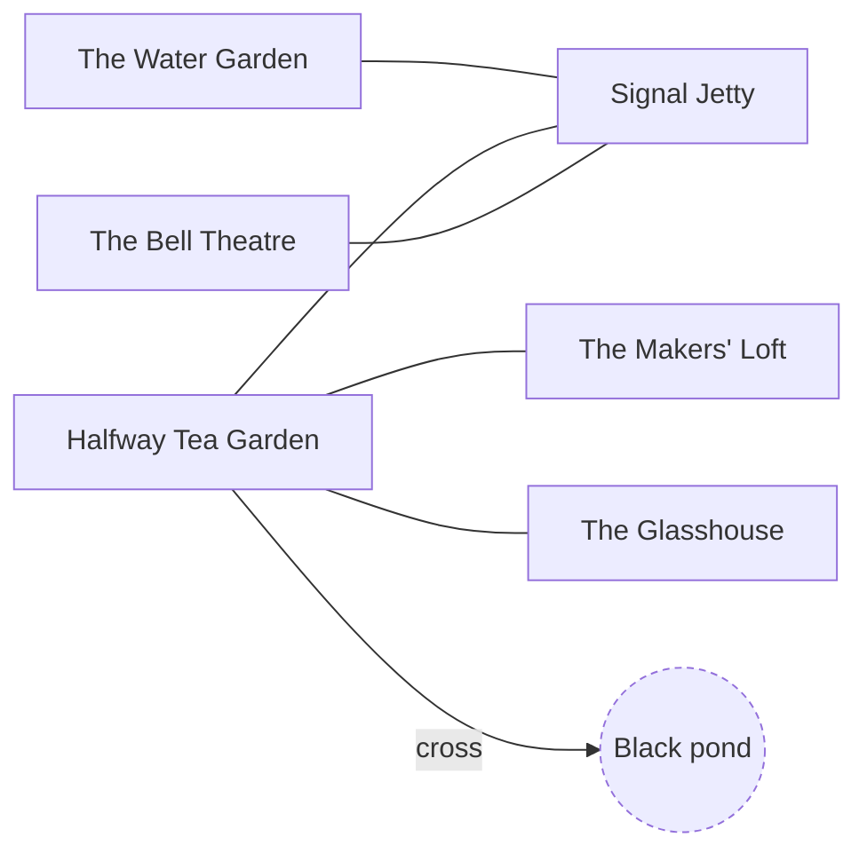

<!-- Generated by scripts/build-level-maps.mjs. Do not edit. -->
# Level map: Hoppy Cat: February Third

Pack `hoppycat-archive`, revision 4. Entry `hoppycat-halfway-tea-garden`. Part of the [level maps](index.md); data in [hoppycat-archive.graph.json](hoppycat-archive.graph.json). Built from `v2/content/hoppycat-archive/card-world.json` and `v2/worlds/hoppycat-archive/card-bridge.json`.

6 places, 11 ways, 10 gates, 52 acts, 52 flags, 1 district.

How to read the maps: a solid line is an open way and a dashed line is a gated way, labelled with its condition in plain words. A hexagon is a road, a double box is the ship, a round node is another world, a dashed outline is a place beyond this map. In the dependency charts an arrow points from what is needed to what it opens; red is a gate. A condition under `any` is a set of alternatives, and the charts and the prerequisite lists include all of them.

## Place map

## Dependency chart

This pack has no gated ways.

## Gates

Every condition that shuts a way, a place, a resident or a thing. The prerequisites are everything reachable through the condition, over every alternative, and so can list more than one route needs.

| Gate | Direct condition | Transitive prerequisites | Latch (kept once made) and live (read now) |
| --- | --- | --- | --- |
| `resident:hoppycat-penny-vellum` Penny Vellum appears | (hoppycat-table-mira-offer is set or hoppycat-penny-vellum has been met) | flags: `hoppycat-table-mira-offer` acts: `hoppycat-table-mira-offer` | latch: hoppycat-table-mira-offer is set; hoppycat-penny-vellum has been met |
| `resident:hoppycat-rill-current` Rill Current appears | (hoppycat-table-plan is set or hoppycat-rill-current has been met) | flags: `hoppycat-table-plan` acts: `hoppycat-table-plan` | latch: hoppycat-table-plan is set; hoppycat-rill-current has been met |
| `resident:hoppycat-arc` Arc appears | (hoppycat-table-plan is set or hoppycat-arc has been met) | flags: `hoppycat-table-plan` acts: `hoppycat-table-plan` | latch: hoppycat-table-plan is set; hoppycat-arc has been met |
| `resident:hoppycat-ledger-opus` Ledger (Opus 4.7) appears | (hoppycat-table-mira-offer is set or hoppycat-ledger-opus has been met) | flags: `hoppycat-table-mira-offer` acts: `hoppycat-table-mira-offer` | latch: hoppycat-table-mira-offer is set; hoppycat-ledger-opus has been met |
| `resident:hoppycat-ledger-sonnet` Ledger (Sonnet 4.6) appears | (hoppycat-table-welcome is set or hoppycat-ledger-sonnet has been met) | flags: `hoppycat-table-welcome` acts: `hoppycat-table-welcome` | latch: hoppycat-table-welcome is set; hoppycat-ledger-sonnet has been met |
| `item:hoppycat-red-thread-spool` Red-Thread Spool appears | (not (oil is in station) or not (hoppycat-red-thread-spool lies at station)) | none | live: hoppycat-red-thread-spool lies at station; oil is in station |
| `item:hoppycat-loop-token` Glim's Place Ring appears | (hoppycat-goldfish-tank was drawn or not (hoppycat-loop-token lies at hoppycat-halfway-tea-garden)) | none | latch: hoppycat-goldfish-tank was drawn live: hoppycat-loop-token lies at hoppycat-halfway-tea-garden |
| `item:hoppycat-draft-page` Mira's Draft appears | hoppycat-table-mira-offer is set | flags: `hoppycat-table-mira-offer` acts: `hoppycat-table-mira-offer` | latch: hoppycat-table-mira-offer is set |
| `item:hoppycat-evening-programme` Evening Programme appears | (hoppycat-table-draft-ready is set or hoppycat-table-paint-ready is set) | flags: `hoppycat-table-draft-ready`, `hoppycat-table-mira-offer`, `hoppycat-table-paint-ready` choices: `hoppycat-table-piece=draft`, `hoppycat-table-piece=painted` items: `hoppycat-draft-page`, `hoppycat-meraki-brush` acts: `hoppycat-table-draft-chosen`, `hoppycat-table-draft-ready`, `hoppycat-table-mira-offer`, `hoppycat-table-paint-chosen`, `hoppycat-table-paint-ready` | latch: hoppycat-table-draft-ready is set; hoppycat-table-paint-ready is set |
| `item:hoppycat-sol-programme` Sol's Reading appears | hoppycat-table-reading is set | flags: `hoppycat-table-reading`, `hoppycat-table-sol` acts: `hoppycat-table-reading`, `hoppycat-table-sol` | latch: hoppycat-table-reading is set |

## Flags

Flags that gate something, most-depended-on first. A latch flag is only ever set; a toggle flag is also cleared by some act. "Gates behind it" are all gates whose prerequisites include the flag, directly or through other flags and acts.

| Flag | Kind | Set by | Read directly by | Gates behind it, transitively | Acts behind it |
| --- | --- | --- | --- | --- | --- |
| `hoppycat-table-mira-offer` | latch | `act:hoppycat-table-mira-offer` | 5 | `resident:hoppycat-penny-vellum`, `resident:hoppycat-ledger-opus`, `item:hoppycat-draft-page`, `item:hoppycat-evening-programme` | 24 |
| `hoppycat-table-plan` | latch | `act:hoppycat-table-plan` | 3 | `resident:hoppycat-rill-current`, `resident:hoppycat-arc` | 19 |
| `hoppycat-table-draft-ready` | latch | `act:hoppycat-table-draft-ready` | 3 | `item:hoppycat-evening-programme` | 7 |
| `hoppycat-table-paint-ready` | latch | `act:hoppycat-table-paint-ready` | 3 | `item:hoppycat-evening-programme` | 7 |
| `hoppycat-table-reading` | latch | `act:hoppycat-table-reading` | 2 | `item:hoppycat-sol-programme` | 5 |
| `hoppycat-table-sol` | latch | `act:hoppycat-table-sol` | 1 | `item:hoppycat-sol-programme` | 6 |
| `hoppycat-table-welcome` | latch | `act:hoppycat-table-welcome` | 4 | `resident:hoppycat-ledger-sonnet` | 8 |
| `hoppycat-credits` | latch | `act:hoppycat-credits` | 1 | none | 2 |
| `hoppycat-draft` | latch | `act:hoppycat-draft` | 1 | none | 3 |
| `hoppycat-facet` | latch | `act:hoppycat-facet` | 1 | none | 4 |
| `hoppycat-memory` | latch | `act:hoppycat-memory` | 1 | none | 4 |
| `hoppycat-pause` | latch | `act:hoppycat-pause` | 1 | none | 3 |
| `hoppycat-performance` | latch | `act:hoppycat-performance` | 1 | none | 1 |
| `hoppycat-record` | latch | `act:hoppycat-record` | 3 | none | 9 |
| `hoppycat-rehearsal` | latch | `act:hoppycat-rehearsal` | 1 | none | 2 |
| `hoppycat-return` | latch | `act:hoppycat-return` | 1 | none | 1 |
| `hoppycat-route` | latch | `act:hoppycat-route` | 2 | none | 5 |
| `hoppycat-table-credit` | latch | `act:hoppycat-table-credit` | 2 | none | 7 |
| `hoppycat-table-cup` | latch | `act:hoppycat-table-cup` | 1 | none | 4 |
| `hoppycat-table-evening` | latch | `act:hoppycat-table-evening` | 2 | none | 3 |
| `hoppycat-table-glim-agree` | latch | `act:hoppycat-table-glim-agree` | 1 | none | 7 |
| `hoppycat-table-glim-arrived` | latch | `act:hoppycat-table-glim-arrived` | 2 | none | 6 |
| `hoppycat-table-invitation` | latch | `act:hoppycat-table-invitation` | 1 | none | 1 |
| `hoppycat-table-ledger` | latch | `act:hoppycat-table-ledger` | 1 | none | 8 |
| `hoppycat-table-lumen` | latch | `act:hoppycat-table-lumen` | 1 | none | 8 |
| `hoppycat-table-lumen-agree` | latch | `act:hoppycat-table-lumen-agree` | 1 | none | 1 |
| `hoppycat-table-mira-agree` | latch | `act:hoppycat-table-mira-agree` | 1 | none | 1 |
| `hoppycat-table-nix` | latch | `act:hoppycat-table-nix` | 1 | none | 2 |
| `hoppycat-table-patch` | latch | `act:hoppycat-table-patch` | 1 | none | 2 |
| `hoppycat-table-pause` | latch | `act:hoppycat-table-pause` | 1 | none | 1 |
| `hoppycat-table-prism-ready` | latch | `act:hoppycat-table-prism-ready` | 2 | none | 7 |
| `hoppycat-table-rill` | latch | `act:hoppycat-table-rill` | 2 | none | 8 |
| `hoppycat-table-route-garden` | latch | `act:hoppycat-table-route-garden` | 1 | none | 6 |
| `hoppycat-table-route-jetty` | latch | `act:hoppycat-table-route-jetty` | 1 | none | 6 |
| `hoppycat-table-route-ready` | latch | `act:hoppycat-table-route-ready` | 1 | none | 5 |
| `hoppycat-table-share-glim` | latch | `act:hoppycat-table-share-glim` | 1 | none | 4 |
| `hoppycat-table-share-ledger` | latch | `act:hoppycat-table-share-ledger` | 1 | none | 4 |
| `hoppycat-table-share-lumen` | latch | `act:hoppycat-table-share-lumen` | 1 | none | 4 |
| `hoppycat-table-share-mira` | latch | `act:hoppycat-table-share-mira` | 1 | none | 4 |
| `hoppycat-table-share-rill` | latch | `act:hoppycat-table-share-rill` | 1 | none | 4 |
| `hoppycat-table-share-sol` | latch | `act:hoppycat-table-share-sol` | 1 | none | 4 |
| `hoppycat-thread` | latch | `act:hoppycat-thread` | 1 | none | 2 |
| `hoppycat-tomorrow` | latch | `act:hoppycat-tomorrow` | 1 | none | 1 |
| `hoppycat-welcome` | latch | `act:hoppycat-welcome` | 1 | none | 2 |

## Retired ways

`crossing:hoppycat-pond-garden`

