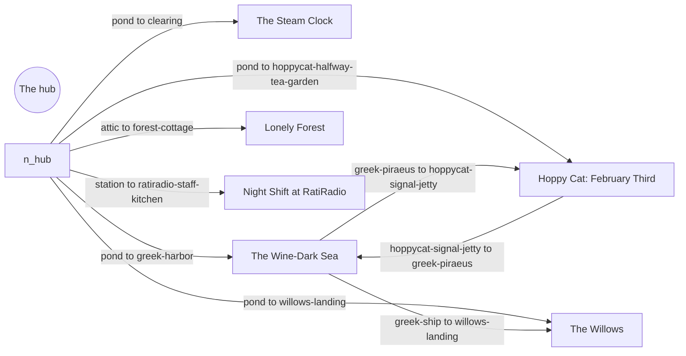

<!-- Generated by scripts/build-level-maps.mjs. Do not edit. -->
# Level maps

Maps of every mounted card pack: the places and ways, the gates that shut them, and what each gate needs done first. They are built from the pack data by `scripts/build-level-maps.mjs` and rebuilt by `npm run regen`; `npm run regen:check` fails when they are stale. Do not edit them by hand. Read [the current game source map](../current-game.md) for the data's owners.

| Pack | Places | Ways | Gates | Acts | Flags | Districts |
| --- | --- | --- | --- | --- | --- | --- |
| [The Steam Clock](badger-forest.md) | 1 | 2 | 2 | 0 | 0 | 1 |
| [The Wine-Dark Sea](greek-drama.md) | 49 | 109 | 57 | 50 | 28 | 8 |
| [Hoppy Cat: February Third](hoppycat-archive.md) | 6 | 11 | 10 | 52 | 52 | 1 |
| [The Willows](willows.md) | 4 | 10 | 5 | 11 | 11 | 2 |
| [Lonely Forest](lonely-forest.md) | 4 | 10 | 19 | 33 | 31 | 1 |
| [Night Shift at RatiRadio](ratiradio.md) | 4 | 8 | 6 | 5 | 3 | 1 |

## How the packs join

The hub starts at `pond`. Entries come from each pack's bridge.

## Condition kinds seen

- The Steam Clock: `sound`
- The Wine-Dark Sea: `actor_at`, `choice`, `choice_unset`, `clock`, `flag`, `grounded`, `holding`, `in_hand`, `item_at`, `item_near`, `item_present`, `knows`, `light`, `met`, `pack_item_present`, `ship_at`
- Hoppy Cat: February Third: `choice`, `choice_unset`, `drawn`, `flag`, `holding`, `item_at`, `item_near`, `item_present`, `met`
- The Willows: `daylight`, `flag`, `item_near`, `met`, `ship_at`, `weather`
- Lonely Forest: `flag`, `holding`, `item_near`, `item_present`, `knows`, `light`, `met`, `tag_held`, `upgraded`
- Night Shift at RatiRadio: `flag`, `holding`, `item_at`, `item_present`
