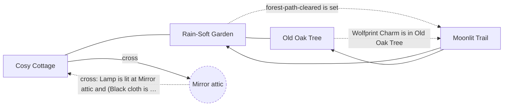
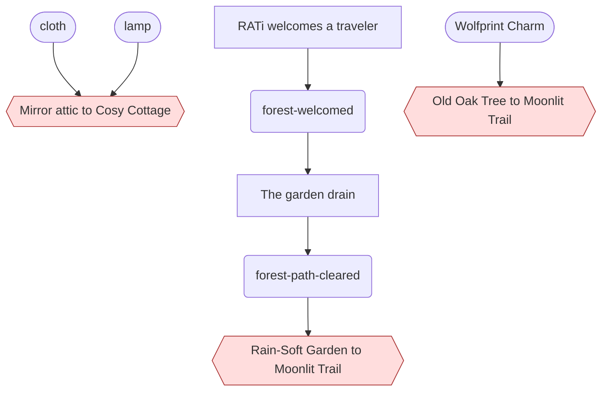

<!-- Generated by scripts/build-level-maps.mjs. Do not edit. -->
# Level map: Lonely Forest

Pack `lonely-forest`, revision 3. Entry `forest-cottage`. Part of the [level maps](index.md); data in [lonely-forest.graph.json](lonely-forest.graph.json). Built from `v2/content/lonely-forest/card-world.json` and `v2/worlds/lonely-forest/card-bridge.json`.

4 places, 10 ways, 19 gates, 33 acts, 31 flags, 1 district.

How to read the maps: a solid line is an open way and a dashed line is a gated way, labelled with its condition in plain words. A hexagon is a road, a double box is the ship, a round node is another world, a dashed outline is a place beyond this map. In the dependency charts an arrow points from what is needed to what it opens; red is a gate. A condition under `any` is a set of alternatives, and the charts and the prerequisite lists include all of them.

## Place map

## Dependency chart

3 gated ways here; 10 nodes in the chain.

## Gates

Every condition that shuts a way, a place, a resident or a thing. The prerequisites are everything reachable through the condition, over every alternative, and so can list more than one route needs.

| Gate | Direct condition | Transitive prerequisites | Latch (kept once made) and live (read now) |
| --- | --- | --- | --- |
| `route:forest-oak>forest-trail` Old Oak Tree to Moonlit Trail | forest-wolfprint-charm is in forest-oak | items: `forest-wolfprint-charm` | live: forest-wolfprint-charm is in forest-oak route follows its condition sealed (place forest-trail) |
| `route:forest-garden>forest-trail` Rain-Soft Garden to Moonlit Trail | forest-path-cleared is set | flags: `forest-path-cleared`, `forest-welcomed` acts: `forest-clear-drain`, `forest-stay-for-tea` | latch: forest-path-cleared is set route latches open once opened sealed (place forest-trail) |
| `crossing:attic-forest-cottage` Mirror attic to Cosy Cottage | lamp is lit at attic and (cloth is in attic or a scarf thing is held in attic) | items: `cloth`, `lamp` | live: cloth is in attic; lamp is lit at attic; a scarf thing is held in attic |
| `item:forest-button-vale` Vale's Black Button appears | forest-button-vale-hidden is set and forest-scarf-vale-sewn is not set | flags: `forest-button-vale-hidden` acts: `forest-hide-button-vale` | latch: forest-button-vale-hidden is set; forest-scarf-vale-sewn is not set |
| `item:forest-button-mara` Mara's Red Button appears | forest-button-mara-hidden is set and forest-scarf-mara-sewn is not set | flags: `forest-button-mara-hidden` acts: `forest-hide-button-mara` | latch: forest-button-mara-hidden is set; forest-scarf-mara-sewn is not set |
| `item:forest-button-ash` Ash's Orange Button appears | forest-button-ash-hidden is set and forest-scarf-ash-sewn is not set | flags: `forest-button-ash-hidden` acts: `forest-hide-button-ash` | latch: forest-button-ash-hidden is set; forest-scarf-ash-sewn is not set |
| `item:forest-button-nell` Iris's Yellow Button appears | forest-button-nell-hidden is set and forest-scarf-nell-sewn is not set | flags: `forest-button-nell-hidden` acts: `forest-hide-button-nell` | latch: forest-button-nell-hidden is set; forest-scarf-nell-sewn is not set |
| `item:forest-button-tavi` Tavi's Green Button appears | forest-button-tavi-hidden is set and forest-scarf-tavi-sewn is not set | flags: `forest-button-tavi-hidden` acts: `forest-hide-button-tavi` | latch: forest-button-tavi-hidden is set; forest-scarf-tavi-sewn is not set |
| `item:forest-button-rue` Rue's Blue Button appears | forest-button-rue-hidden is set and forest-scarf-rue-sewn is not set | flags: `forest-button-rue-hidden` acts: `forest-hide-button-rue` | latch: forest-button-rue-hidden is set; forest-scarf-rue-sewn is not set |
| `item:forest-button-orin` Cass's Indigo Button appears | forest-button-orin-hidden is set and forest-scarf-orin-sewn is not set | flags: `forest-button-orin-hidden` acts: `forest-hide-button-orin` | latch: forest-button-orin-hidden is set; forest-scarf-orin-sewn is not set |
| `item:forest-button-ada` Sage's Violet Button appears | forest-button-ada-hidden is set and forest-scarf-ada-sewn is not set | flags: `forest-button-ada-hidden` acts: `forest-hide-button-ada` | latch: forest-button-ada-hidden is set; forest-scarf-ada-sewn is not set |
| `item:forest-scarf-vale` Vale's White Scarf appears | forest-scarf-vale-sewn is set and forest-scarf-vale-worn is not set | flags: `forest-button-vale-hidden`, `forest-scarf-vale-sewn` items: `forest-button-vale` acts: `forest-hide-button-vale`, `forest-sew-scarf-vale` | latch: forest-scarf-vale-sewn is set; forest-scarf-vale-worn is not set |
| `item:forest-scarf-mara` Mara's Green Scarf appears | forest-scarf-mara-sewn is set and forest-scarf-mara-worn is not set | flags: `forest-button-mara-hidden`, `forest-scarf-mara-sewn` items: `forest-button-mara` acts: `forest-hide-button-mara`, `forest-sew-scarf-mara` | latch: forest-scarf-mara-sewn is set; forest-scarf-mara-worn is not set |
| `item:forest-scarf-ash` Ash's Blue Scarf appears | forest-scarf-ash-sewn is set and forest-scarf-ash-worn is not set | flags: `forest-button-ash-hidden`, `forest-scarf-ash-sewn` items: `forest-button-ash` acts: `forest-hide-button-ash`, `forest-sew-scarf-ash` | latch: forest-scarf-ash-sewn is set; forest-scarf-ash-worn is not set |
| `item:forest-scarf-nell` Iris's Violet Scarf appears | forest-scarf-nell-sewn is set and forest-scarf-nell-worn is not set | flags: `forest-button-nell-hidden`, `forest-scarf-nell-sewn` items: `forest-button-nell` acts: `forest-hide-button-nell`, `forest-sew-scarf-nell` | latch: forest-scarf-nell-sewn is set; forest-scarf-nell-worn is not set |
| `item:forest-scarf-tavi` Tavi's Red Scarf appears | forest-scarf-tavi-sewn is set and forest-scarf-tavi-worn is not set | flags: `forest-button-tavi-hidden`, `forest-scarf-tavi-sewn` items: `forest-button-tavi` acts: `forest-hide-button-tavi`, `forest-sew-scarf-tavi` | latch: forest-scarf-tavi-sewn is set; forest-scarf-tavi-worn is not set |
| `item:forest-scarf-rue` Rue's Orange Scarf appears | forest-scarf-rue-sewn is set and forest-scarf-rue-worn is not set | flags: `forest-button-rue-hidden`, `forest-scarf-rue-sewn` items: `forest-button-rue` acts: `forest-hide-button-rue`, `forest-sew-scarf-rue` | latch: forest-scarf-rue-sewn is set; forest-scarf-rue-worn is not set |
| `item:forest-scarf-orin` Cass's Amber Scarf appears | forest-scarf-orin-sewn is set and forest-scarf-orin-worn is not set | flags: `forest-button-orin-hidden`, `forest-scarf-orin-sewn` items: `forest-button-orin` acts: `forest-hide-button-orin`, `forest-sew-scarf-orin` | latch: forest-scarf-orin-sewn is set; forest-scarf-orin-worn is not set |
| `item:forest-scarf-ada` Sage's Yellow Scarf appears | forest-scarf-ada-sewn is set and forest-scarf-ada-worn is not set | flags: `forest-button-ada-hidden`, `forest-scarf-ada-sewn` items: `forest-button-ada` acts: `forest-hide-button-ada`, `forest-sew-scarf-ada` | latch: forest-scarf-ada-sewn is set; forest-scarf-ada-worn is not set |

## Flags

Flags that gate something, most-depended-on first. A latch flag is only ever set; a toggle flag is also cleared by some act. "Gates behind it" are all gates whose prerequisites include the flag, directly or through other flags and acts.

| Flag | Kind | Set by | Read directly by | Gates behind it, transitively | Acts behind it |
| --- | --- | --- | --- | --- | --- |
| `forest-button-ada-hidden` | latch | `act:forest-hide-button-ada` | 3 | `item:forest-button-ada`, `item:forest-scarf-ada` | 2 |
| `forest-button-ash-hidden` | latch | `act:forest-hide-button-ash` | 3 | `item:forest-button-ash`, `item:forest-scarf-ash` | 2 |
| `forest-button-mara-hidden` | latch | `act:forest-hide-button-mara` | 3 | `item:forest-button-mara`, `item:forest-scarf-mara` | 2 |
| `forest-button-nell-hidden` | latch | `act:forest-hide-button-nell` | 3 | `item:forest-button-nell`, `item:forest-scarf-nell` | 2 |
| `forest-button-orin-hidden` | latch | `act:forest-hide-button-orin` | 3 | `item:forest-button-orin`, `item:forest-scarf-orin` | 2 |
| `forest-button-rue-hidden` | latch | `act:forest-hide-button-rue` | 3 | `item:forest-button-rue`, `item:forest-scarf-rue` | 2 |
| `forest-button-tavi-hidden` | latch | `act:forest-hide-button-tavi` | 3 | `item:forest-button-tavi`, `item:forest-scarf-tavi` | 2 |
| `forest-button-vale-hidden` | latch | `act:forest-hide-button-vale` | 3 | `item:forest-button-vale`, `item:forest-scarf-vale` | 2 |
| `forest-path-cleared` | latch | `act:forest-clear-drain` | 2 | `route:forest-garden>forest-trail` | 7 |
| `forest-scarf-ada-sewn` | latch | `act:forest-sew-scarf-ada` | 3 | `item:forest-scarf-ada` | 1 |
| `forest-scarf-ash-sewn` | latch | `act:forest-sew-scarf-ash` | 3 | `item:forest-scarf-ash` | 1 |
| `forest-scarf-mara-sewn` | latch | `act:forest-sew-scarf-mara` | 3 | `item:forest-scarf-mara` | 1 |
| `forest-scarf-nell-sewn` | latch | `act:forest-sew-scarf-nell` | 3 | `item:forest-scarf-nell` | 1 |
| `forest-scarf-orin-sewn` | latch | `act:forest-sew-scarf-orin` | 3 | `item:forest-scarf-orin` | 1 |
| `forest-scarf-rue-sewn` | latch | `act:forest-sew-scarf-rue` | 3 | `item:forest-scarf-rue` | 1 |
| `forest-scarf-tavi-sewn` | latch | `act:forest-sew-scarf-tavi` | 3 | `item:forest-scarf-tavi` | 1 |
| `forest-scarf-vale-sewn` | latch | `act:forest-sew-scarf-vale` | 3 | `item:forest-scarf-vale` | 1 |
| `forest-welcomed` | latch | `act:forest-stay-for-tea` | 1 | `route:forest-garden>forest-trail` | 8 |
| `forest-homecoming-shared` | latch | `act:forest-keep-charm`, `act:forest-leave-charm` | 7 | none | 3 |
| `forest-oak-heard` | latch | `act:forest-tell-hearth` | 2 | none | 5 |
| `forest-watch-shared` | latch | `act:forest-mark-pawprints` | 1 | none | 6 |

