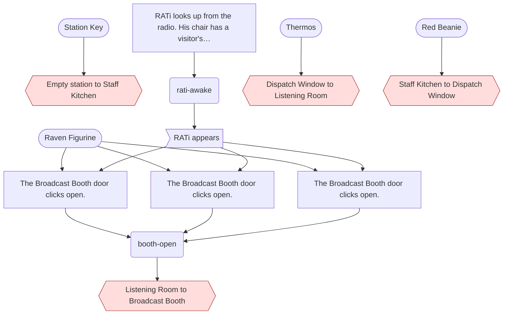

<!-- Generated by scripts/build-level-maps.mjs. Do not edit. -->
# Level map: Night Shift at RatiRadio

Pack `ratiradio`, revision 3. Entry `ratiradio-staff-kitchen`. Part of the [level maps](index.md); data in [ratiradio.graph.json](ratiradio.graph.json). Built from `v2/content/ratiradio/card-world.json` and `v2/worlds/ratiradio/card-bridge.json`.

4 places, 8 ways, 6 gates, 5 acts, 3 flags, 1 district.

How to read the maps: a solid line is an open way and a dashed line is a gated way, labelled with its condition in plain words. A hexagon is a road, a double box is the ship, a round node is another world, a dashed outline is a place beyond this map. In the dependency charts an arrow points from what is needed to what it opens; red is a gate. A condition under `any` is a set of alternatives, and the charts and the prerequisite lists include all of them.

## Place map

```mermaid
flowchart LR
  %% Night Shift at RatiRadio
  n_ratiradio_broadcast_booth["Broadcast Booth"]
  n_ratiradio_dispatch_window["Dispatch Window"]
  n_ratiradio_listening_room["Listening Room"]
  n_ratiradio_staff_kitchen["Staff Kitchen"]
  n_station(("Empty station"))
  n_ratiradio_broadcast_booth --> n_ratiradio_listening_room
  n_ratiradio_dispatch_window -. "Thermos lies at Dispatch Window" .-> n_ratiradio_listening_room
  n_ratiradio_dispatch_window --> n_ratiradio_staff_kitchen
  n_ratiradio_listening_room -. "booth-open is set" .-> n_ratiradio_broadcast_booth
  n_ratiradio_listening_room --> n_ratiradio_dispatch_window
  n_ratiradio_staff_kitchen -. "Red Beanie is in Staff Kitchen and not (Red Beanie lies…" .-> n_ratiradio_dispatch_window
  n_ratiradio_staff_kitchen -- "cross" --> n_station
  n_station -. "cross: the traveler holds Station Key" .-> n_ratiradio_staff_kitchen
  classDef stub stroke-dasharray: 4 3
  class n_station stub
```

## Dependency chart

4 gated ways here; 15 nodes in the chain.

## Gates

Every condition that shuts a way, a place, a resident or a thing. The prerequisites are everything reachable through the condition, over every alternative, and so can list more than one route needs.

| Gate | Direct condition | Transitive prerequisites | Latch (kept once made) and live (read now) |
| --- | --- | --- | --- |
| `route:ratiradio-staff-kitchen>ratiradio-dispatch-window` Staff Kitchen to Dispatch Window | ratiradio-red-beanie is in ratiradio-staff-kitchen and not (ratiradio-red-beanie lies at ratiradio-staff-kitchen) | items: `ratiradio-red-beanie` | live: ratiradio-red-beanie lies at ratiradio-staff-kitchen; ratiradio-red-beanie is in ratiradio-staff-kitchen route follows its condition sealed (item ratiradio-red-beanie) |
| `route:ratiradio-dispatch-window>ratiradio-listening-room` Dispatch Window to Listening Room | ratiradio-thermos lies at ratiradio-dispatch-window | items: `ratiradio-thermos` | live: ratiradio-thermos lies at ratiradio-dispatch-window route follows its condition sealed (place ratiradio-listening-room) |
| `route:ratiradio-listening-room>ratiradio-broadcast-booth` Listening Room to Broadcast Booth | booth-open is set | flags: `booth-open`, `rati-awake` items: `ratiradio-raven-figurine` acts: `ratiradio-open-broadcast-booth`, `ratiradio-open-broadcast-booth-dispatch`, `ratiradio-open-broadcast-booth-kitchen`, `ratiradio-wake-rati` residents: `ratiradio-rati` | latch: booth-open is set route latches open once opened sealed (place ratiradio-broadcast-booth) |
| `crossing:station-ratiradio` Empty station to Staff Kitchen | the traveler holds ratiradio-station-key | items: `ratiradio-station-key` | live: the traveler holds ratiradio-station-key |
| `resident:ratiradio-rati` RATi appears | rati-awake is set | flags: `rati-awake` acts: `ratiradio-wake-rati` | latch: rati-awake is set |
| `resident:ratiradio-raven` Raven appears | raven-awake is set | flags: `raven-awake` items: `ratiradio-glass`, `ratiradio-raven-figurine`, `ratiradio-red-beanie` acts: `ratiradio-return-things` | latch: raven-awake is set |

## Flags

Flags that gate something, most-depended-on first. A latch flag is only ever set; a toggle flag is also cleared by some act. "Gates behind it" are all gates whose prerequisites include the flag, directly or through other flags and acts.

| Flag | Kind | Set by | Read directly by | Gates behind it, transitively | Acts behind it |
| --- | --- | --- | --- | --- | --- |
| `rati-awake` | latch | `act:ratiradio-wake-rati` | 1 | `route:ratiradio-listening-room>ratiradio-broadcast-booth`, `resident:ratiradio-rati` | 3 |
| `booth-open` | latch | `act:ratiradio-open-broadcast-booth`, `act:ratiradio-open-broadcast-booth-dispatch`, `act:ratiradio-open-broadcast-booth-kitchen` | 1 | `route:ratiradio-listening-room>ratiradio-broadcast-booth` | 0 |
| `raven-awake` | latch | `act:ratiradio-return-things` | 3 | `resident:ratiradio-raven` | 0 |

