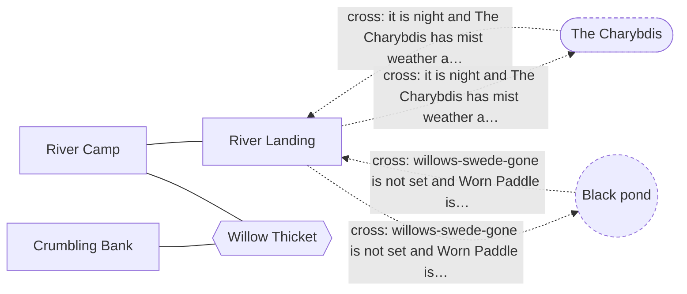
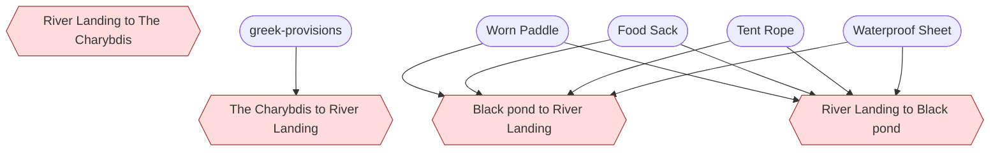

<!-- Generated by scripts/build-level-maps.mjs. Do not edit. -->
# Level map: The Willows

Pack `willows`, revision 2. Entry `willows-landing`. Part of the [level maps](index.md); data in [willows.graph.json](willows.graph.json). Built from `v2/content/willows/card-world.json` and `v2/worlds/willows/card-bridge.json`.

4 places, 10 ways, 5 gates, 11 acts, 11 flags, 2 districts.

How to read the maps: a solid line is an open way and a dashed line is a gated way, labelled with its condition in plain words. A hexagon is a road, a double box is the ship, a round node is another world, a dashed outline is a place beyond this map. In the dependency charts an arrow points from what is needed to what it opens; red is a gate. A condition under `any` is a set of alternatives, and the charts and the prerequisite lists include all of them.

## Place map

## Dependency chart

4 gated ways here; 9 nodes in the chain.

## Gates

Every condition that shuts a way, a place, a resident or a thing. The prerequisites are everything reachable through the condition, over every alternative, and so can list more than one route needs.

| Gate | Direct condition | Transitive prerequisites | Latch (kept once made) and live (read now) |
| --- | --- | --- | --- |
| `crossing:greek-ship-willows-landing` The Charybdis to River Landing | it is night and greek-ship has mist weather and (greek-ship is docked at pond or greek-ship is at sea) and (greek-provisions is in greek-ship or a hoppycat-archive thing is in greek-ship) | items: `greek-provisions` | live: it is night; greek-provisions is in greek-ship; a hoppycat-archive thing is in greek-ship; greek-ship is at sea; greek-ship is docked at pond; greek-ship has mist weather |
| `crossing:willows-landing-greek-ship` River Landing to The Charybdis | it is night and greek-ship has mist weather and (greek-ship is docked at pond or greek-ship is at sea) | none | live: it is night; greek-ship is at sea; greek-ship is docked at pond; greek-ship has mist weather |
| `crossing:willows-landing-pond` River Landing to Black pond | willows-swede-gone is not set and willows-paddle is in willows-camp and willows-sheet is in willows-camp and willows-rope is in willows-camp and willows-provisions is in willows-camp | items: `willows-paddle`, `willows-provisions`, `willows-rope`, `willows-sheet` | latch: willows-swede-gone is not set live: willows-paddle is in willows-camp; willows-provisions is in willows-camp; willows-rope is in willows-camp; willows-sheet is in willows-camp |
| `crossing:pond-willows-landing` Black pond to River Landing | willows-swede-gone is not set and willows-paddle is in willows-camp and willows-sheet is in willows-camp and willows-rope is in willows-camp and willows-provisions is in willows-camp | items: `willows-paddle`, `willows-provisions`, `willows-rope`, `willows-sheet` | latch: willows-swede-gone is not set live: willows-paddle is in willows-camp; willows-provisions is in willows-camp; willows-rope is in willows-camp; willows-sheet is in willows-camp |
| `resident:willows-swede` The Swede appears | willows-swede-gone is not set | none | latch: willows-swede-gone is not set |

## Flags

Flags that gate something, most-depended-on first. A latch flag is only ever set; a toggle flag is also cleared by some act. "Gates behind it" are all gates whose prerequisites include the flag, directly or through other flags and acts.

| Flag | Kind | Set by | Read directly by | Gates behind it, transitively | Acts behind it |
| --- | --- | --- | --- | --- | --- |
| `willows-hull-seen` | latch | `act:willows-examine-hull` | 1 | none | 1 |
| `willows-mark-seen` | latch | `act:willows-look-beneath-roots` | 1 | none | 1 |
| `willows-stores-counted` | latch | `act:willows-count-stores` | 1 | none | 1 |
| `willows-willows-paced` | latch | `act:willows-pace-willows` | 1 | none | 1 |

