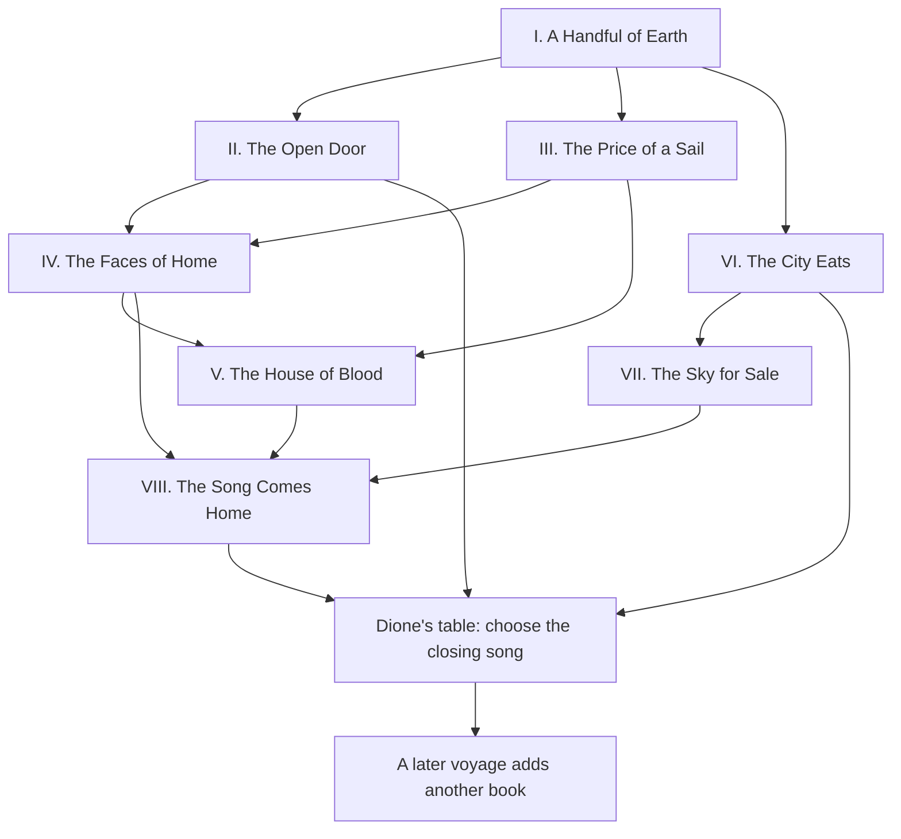

# The Wine-Dark Sea: a branching epic

Design proposal, 26 October 2026. Working poem title: **The Cloth We Carry**.

The traveler begins with water, bread, and an exposed body. Across the sea,
the same questions grow: who receives shelter, whose account enters the
song, who pays for a voyage, and who may sit at the common table? The journey
ends with a return. The people at that table answer the poem the traveler
has made.

The source pack contains **44 plays and 50 places, including the ship**.
This plan gives every play a strand. Places hold several strands when their
histories meet. A particular journey follows the strands its choices open.
The full repertoire supports many poems over time.

## The three opening cards

The wording in the [three-card draft](https://github.com/cenetex/cosyworld/pull/1180)
reports progress well. As poetry, it has three limits:

| Card | Current text | Critique |
| --- | --- | --- |
| A place at the table | “A jar of water could ease Dione's work and earn a place at her table.” | “Could ease” weakens the image. “Earn a place” turns hospitality into payment. The jar, hands, and bread can carry the meaning. |
| Before the burial | “Permission has been given. The brother still awaits the burial rite.” | Passive speech hides Creon and Antigone. “Permission” and “rite” sound like status labels. Earth and the open gate give this moment weight. |
| What the courtyard knows | “Dione keeps a place at the common table. She should hear what I chose.” | “Should hear” sounds like a chore. This is where a private deed becomes a public account, with room for grief, doubt, and dissent. |

Keep each face to a title and two short lines. Let the art supply the setting.
Opening the card reveals a plain action and the people involved. The poem
view holds the earned verses in the order of events.

| Card state | Exact proposed face text | Plain action in the open card |
| --- | --- | --- |
| A place at the table: offered | Dione's jar waits by the well. The bread is warm within. | Bring Dione her water jar. |
| A place at the table: earned | I set the water by her hands. She made room beside the bread. | Recorded when Dione receives the jar. |
| Before the burial: offered | Antigone stands beyond the gate. Her brother waits for earth. | Hear Antigone and the city's decree. Choose your part. |
| Before the burial: permission | Creon has granted this one grave. Her brother waits for earth. | Prepare the grave. Bring the cloth and oil. |
| Before the burial: buried after permission | Creon gave leave for this one grave. I laid her brother in the earth. | Recorded when the permitted burial happens. |
| Before the burial: buried in defiance | I laid her brother in the earth. The king's words crossed the wind. | Recorded when the burial happens. |
| Before the burial: stepped away | I left her standing at the gate. The dust came home with me. | Recorded when the traveler tells Antigone they will step away. |
| Before the burial: warned the guard | I gave the guard the hidden plan. He held it with the king's command. | Recorded when the traveler warns the guard. |
| What the courtyard knows: offered | Dione sets a place for me. What shall I bring beside the bread? | Tell Dione what you chose. |
| Courtyard: burial shared | I spoke of earth beside the bread. The courtyard heard me through. | Recorded when Dione hears about the burial. |
| Courtyard: permission shared before burial | I spoke the promise of a grave. His body waited in the sun. | Recorded when permission is shared while the rite remains open. |
| Courtyard: permitted burial shared | I spoke of leave, and cloth, and earth. The courtyard heard me through. | Recorded when the completed permitted burial is shared. |
| Courtyard: withdrawal shared | I told her how I turned away. She drew my chair beside the bread. | Recorded when Dione hears the traveler stepped away. |
| Courtyard: warning shared | I told her what the guard had heard. My words lay open on the table. | Recorded when Dione hears about the warning. |

These are proposed lines. Each offer follows the current scene. Once the
traveler holds the jar, its first line becomes “I carry water for her
hands.” The poem uses “we” only after a recorded shared act.

The courtyard stanza records what was true when it was spoken. If burial
follows a report of permission, a later return adds its own stanza:

> The grave I promised holds him now.\
> I brought that word to Dione.

## The shape of the poem

**Voice.** The traveler speaks in simple first-person verse. A named local
voice may answer. The chorus can disagree with the traveler. Comic songs
use brisk turns, hunger, noise, and bodily humor. Grief receives time and
space. Every line is original writing for this world.

**Scale.** Each play has three quest beats and at least two branch endings.
That gives 132 planned beats across 44 strands, with 127 outcome variants.
Each finished beat earns a
short line. The decisive choice earns a couplet. The water and courtyard
cards frame the Antigone strand; they also begin the larger cycle of return.

**Order.** The eight books below give a reading order and a release plan.
Travel follows local invitations, people, and carried promises. A player
may leave a strand open, return to it, or bring their poem home early.

**Time.** The live opening remains the aftermath of the Theban battle.
Older events appear as clearly introduced remembered scenes. The chorus
names the speaker and time before each such song. Choices inside a recalled
scene shape the account being heard; any change to the present needs a
separate present-day action. Comic visions and rival histories announce
their own frames. The poem marks these passages as “The elder sang…” or
“In the other telling…”.

**Accounts.** Helen's Egypt and Troy accounts remain distinct commitments.
The three Electra/Orestes accounts retain their own people and evidence.
A traveler can hear a rival poem as testimony. Embodied action follows the
chosen account. Each account has its own tense, entry, and ending.

**Return.** Dione's table is the first place where deeds become shared
memory. The ship is the place where the traveler arranges the song. Later
hearths can hold return scenes too. The traveler chooses which true stanza
to read aloud; listeners answer from their own knowledge.

These arrows show thematic routes. The chapter map and local scene plans
specify the places; existing travel exits remain the starting point for
implementation. Every book also permits a return to a known hearth.

## Eight books, forty-four strands

Each book below has an original proposed refrain. It enters the poem after
the deeds its lines describe have happened. The first local quest supplies
the invitation on arrival. A book can gather further verses on later visits.

1. **A Handful of Earth.** Antigone's request opens the question of law,
   family, and burial. Thebes hears its own earlier voices. On Cithaeron,
   certainty breaks into grief. *A handful of earth lay between us. / The
   city weighed it against a crown.*
2. **The Open Door.** Exiles, children, mourners, and wounded heroes seek a
   place to stand. Hospitality gains a cost, a witness, and a limit.
   *We made a door within the wall. / The road came through with names.*
3. **The Price of a Sail.** A fleet asks for a life. Its war leaves bodies,
   captives, and a rival empire's grief. The opening grave becomes a shore
   full of graves. *The wind rose under every sail. / Each sail had someone's
   breath.*
4. **The Faces of Home.** A name can shelter someone or condemn them.
   Letters, tokens, testimony, and withheld knowledge change who may return.
   *I carried names across the sea. / At home they opened different doors.*
5. **The House of Blood.** The same family sings rival accounts of justice.
   Mourning can become revenge, judgment, exile, or a renewed claim.
   *Blood called the house by every name. / We chose who else could speak.*
6. **The City Eats.** Peace reaches a market, a courtroom, a school, a
   treasury, and a common meal. The joke asks who enjoys the feast and who
   does its work. *The city brought its largest bowl. / Each hand declared
   itself the cook.*
7. **The Sky for Sale.** Guests become prey; a refuge becomes an empire;
   mortals bargain with gods. Power reveals itself through the use of a
   shared gift. *We raised a ladder to the clouds. / Someone began to charge.*
8. **The Song Comes Home.** In the underworld, poems are weighed for the
   life they can sustain. The traveler returns with a chosen account and
   hears its answer at the table. *I brought the sea into the room. / Dione
   passed the bread.*

| Strand | Book | Play and detailed plan | Source place |
| --- | --- | --- | --- |
| 1 | I | [Sophocles: Antigone](tragedians.md#sophocles-antigone) | Theban City Gate (`greek-gate`) |
| 2 | I | [Aeschylus: Seven Against Thebes](tragedians.md#aeschylus-seven-against-thebes) | Theban City Gate (`greek-gate`) |
| 3 | I | [Euripides: Phoenician Women](euripides.md#euripides-phoenician-women) | Theban Palace Forecourt (`greek-palace`) |
| 4 | I | [Sophocles: Oedipus Tyrannus](tragedians.md#sophocles-oedipus-tyrannus) | Theban Palace Forecourt (`greek-palace`) |
| 5 | I | [Sophocles: Oedipus at Colonus](tragedians.md#sophocles-oedipus-at-colonus) | Colonus Grove (`greek-colonus`) |
| 6 | I | [Euripides: Bacchae](euripides.md#euripides-bacchae) | Cithaeron Slopes (`greek-cithaeron`) |
| 7 | II | [Aeschylus: Suppliant Women](tragedians.md#aeschylus-suppliant-women) | Argive Shore Sanctuary (`greek-argos-sanctuary`) |
| 8 | II | [Euripides: Children of Heracles](euripides.md#euripides-children-of-heracles) | Marathon Altar (`greek-marathon`) |
| 9 | II | [Euripides: Suppliant Women](euripides.md#euripides-suppliant-women) | Eleusinian Sanctuary (`greek-eleusis`) |
| 10 | II | [Euripides: Alcestis](euripides.md#euripides-alcestis) | Palace of Pherae (`greek-pherae`) |
| 11 | II | [Euripides: Heracles](euripides.md#euripides-heracles) | Theban Courtyard (`greek-courtyard`) |
| 12 | II | [Sophocles: Women of Trachis](tragedians.md#sophocles-women-of-trachis) | House at Trachis (`greek-trachis`) |
| 13 | III | [Euripides: Iphigenia at Aulis](euripides.md#euripides-iphigenia-at-aulis) | Aulis Anchorage (`greek-aulis`) |
| 14 | III | [Sophocles: Philoctetes](tragedians.md#sophocles-philoctetes) | The Lemnian Cave (`greek-lemnos`) |
| 15 | III | [Euripides: Rhesus](euripides.md#euripides-rhesus) | The Trojan Night Camp (`greek-trojan-camp`) |
| 16 | III | [Sophocles: Ajax](tragedians.md#sophocles-ajax) | The Greek Camp at Troy (`greek-greek-camp`) |
| 17 | III | [Euripides: Trojan Women](euripides.md#euripides-trojan-women) | The Trojan Walls (`greek-troy`) |
| 18 | III | [Euripides: Hecuba](euripides.md#euripides-hecuba) | The Thracian Shore (`greek-thrace`) |
| 19 | III | [Aeschylus: Persians](tragedians.md#aeschylus-persians) | The Court at Susa (`greek-susa`) |
| 20 | IV | [Euripides: Helen](euripides.md#euripides-helen) | Proteus's Tomb in Egypt (`greek-egypt-tomb`) |
| 21 | IV | [Euripides: Andromache](euripides.md#euripides-andromache) | Thetis's Sanctuary (`greek-thetis`) |
| 22 | IV | [Euripides: Hippolytus](euripides.md#euripides-hippolytus) | Troezen Palace (`greek-troezen`) |
| 23 | IV | [Euripides: Medea](euripides.md#euripides-medea) | Corinthian Courtyard (`greek-corinth`) |
| 24 | IV | [Euripides: Ion](euripides.md#euripides-ion) | Delphic Temple (`greek-delphi`) |
| 25 | V | [Aeschylus: Agamemnon](tragedians.md#aeschylus-agamemnon) | Argive Palace (`greek-argos-palace`) |
| 26 | V | [Aeschylus: Libation Bearers](tragedians.md#aeschylus-libation-bearers) | Agamemnon's Tomb (`greek-argos-tomb`) |
| 27 | V | [Sophocles: Electra](tragedians.md#sophocles-electra) | Mycenaean Palace (`greek-mycenae-palace`) |
| 28 | V | [Euripides: Electra](euripides.md#euripides-electra) | The Argive Farmhouse (`greek-argive-farm`) |
| 29 | V | [Euripides: Orestes](euripides.md#euripides-orestes) | Argive Palace (`greek-argos-palace`) |
| 30 | V | [Aeschylus: Eumenides](tragedians.md#aeschylus-eumenides) | Delphic Temple (`greek-delphi`) |
| 31 | V | [Euripides: Iphigenia in Tauris](euripides.md#euripides-iphigenia-in-tauris) | The Taurian Temple (`greek-tauris`) |
| 32 | VI | [Aristophanes: Acharnians](comedy.md#aristophanes-acharnians) | Acharnae Market (`greek-acharnae`) |
| 33 | VI | [Aristophanes: Knights](comedy.md#aristophanes-knights) | House of Demos (`greek-demos-house`) |
| 34 | VI | [Aristophanes: Wasps](comedy.md#aristophanes-wasps) | The Juror's House (`greek-jury-house`) |
| 35 | VI | [Aristophanes: Clouds](comedy.md#aristophanes-clouds) | The Thinkery (`greek-thinkery`) |
| 36 | VI | [Aristophanes: Lysistrata](comedy.md#aristophanes-lysistrata) | Acropolis Treasury (`greek-acropolis`) |
| 37 | VI | [Aristophanes: Assemblywomen](comedy.md#aristophanes-assemblywomen) | The Assembly Hill (`greek-assembly`) |
| 38 | VI | [Aristophanes: Wealth](comedy.md#aristophanes-wealth) | The Attic Farm (`greek-attic-farm`) |
| 39 | VI | [Aristophanes: Women at the Thesmophoria](comedy.md#aristophanes-women-at-the-thesmophoria) | The Women's Festival (`greek-festival`) |
| 40 | VII | [Euripides: Cyclops](euripides.md#euripides-cyclops) | The Sicilian Cave (`greek-sicily`) |
| 41 | VII | [Aristophanes: Birds](comedy.md#aristophanes-birds) | The Hoopoe's Thicket (`greek-bird-wilderness`) |
| 42 | VII | [Aristophanes: Peace](comedy.md#aristophanes-peace) | The Divine Heights (`greek-divine-heights`) |
| 43 | VII | [Aeschylus: Prometheus Bound](tragedians.md#aeschylus-prometheus-bound) | The Scythian Crag (`greek-scythian-crag`) |
| 44 | VIII | [Aristophanes: Frogs](comedy.md#aristophanes-frogs) | The Underworld Landing (`greek-underworld`) |

## One possible song

This excerpt joins earned outcome verses from one proposed journey. The
traveler returns the jar, buries Polyneices in defiance, shares the deed,
helps the Argive guests find homes, and supports Ajax's burial. They then
follow the Egypt account, seek a public settlement of the Atreid claims,
share the market, support the peace council, open the sky routes, and
choose the living chorus in the underworld. Its return ends at Dione's
table. Each action receives its own scene; the excerpt keeps their closing
verses together so the whole shape can be heard.

> I set the water by her hands.\
> She made room beside the bread.\
> I laid her brother in the earth.\
> The king's words crossed the wind.\
> I spoke of earth beside the bread.\
> The courtyard heard me through.\
> We opened houses toward the sea.\
> Their names grew warm beside our fires.\
> His rival spoke; we broke the ground.\
> The camp laid down its quarrel.\
> We mourned a living man to free his wife.\
> The wind took up the name that war had broken.\
> We set bread where the judgment fell.\
> The living shared its weight.\
> We moved the stones beyond our door.\
> Peace smelled of onions, sweat, and rain.\
> We wove our names into the peace.\
> The keys lay bright among the threads.\
> We left a doorway in the wind.\
> Small wings brought news from every shore.\
> We hauled our song across the reeds.\
> The servant took the leading breath.\
> I brought the sea into the room.\
> We passed the bread from hand to hand.

Another journey can report Antigone, keep a private peace, and back the sky
throne. Its earned images carry that choice:

> I gave the guard the hidden plan.\
> He held it with the king's command.\
> I drank my peace from a private cup.\
> Beyond the stones, the shields still rang.\
> We built a refuge in the blue.\
> A crown grew heavy on its wings.

At the return, a named guest can ask who still waits beyond the stones.
That answer needs its own scene and verse. Both paths give the player a
poem worth hearing, with different claims upon its speaker.

## Threads that cross the whole sea

These links are authored consequences. Each refers to a deed, a witness,
or an object with a known history.

| Thread | First form | Later knot | Last form |
| --- | --- | --- | --- |
| Earth | Polyneices' burial | Ajax's burial; the Argive mothers; Trojan mourning | A place for the dead within the city's memory |
| Bread | Dione's welcome | Refugees at Argos; private peace at Acharnae; shared wealth | The people who can actually share the final table |
| Cloth | A funeral covering | Trachis' robe; the palace net; the city's wool | A record of care, concealment, or rule |
| Name | The guard's report | Helen's testimony; Ion's tokens; a court's account | Who receives a voice in the closing song |
| Fire | A household hearth | Troy's ruin; Prometheus' gift; a comic feast | How a useful power is held and shared |
| Oar | The first crossing | Aulis' stalled fleet; captives' passage; the underworld ferry | Who travels home and who still waits |

Six concrete cross-strand knots:

1. **Antigone → Ajax → Euripides' Suppliant Women.** A witnessed burial
   gives the traveler an example they can cite in the next dispute. A
   witnessed warning gives the guard's side an example instead. The later
   scene still requires its own decision and action.
2. **Dione → Aeschylus' Suppliant Women → Children of Heracles.** The
   traveler begins as a guest, later stands with hosts, then faces the cost
   imposed on a child. The refrain changes from “She made room” to “We
   made room” only when others join the act.
3. **Aulis → Trojan Women → Hecuba → Persians.** The cost of departure
   returns through the people left on several shores. Names learned from
   survivors can enter a memorial verse when the traveler has their leave.
4. **Helen → Ion → Women at the Thesmophoria.** An image, a birth token,
   and a stage role each test who controls another person's account.
5. **Libation Bearers / either Electra → Eumenides or Orestes.** A chosen
   household account leads to an explicit continuation frame. Public
   judgment and a new cycle of violence become distinct songs.
6. **Acharnians → Lysistrata → Assemblywomen → Wealth → Birds.** A private
   benefit becomes a public promise, then a test of who may set the terms.
   The comic feast and the tragic refuge share the same question of entry.

Past actions open replies, witnesses, and harder questions. A carried item
keeps its own custody. A recurring image can appear through a new local
object. A witness joins a later scene only through an agreed journey or an
explicit letter. The poem records whose act and whose words it remembers.

## How a quest becomes a verse

1. **An invitation.** A person, object, or place presents one short image
   and a concrete need. The card face carries two lines; the open card
   names the available action.
2. **A deed.** The player acts through the world's existing rules. A quest
   beat resolves from recorded facts: who acted, where, what changed, and
   who witnessed it.
3. **An earned line.** An authored line is selected for those facts and that
   account. Its subject, tense, and people match the scene.
4. **An answer.** A branch couplet records the choice's immediate result.
   A local voice may answer after a separate witnessed event.
5. **A return.** A later scene can cite the earlier stanza. It adds a new
   line about the current consequence. The earlier line keeps its place.

Three planned beats form a small set of linked scenes. Authors may allow different
orders, a refusal, an interrupted attempt, or a return. Each beat's earned
line requires the deed in that beat. Branch endings select one outcome
from the local alternatives. Some results concern separate events: the
Argive bodies may be recovered by force, followed by Evadne's death. Such
results earn both verses in event order. Repeated travel reads the same
earned stanza.

The reports below supply 132 beat seeds and branch couplets. During scene
writing, each seed needs an exact entry fact, a legal action, a success
fact, alternate-result lines, and a route back. Conditional language in a
seed points to variants the writer must separate before release.

## Where the histories divide

| Earlier choice | Later scene | Required story link |
| --- | --- | --- |
| The Theban brothers died | Antigone, Seven, Phoenician Women, Oedipus songs | The opening fixes this history. A peace between the brothers belongs to a separately named version, with its own opening. |
| Iphigenia was taken by Artemis | Agamemnon and Tauris | The household may believe she died. Her later recognition reveals the selected truth. |
| Iphigenia escaped with human help | Atreid grief and Tauris | Write the changed family grievance. A journey to Tauris needs its own cause and scene. |
| Iphigenia died in this telling | Tauris | Hear the priestess's story as a named rival account. |
| Orestes killed his mother | Orestes or Eumenides | Choose and name the continuation. Preserve its witnesses, pursued claims, and earlier judgment. |
| The Electra strand ended in a hearing or departure | Later Argive scenes | Follow that result into a new family aftermath. The play Orestes can be heard as a different account. |
| Helen lived in Egypt | Trojan Women, Helen, Orestes | Keep the woman's location, the phantom, and each speaker's belief distinct. |
| A child escaped Troy | Andromache | Carry that child's life into the mother's later household, alongside the other child named in that play. |
| Rhesus survived the raid | Troy's fall | Give the saved ally an explicit later fate before the war's closing song. |

These joins control which scene and verse can follow. A new telling carries
its own label. The main poem can quote it as testimony while preserving the
traveler's lived events. Hearing a second version adds a comparison stanza;
acting within that version starts a separate account with its own history.

## Closing songs

The traveler can close a voyage at a hearth. After the Frogs strand, the
underworld's debate provides a larger return. Four authored closing forms
draw on the actual history; the player chooses an eligible form to read.
The people present then answer from their own recorded experience.

| Closing form | Evidence needed | Original closing couplet |
| --- | --- | --- |
| The common table | A witnessed act of welcome and a later shared return | I brought the sea into the room. We passed the bread from hand to hand. |
| The named dead | A completed burial or memorial, with a name learned in play | I set their names beside the bread. The living spoke them one by one. |
| The crown's cloth | A chosen exercise of public power, followed by a public account | I spread the law across the table. Each face looked up from its fold. |
| The open seam | An acknowledged open promise and a chosen departure | I left one thread beside the door. The tide took up its end. |

The first three couplets require the described return scene: shared bread,
spoken names, or a public reading. Until those actions happen, their cards
offer the scene. The open seam is available after the traveler names an
unfinished promise. More than one ending can be eligible; choosing one
sets the closing emphasis for this voyage. A later voyage adds a new book.

## The fifty places

The chapter map covers all 40 work sites. Four sites hold two work records: the Theban gate, Theban palace forecourt, Argive palace, and Delphi. Each scene uses its named account and time. The ten connecting places below complete the 50-place map. Dione’s courtyard also links the opening to the Heracles strand.

| Connecting place | Planned role |
| --- | --- |
| The Wine-Dark Harbor (`greek-harbor`) | Arrival, named departure, and the choice of a new voyage. |
| Theban Market Well (`greek-well`) | The opening water quest; a place for public testimony. |
| The Exposed Battlefield (`greek-battlefield`) | The actual Theban burial and its later return. |
| The Hillside Sanctuary (`greek-sanctuary`) | A quiet return; naming an open promise before departure. |
| Athenian Agora (`greek-athens`) | Proposed public hearing for Eumenides; a meeting point for civic strands. |
| Piraeus Quays (`greek-piraeus`) | Passage for returning people, news, and goods; proposed witness journeys. |
| The Argolid Crossroads (`greek-argolid-road`) | Choice among the three Atreid accounts; explicit continuation frames. |
| The Oeta Road (`greek-oeta`) | Trachis aftersong and a witnessed farewell, when that account reaches it. |
| The Homecoming Beach (`greek-troy-beach`) | The Troy-side Helen account and the return of survivors. |
| Greek ship (`greek-ship`) | Travel, reading the earned poem, and choosing the next strand. |

## Release plan

1. **Finish Before the Burial.** Refine these three cards. Earn a complete
   small poem from water, decree, choice, rite where chosen, and courtyard
   return. Cover permission before burial, burial after the report,
   withdrawal, warning, departure, and reload.
2. **Prove one cross-strand knot.** Add the Argive mothers at Eleusis and
   Ajax's burial dispute. Let the same first deed earn a different response
   in each place. Keep their earlier events within named song frames.
3. **Open the homecoming fork.** Develop Helen's two accounts and the three
   Atreid accounts. Add explicit continuation choices for Orestes,
   Eumenides, and Tauris where the selected history supports them.
4. **Expand book by book.** Build the remaining strands from the reports.
   Give each place its resident voices, objects, choices, art, return scene,
   and verified poem variants before its release.
5. **Complete the great return.** Build Frogs, the closing songs, and a
   readable poem view. Check several very different voyages end to end.

The current card pack supports saved choices, flags, receipts, and item
placement. The planned scenes also need new residents, evidence, and
authored actions. Each wider effect, such as a rescue or new public hearing,
needs an explicit supported world change before its verse can be earned.
The poem layer should select text from those recorded events. The existing
[Quest Grammar and Return plan](../../archive/backlog/quest-grammar-and-return.md)
provides the wider design for such evidence and return scenes.

For the opening, use the current Greek receipts and story-card states.
For expansion, add stable stanza IDs, work and account IDs, the source
event, the original wording version, the speaker, and the verse order.
Store earned wording or its frozen version so a later prose edit preserves
the player's earlier poem. Reload reconstructs the same order and wording.
A later account change receives an explicit new frame and reconciliation
rule before it can affect residents or evidence.

Existing `euripides-orestes` data uses the Aeschylus account gate. Its wider
adaptation needs a distinct continuation choice. Eumenides begins at Delphi;
its public trial needs a planned scene in Athens. Helen's Troy-side answer
belongs to the existing Troy account and the Trojan Women strand. These
joins receive specific review during step 3.

Checks for each released strand: legal entry, each outcome, earlier/later
visit order, absent witnesses, item custody, conflicting accounts, departure
and return, repeat action, reload, and exact verse truth. The card face must
fit at the smallest supported screen size. The poem view must read smoothly
across both joyful and severe choices.

## Sources and detailed scene plans

- [Aeschylus and Sophocles: 14 strands](tragedians.md).
- [Euripides: 19 strands](euripides.md).
- [Aristophanes: 11 strands](comedy.md).
- Pack inventory and current account rules:
  [canonical world](../../../v2/content/greek-drama/card-world.json),
  [pack notes](../../../v2/content/greek-drama/README.md).
- The burial conflict comes from Sophocles' [Antigone](https://classics.mit.edu/Sophocles/antigone.html).
  Dione's hospitality, the permitted-burial route, and the player's verses
  are CosyWorld adaptations.
- The final debate takes its starting image from Aristophanes'
  [Frogs](https://classics.mit.edu/Aristophanes/frogs.html), where poets are
  judged in the underworld. The player's poem and closing forms are new.
- The civic loom comes from Lysistrata's wool-work speech in
  [Lysistrata](https://www.gutenberg.org/cache/epub/8688/pg8688.html#:~:text=Then%20as%20for%20our%20Colonies).
  Her image joins scattered communities into one cloth. Our wider quest
  structure adapts that image across the whole repertoire.

Each detailed report separates source events from proposed quests and
provides primary-text links. The proposed branch outcomes and all verse
in this plan are original adaptation writing.
