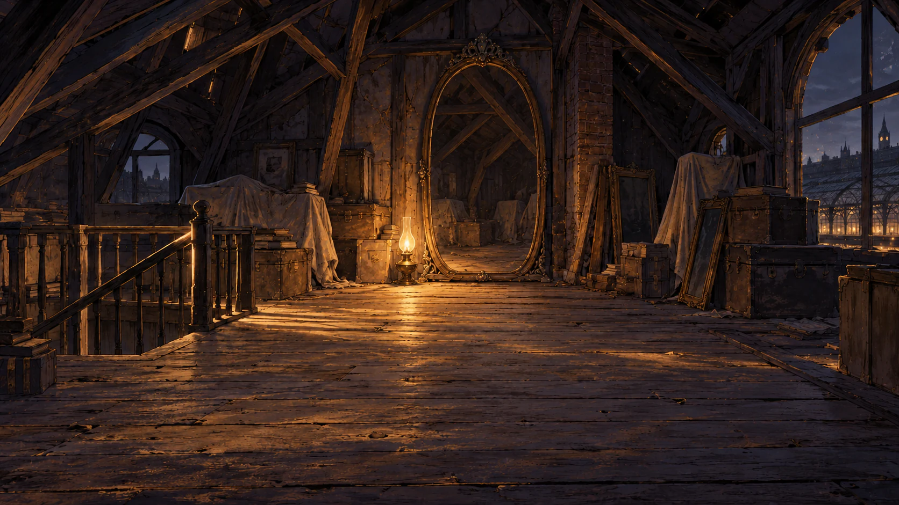
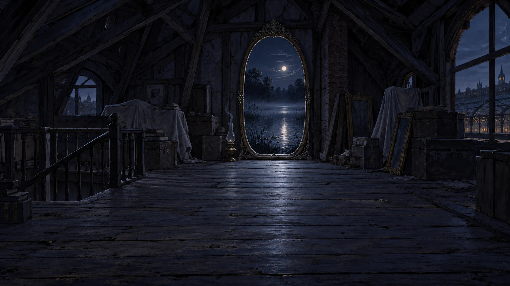

# Attic: lamplight and dark escape

Two matched paintings from the original 1672 × 941 attic composition. The same
rafters, shrouded furniture, stair opening and balustrade, city windows, floor
perspective, and ornate mirror remain in place. One oil lamp stands on the
floor immediately left of the mirror in both states.

| State                                                                                      | Painting                                                |
| ------------------------------------------------------------------------------------------ | ------------------------------------------------------- |
| `attic-lit` — warm refuge; the mirror reflects only the attic                              |                   |
| `attic-doused` — extinguished lamp, smoke and ember; moonlit Black Pond through the mirror |  |

The doused image was edited directly from the finished lit image to keep the
camera, furnishings and lamp consistent. Both full-size WebPs remain exactly
1672 × 941, without cropping or resizing, and stay below 300,000 bytes. The
standard image builder supplies 512 × 288 card variants.

`art-prompts.json` preserves the full prompts and reference chain.
`provenance.json` records the pinned original, generation IDs, original PNG
and output hashes, dimensions and encoding settings. The older paintings and
their provenance remain historical references.

## Integration note

These named assets are published for the new art direction. They are not yet
selected by the scene rules. The current attic-to-pond gate requires lamplight,
and the existing third state reveals cottage stairs with light and cloth.
Activating the new dark-escape direction needs a coordinated rule/story change
and a decision for that third state. The lamp is painted into these images, so
runtime integration should also avoid drawing a second lamp at the same place.
