# Brace pose art

18 transparent full-body portraits for Brace. The eight player characters have matching plain and scarf wardrobes; Pip uses the existing ID `moth`. Every image is 1024 × 1536 WebP, at most 300,000 bytes, with the generated PNG's alpha preserved exactly.

The figures prepare for impact with grounded feet, raised forearms and alert eyes. Ada remains seated in her complete wheelchair with feet supported. Faces, clothing and the painted character style follow the canonical portraits. Scarf variants edit the completed plain guard pose and use the canonical scarf portrait only as a wardrobe reference.

## Integration

The requested **Brace** art maps to the existing **Guard** action and its presentation pose `guard`. Files use `{id}-guard.webp` and `{id}-scarf-guard.webp` beside the attack/hit set from #1592. These assets and their 512 × 768 card variants are registered for delivery; current combat presentation still animates neutral portraits. Runtime pose selection is a separate follow-up.

When integrating, preserve outfit choice and native facing: players face right; Pip and the Keeper face left. Keep the Keeper's Roman clock numerals readable when choosing orientation. Empty hands allow carried items to remain separate. No rules, dialogue, saves, existing attack/hit art, or neutral portraits are changed.

## Files

| File                                           | Character | Wardrobe | Native facing |   Bytes |
| ---------------------------------------------- | --------- | -------- | ------------- | ------: |
| [vale-guard.webp](vale-guard.webp)             | Vale      | plain    | right         | 205,398 |
| [vale-scarf-guard.webp](vale-scarf-guard.webp) | Vale      | scarf    | right         | 202,580 |
| [mara-guard.webp](mara-guard.webp)             | Mara      | plain    | right         | 283,616 |
| [mara-scarf-guard.webp](mara-scarf-guard.webp) | Mara      | scarf    | right         | 278,980 |
| [ash-guard.webp](ash-guard.webp)               | Ash       | plain    | right         | 289,414 |
| [ash-scarf-guard.webp](ash-scarf-guard.webp)   | Ash       | scarf    | right         | 294,654 |
| [nell-guard.webp](nell-guard.webp)             | Nell      | plain    | right         | 293,968 |
| [nell-scarf-guard.webp](nell-scarf-guard.webp) | Nell      | scarf    | right         | 288,104 |
| [tavi-guard.webp](tavi-guard.webp)             | Tavi      | plain    | right         | 298,100 |
| [tavi-scarf-guard.webp](tavi-scarf-guard.webp) | Tavi      | scarf    | right         | 279,626 |
| [rue-guard.webp](rue-guard.webp)               | Rue       | plain    | right         | 212,620 |
| [rue-scarf-guard.webp](rue-scarf-guard.webp)   | Rue       | scarf    | right         | 198,204 |
| [orin-guard.webp](orin-guard.webp)             | Orin      | plain    | right         | 272,386 |
| [orin-scarf-guard.webp](orin-scarf-guard.webp) | Orin      | scarf    | right         | 244,336 |
| [ada-guard.webp](ada-guard.webp)               | Ada       | plain    | right         | 298,544 |
| [ada-scarf-guard.webp](ada-scarf-guard.webp)   | Ada       | scarf    | right         | 296,808 |
| [moth-guard.webp](moth-guard.webp)             | Pip       | plain    | left          | 288,448 |
| [keeper-guard.webp](keeper-guard.webp)         | Keeper    | plain    | left          | 200,914 |

## Player gallery

| Character | Plain brace                                                                              | Scarf brace                                                                                               |
| --------- | ---------------------------------------------------------------------------------------- | --------------------------------------------------------------------------------------------------------- |
| Vale      | 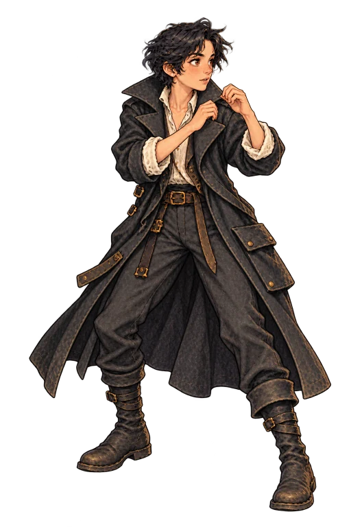 | 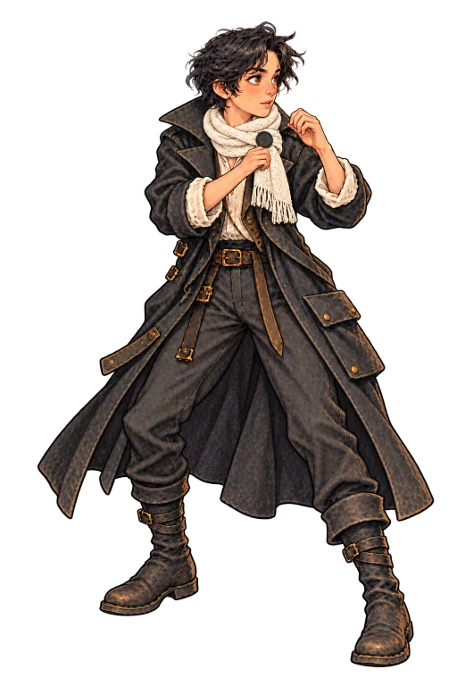 |
| Mara      | 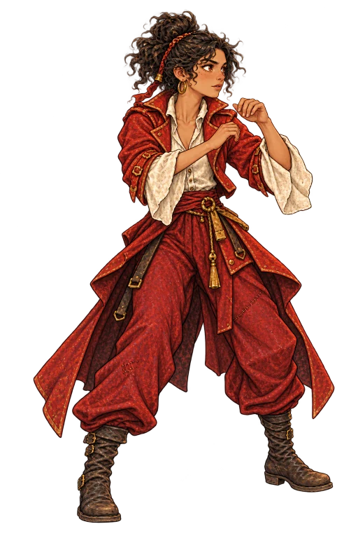 | 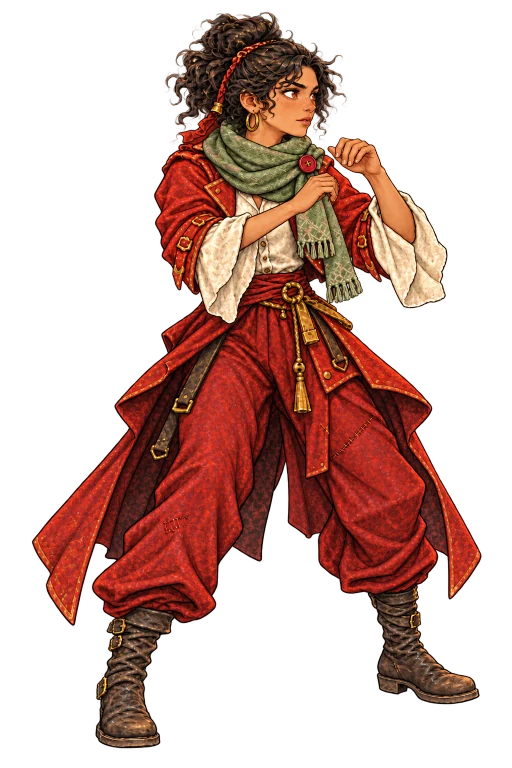 |
| Ash       | 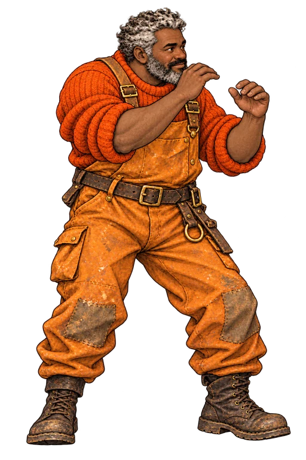   | 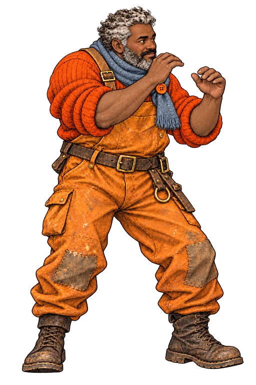   |
| Nell      | 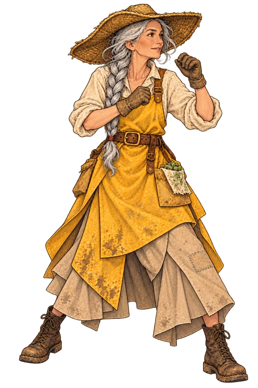 | 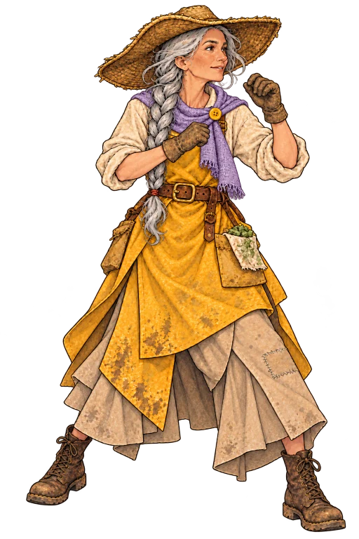 |
| Tavi      | 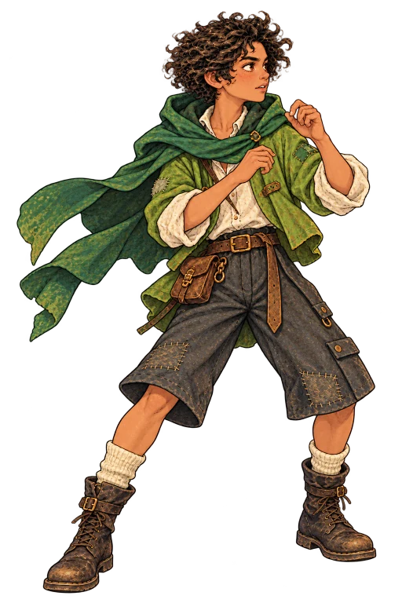 | 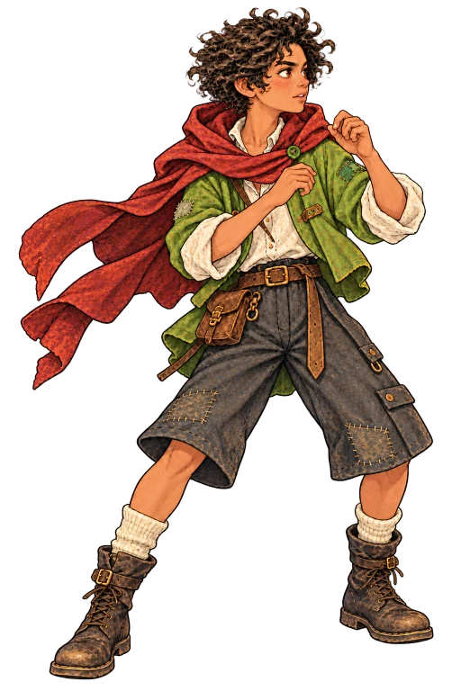 |
| Rue       | 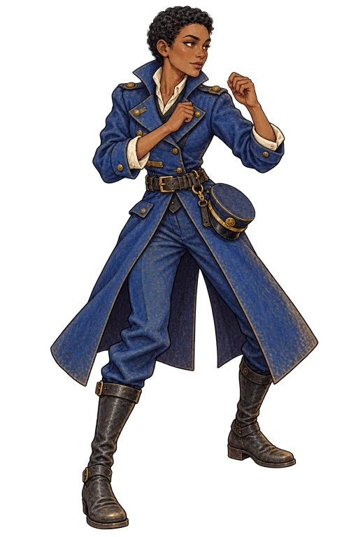   | 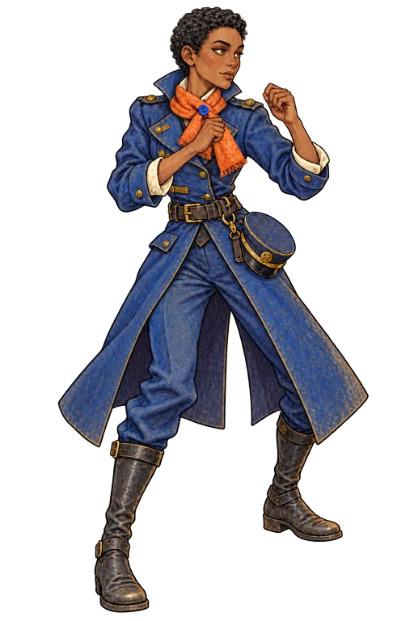   |
| Orin      | 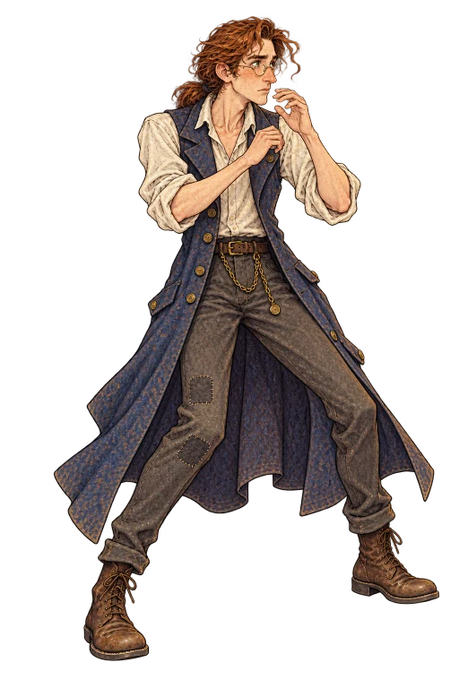 | 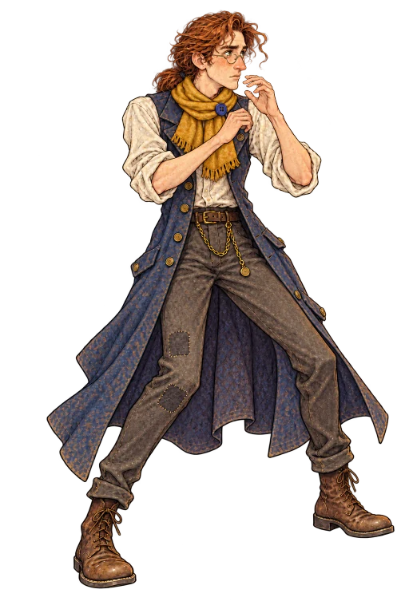 |
| Ada       | 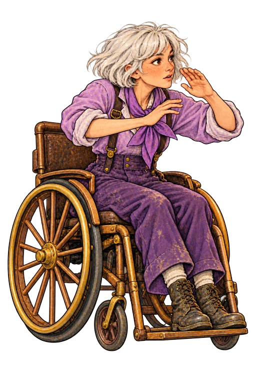   | 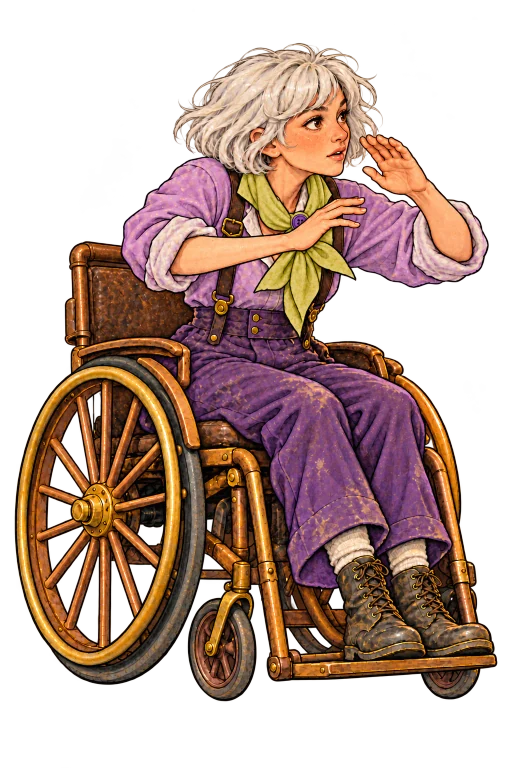   |

| Character | Brace                                                                                        |
| --------- | -------------------------------------------------------------------------------------------- |
| Pip       | 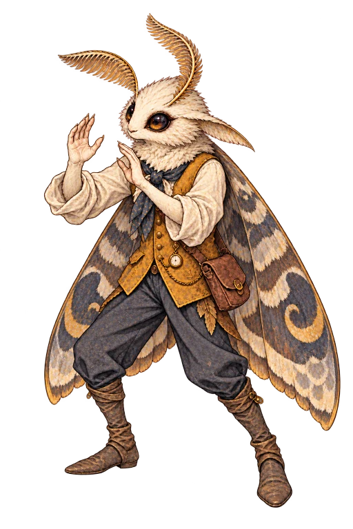      |
| Keeper    | 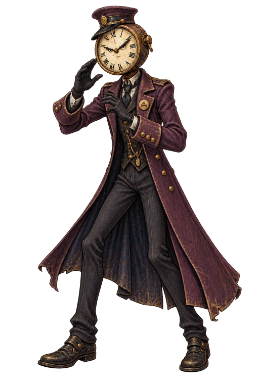 |

## Source and review notes

`guard-art-prompts.json` records complete prompts and pinned identity/wardrobe references. `guard-provenance.json` records generation identifiers, original PNG hashes, output hashes, exact alpha checks, encoder settings and measured silhouette bounds. The official image builder supplies smaller card variants and their hashes.

The generated character interiors are near-opaque (maximum alpha 254), with zero-alpha backgrounds and antialiased edges. A few very faint background residues and tighter-than-requested margins are recorded per image; the figures remain fully inside their canvases. Generated textures and small details are visually matched, not pixel-identical to the canonical portraits. No alpha cleanup, reframing, resizing or creative postprocessing was applied to the source images.
