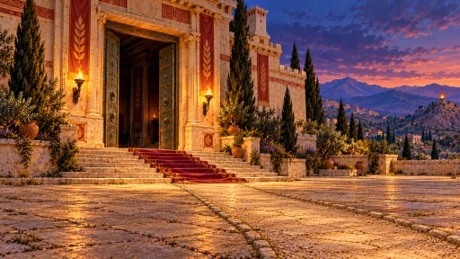
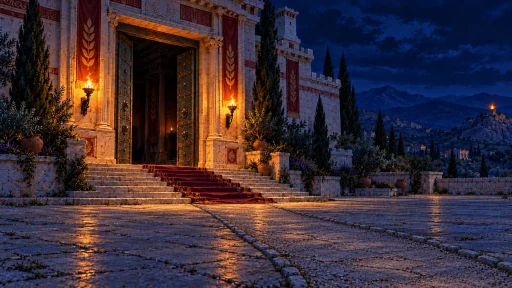
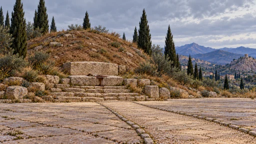
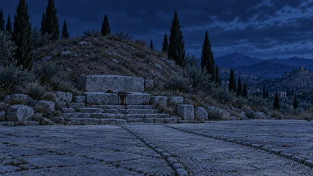
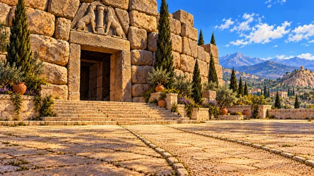
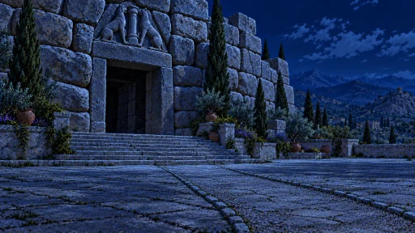
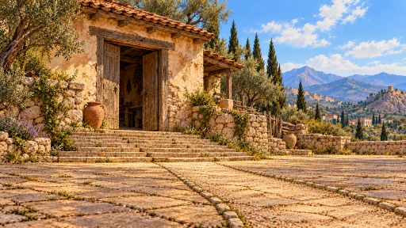
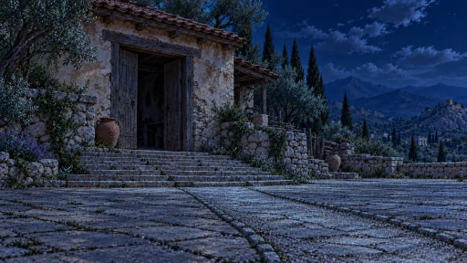
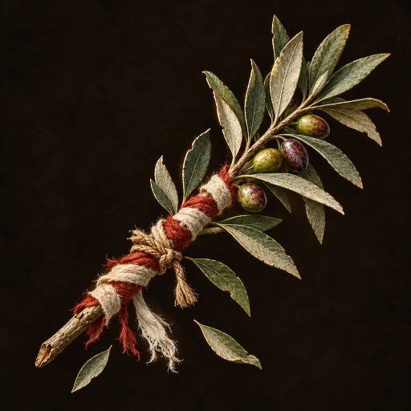

# Argos: the House of Atreus and the suppliant’s branch

9 completed art files from the requested set are included here. The four main House paintings tell the homecoming, the grave, the Lion Gate and the exile’s cottage through a shared camera and approach. Their night versions follow the corresponding main painting.

## Shared composition

The palace master establishes the doorway left of centre, an explicit pale path entering from the lower right, the same ground perspective, and the Argive hills behind a low plain horizon. Approximate master anchors are threshold (517,541), path-to-steps connection (765,667), lower-right path direction (1450,941), and the far beacon (1608,351). Each alternate edits the accepted master; each night image edits its own accepted main image. The building, account-specific objects and lighting change while the approach and viewpoint remain visually matched.

All backdrops are opaque 1672 × 941 WebPs below 300,000 bytes. The official builder supplies 512 × 288 card variants. Fine paint texture may differ between generated edits; these are complete reference-matched paintings, not pixel-identical composited layers.

| Telling                         | Main light     | Main painting                                                                                                          | Night                                                                                                                                 |
| ------------------------------- | -------------- | ---------------------------------------------------------------------------------------------------------------------- | ------------------------------------------------------------------------------------------------------------------------------------- |
| Aeschylus — the homecoming      | Dusk           |        |        |
| Libation Bearers — the grave    | Grey morning   |            |            |
| Sophocles — the Lion Gate       | Hard noon      |      |      |
| Euripides — the exile’s cottage | Plain daylight |  |  |

## Suppliant’s Olive Branch

The worn olive bough has white and red wool, a cord knot and two falling leaves on a transparent background. Its 1254 × 1254 square canvas matches the existing Greek item set; the card variant is 512 × 512 and the phone version is 960 × 960. All three preserve the cutout so the temple floor remains visible around it.

The November 1 correction removes the former painted dark rectangle with the built-in image tool. The source and both smaller variants are rebuilt together. A regression checks real background transparency at every delivered size, and the image builder now invalidates an old phone version when its source changes.

## Files

| File                                                                   | Dimensions  |   Bytes |
| ---------------------------------------------------------------------- | ----------- | ------: |
| [house-atreus-palace.webp](house-atreus-palace.webp)                   | 1672 × 941  | 299,118 |
| [house-atreus-tomb.webp](house-atreus-tomb.webp)                       | 1672 × 941  | 298,120 |
| [house-atreus-mycenae.webp](house-atreus-mycenae.webp)                 | 1672 × 941  | 299,998 |
| [house-atreus-farmhouse.webp](house-atreus-farmhouse.webp)             | 1672 × 941  | 299,798 |
| [house-atreus-palace-night.webp](house-atreus-palace-night.webp)       | 1672 × 941  | 294,804 |
| [house-atreus-tomb-night.webp](house-atreus-tomb-night.webp)           | 1672 × 941  | 293,354 |
| [house-atreus-mycenae-night.webp](house-atreus-mycenae-night.webp)     | 1672 × 941  | 289,214 |
| [house-atreus-farmhouse-night.webp](house-atreus-farmhouse-night.webp) | 1672 × 941  | 290,848 |
| [olive-branch.webp](olive-branch.webp)                                 | 1254 × 1254 | 299,518 |

## Integration and provenance

These are art assets for the approved small-worlds design in #1622 and the eight-painting brief in #1631. Account/state-based selection and content folding belong to that pilot; this PR publishes and registers the images without changing rules or alternate selection. Preserve the existing backdrop where no alternate applies.

The stable item `greek-olive-branch`, currently named The Herald’s Truce, already uses `olive-branch.webp`. The floor props render its card variant directly. This correction keeps that item and asset path unchanged.

`argos-art-prompts.json` and `argos-art-provenance.json` record exact prompts, canonical references, composition references, generation IDs, full correction histories, original PNG hashes, output hashes and encoder settings. Source canvases were encoded without cropping, resizing or creative postprocessing.

The original opaque olive painting, prompt and hashes remain in the provenance revision history. The current correction record describes its transparent replacement.
