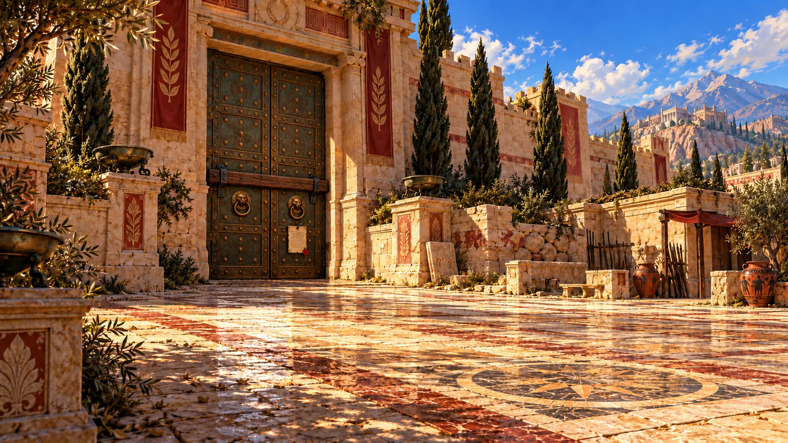
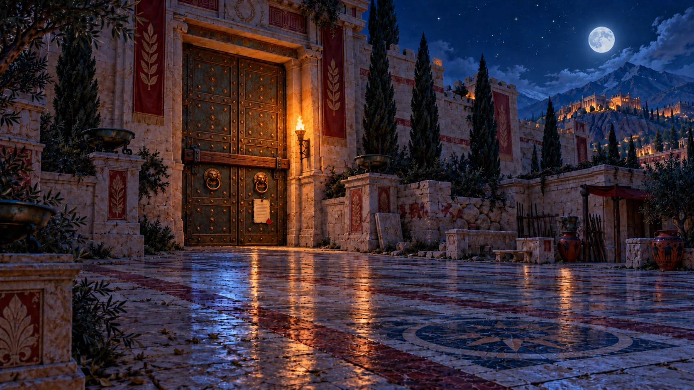

# Closed Theban City Gate

Matched paintings for the `greek-gate` place when its state is `closed`.
Both bronze-studded leaves are shut and barred. The lion-head handles remain
visible, and a small sealed decree hangs below the right ring handle at adult
eye height. The Gate Guard belongs in a separate character sprite.

| Place        | State    | Period  | Asset                         |
| ------------ | -------- | ------- | ----------------------------- |
| `greek-gate` | `closed` | `day`   | `city-gate-closed-day.webp`   |
| `greek-gate` | `closed` | `night` | `city-gate-closed-night.webp` |

## Day

## Night

The night painting keeps the original moon and distant city lights. Every
courtyard brazier remains in place, unlit; one bracket torch lights the doors.

## Wiring handoff

The user will select these assets in the separate gate and passes work.
`scene.mjs` sends the selected backdrop through `daylightBackdrop` in
`daylight.mjs`. Its current `nightBackdrops["greek-gate"]` override selects
`city-gate-night.webp`. The closed state must also select
`city-gate-closed-night.webp` there; selecting the closed day image alone would
show the open gate at night. Use the existing day and night paintings for the
open state.

## Sources and encoding

The source paintings are `city-gate-day.webp` and `city-gate-night.webp`.
[Art prompts](city-gate-closed-art-prompts.json) and
[provenance](city-gate-closed-provenance.json) record the complete initial and
correction prompts, generation IDs, checksums, and actual edit-target lineage.
The decree correction preserves the scene visually; measured texture changes
outside the notice are recorded in provenance.

Both source WebPs preserve the full 1672 × 941 opaque canvas and stay below
300,000 bytes. The official image builder produces the smaller card variants.
