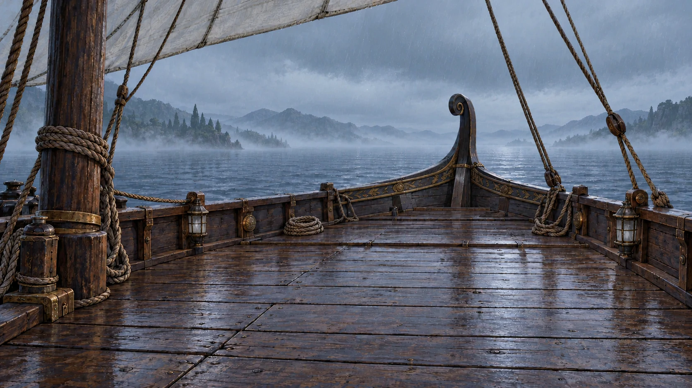
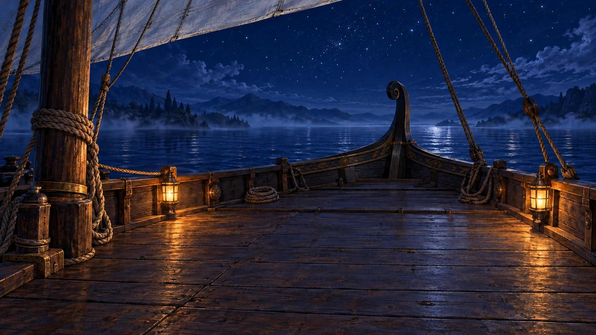
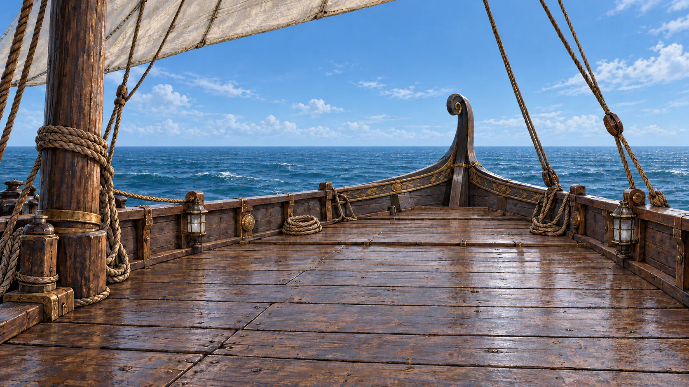
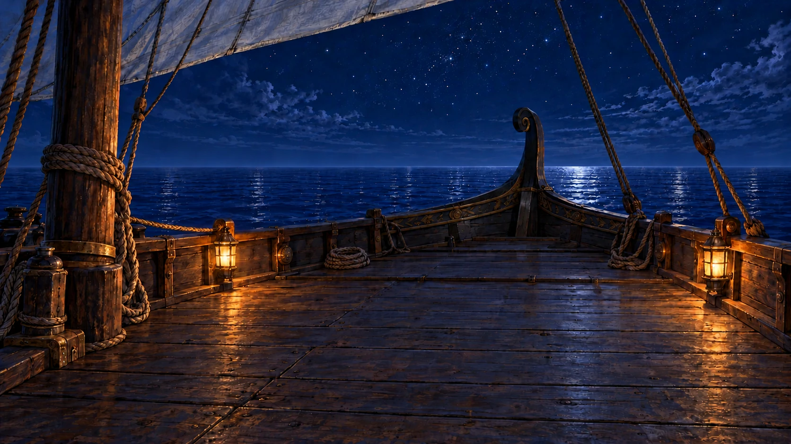

# Coastal and open-sea ship paintings

The daytime ship deck now shows fine rain, sea mist and wet wooden planks under
soft overcast light. The mast, sail, rigging, curled prow, rope coils, lantern
housings and distant coast keep the established composition. Two new open-sea
paintings retain that ship and camera while removing all land. Every painting
uses the full 1672 × 941 canvas.

| Period        | File                          | Treatment                                                 |
| ------------- | ----------------------------- | --------------------------------------------------------- |
| Day           | `ship-deck.webp`              | New rainy, misty daylight painting; lanterns unlit.       |
| Night         | `ship-deck-night.webp`        | The existing coastal night painting, preserved unchanged. |
| Twilight      | `ship-deck-twilight.webp`     | The former default painting, preserved byte for byte.     |
| At sea, day   | `ship-deck-at-sea-day.webp`   | Clear open water, natural daylight and unlit lanterns.    |
| At sea, night | `ship-deck-at-sea-night.webp` | Open water under an indigo sky; two warm lanterns.        |

## Day

## Night

## At sea, day

## At sea, night

The open-sea pair has no land, fixed rain, mist, fog bank, visible moon or
forward wake. The game can apply its saved weather independently. The rainy
coastal day painting follows the earlier explicit weather brief.

## Source and integration

The daylight painting is an identity-preserving lighting and weather edit of
the previous darker `ship-deck-night.webp`. Its camera and scene geometry match
visually; generation changes painted surface textures, so it is not a
pixel-identical transformation. The full prompt, generation ID, reference
hashes and encoding settings are in
[the provenance record](ship-deck-daylight-provenance.json).

The accepted [ship plan](https://github.com/cenetex/cosyworld/pull/1613) keeps
the existing coastal night painting and gives the former default its own
twilight filename. The earlier generation records remain in the provenance
history, including their original hashes and prompts.

The existing `greek-ship` day/night selection uses these same filenames. This
asset update does not change weather conditions, travel rules, dialogue or
the release version. The official image builder supplies the 512 × 288 card
variants, and the media manifest records the new source and variant hashes.

## Layer proof and production choice

One night-foreground extraction and one opacity correction were reviewed on
white, black, checker and ocean backings at full size and at desktop/phone
crops. Solid wood and sail retained slight transparency and changed painted
detail. The proof was rejected as a reusable production foreground.

These exports use the plan's complete-painting fallback. They preserve the
ship geometry visually, with small generated texture differences. The sea
day/night horizons are within approximately two pixels after one night
alignment correction. The full prompts, reference hashes, measurements and
rejected-proof records are in
[open-sea provenance](ship-deck-at-sea-provenance.json).

The clean [night ocean plate](ship-deck-sources/environment-at-sea-night.png)
is retained as an authoring reference for later layer work. It is not a runtime
image, and the rejected foregrounds are not supplied as approved masters.

## Selector handoff

The open-sea paintings are published assets. Selecting them by voyage phase
is a separate follow-up; this art PR does not change the current selectors.

| Saved phase                   | Day                         | Night                         |
| ----------------------------- | --------------------------- | ----------------------------- |
| `docked`, `course`, `arrived` | `ship-deck.webp`            | `ship-deck-night.webp`        |
| `sea`                         | `ship-deck-at-sea-day.webp` | `ship-deck-at-sea-night.webp` |

Resolve `shipAtSea(world, "greek-ship")` and day/night together. The generic
night override must not replace the sea-night choice with coastal night art.
Keep the exterior portrait `ship-card.webp` separate: a generic location
overlay also reaches place cards and must not draw this onboard deck over
the exterior portrait. Preserve the saved weather cycle and conditional
Willows dark-mist crossing. Verify the four phases in both light states and
save reload at sea without changing voyage timing or legality.
