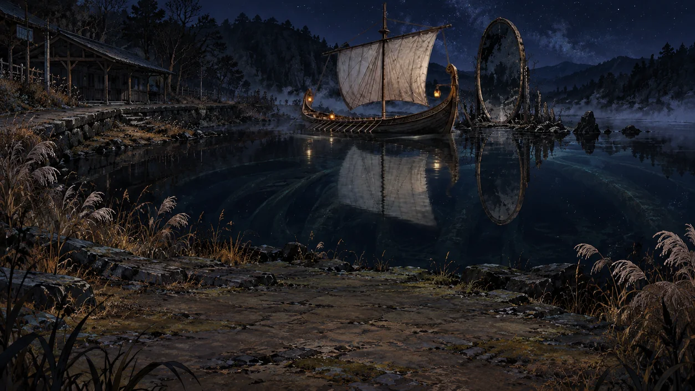

# Black Pond ship layers

The approved exterior ship is separated into three registered layers. Its hull,
mast, sail, rigging and attached lanterns form one rigid piece. Reflected light
and the small water-contact strokes can move independently on the pond.



## Files and registration

The original canvas is **1672 × 940**, including its one-pixel difference from
the newer 1672 × 941 location paintings. The clean environment is the existing
[`assets/pond.png`](../../pond.png). It already contains no boat or boat
reflection. `assets/shared/places/pond.png` is a different painting and must not
be substituted underneath these layers.

| Back-to-front order | File | Crop size | Position in original canvas |
| --- | --- | --- | --- |
| Reflection | [pond-ship-reflection.webp](pond-ship-reflection.webp) | 429 × 306 | 697, 296 |
| Water contact | [pond-ship-contact.webp](pond-ship-contact.webp) | 612 × 366 | 568, 171 |
| Rigid ship | [pond-ship-body.webp](pond-ship-body.webp) | 461 × 329 | 689, 0 |

The contact layer sits behind the hull, so its quiet ripples meet the waterline
without painting across the wood. Its conservative crop retains faint generated
edge pixels around the much smaller visible ripple.

[`recipe.json`](recipe.json) records all offsets, sizes, hashes, order and
pivots. The reference waterline is y = 319. The ship pivot is (920, 319) in the
full canvas and (231, 319) in the cropped body. Each layer also records its
crop-relative pivot. Place cropped files inside the same art frame as the Pond;
giving each crop its own `object-fit: cover` would enlarge it incorrectly.

[`pond-ship-still.webp`](pond-ship-still.webp) bakes these layers into one
transparent full-canvas overlay. It can serve a static or reduced-motion view.
The existing game continues to select `pond-ship-overlay.png`; this pack
publishes the new art and recipe without adding a bobbing controller.

## Build and check

```sh
npm run v2:card:ship-art:build
npm run v2:card:ship-art:check
npm run v2:card:images:build
npm run v2:card:assets:build
```

[`layout.json`](layout.json) is the authored input. The intact generated PNGs in
`sources/` are build inputs, not public runtime images. The builder checks their
hashes and dimensions, extracts the declared rectangles, preserves every alpha
value inside them, and encodes WebP at quality 88. Crops may omit only outer
padding whose alpha is at most 1/255; they never threshold pixels inside the
retained image. The source masters retain that original padding.

The check uses committed WebP hashes and verifies their dimensions and alpha
against the masters, including the composed still. It does not require another
platform's encoder to produce identical compressed bytes. All four exported
WebPs are below 300,000 bytes. Prompts, generation IDs, references, the contact
revision and processing are in [art-prompts.json](art-prompts.json) and
[provenance.json](provenance.json). The baked still has no new generation ID.

## Decoded memory and motion handoff

The three crops total **2,027,740 RGBA bytes** (about 1.93 MiB), compared with
**18,860,160 bytes** (about 17.99 MiB) for three full-canvas layers: **89.2% fewer
raw pixels**. One full-canvas overlay is 6,286,720 bytes. These are pixel-storage
estimates, excluding browser/GPU overhead; the current static renderer has not
changed its resident memory use.

Use either the baked still or the moving layers. Keeping both, all authoring
masters and several scene states decoded would waste the benefit. Bake groups
that stay still relative to each other, retain independent moving pieces, and
release a departing scene after its crossfade finishes. Existing card/phone
variants continue to come from the standard image builder.

For a shore camera, keep the environment fixed, move the rigid ship gently and
give the reflected light a quieter water-bound movement. Keep the water-contact
strokes near the reference waterline. The mast already approaches the top of
the painting, so start with roughly ±3 source pixels of heave and 0.2° roll,
then inspect the extremes. Keep animation on a wrapper separate from the
existing fade controller, which cancels animations on its target. Interface
cards remain steady, and reduced motion uses the still.

This exterior does not supply an onboard foreground or a universal boat for
other docks: those paintings have different cameras. Their current approved
paintings remain the references for a later extraction.
