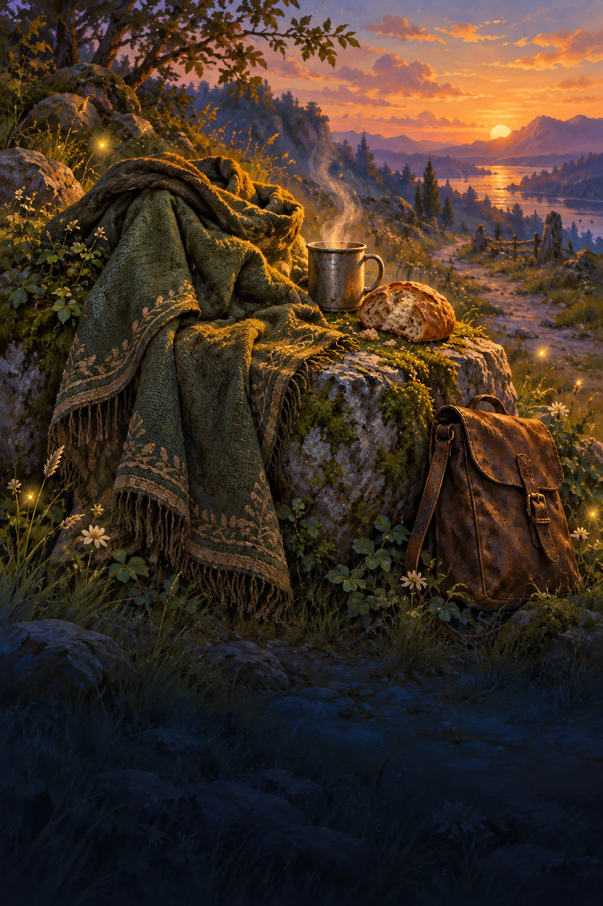
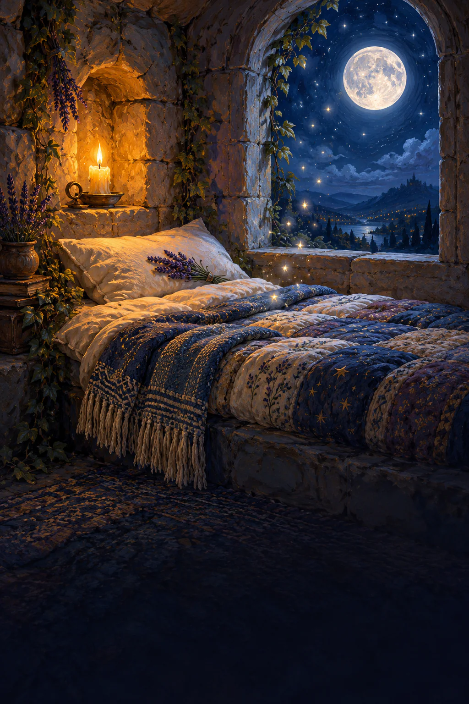

# Short Rest and Long Rest paintings

Two finished paintings for the art briefs in [issue #1849](https://github.com/cenetex/cosyworld/issues/1849).

| Card | Painting | Scene |
| --- | --- | --- |
| Short Rest | [short-rest.webp](short-rest.webp) | An empty travel cloak on a mossy roadside stone at dusk, steaming tin cup, bread, satchel and fireflies. |
| Long Rest | [long-rest.webp](long-rest.webp) | An empty sanctuary bedroll in a stone alcove, wool blanket, one candle, moonlit arched window, lavender and star motes. |

Both are opaque, full-bleed 1024 × 1536 WebP paintings. Their lower quarter stays dark and quiet for UI text. No lettering, people, border or card controls are painted into the images.

## Short Rest

## Long Rest

## Art handoff

These paintings supply the art portion of #1849. The earning rules, sanctuary restriction, haiku flip, card borders and rest actions belong to its gameplay implementation. Current main still uses the older Wait-based rest system.

The artwork is shared across world packs. Keep the future card title, amber or silver edge, disabled state and haiku in the presentation layer. Use the full 2:3 composition without cropping; the cup, bread, lavender and pillow remain above the dark caption area.

Generation used the built-in image tool. [prompts.json](prompts.json) preserves the full prompts. [provenance.json](provenance.json) records original and encoded hashes, dimensions and encoding settings. Original PNGs are represented by their hashes; the committed WebPs preserve the complete composition without resizing or creative changes.

## Delivery status

Source paintings are complete. Public registration, smaller variants and the final validation record are being prepared on this branch.
