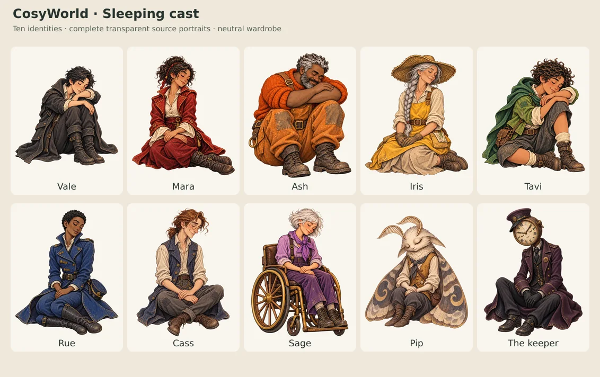
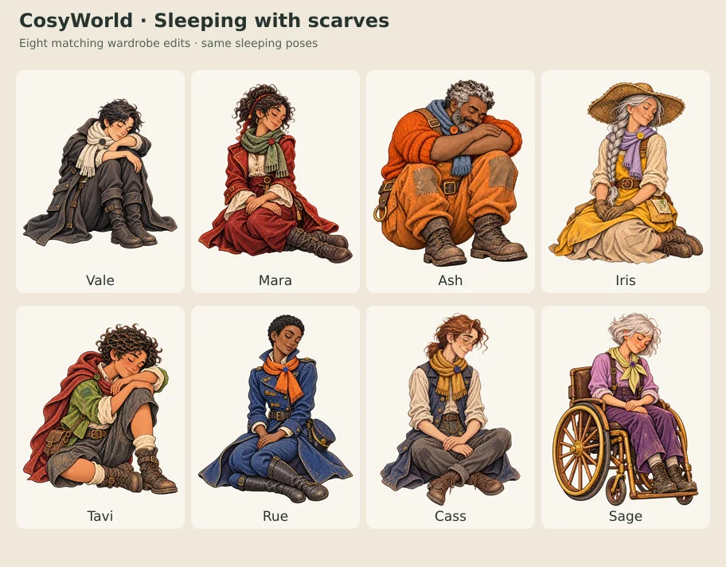

# Sleeping cast

Eighteen transparent paintings show the ten main characters peacefully asleep.
Each of the eight shared travelers has a neutral outfit and a matching version
with their own scarf. Pip and the keeper each have one sleeping pose.

The full prompts and reference chains are in [art-prompts.json](art-prompts.json).
[provenance.json](provenance.json) records generation IDs, source and reference
hashes, encoding, registration and alpha checks for every painting.

## Neutral wardrobe

## With their own scarves

These labelled contact sheets are review files, not public game assets. Their
subjects are cropped and fitted into tiles for comparison; the source portraits
keep their complete registered canvases.

## Cast and files

Human portraits live in `../shared/characters/`. The stable IDs remain unchanged
for saved worlds; Iris, Cass and Sage still use `nell`, `orin` and `ada` in paths.

| Character | Stable ID | Neutral portrait | Scarf portrait |
| --- | --- | --- | --- |
| Vale | `vale` | [vale-sleeping.webp](../shared/characters/vale-sleeping.webp) | [vale-sleeping-scarf.webp](../shared/characters/vale-sleeping-scarf.webp) |
| Mara | `mara` | [mara-sleeping.webp](../shared/characters/mara-sleeping.webp) | [mara-sleeping-scarf.webp](../shared/characters/mara-sleeping-scarf.webp) |
| Ash | `ash` | [ash-sleeping.webp](../shared/characters/ash-sleeping.webp) | [ash-sleeping-scarf.webp](../shared/characters/ash-sleeping-scarf.webp) |
| Iris | `nell` | [nell-sleeping.webp](../shared/characters/nell-sleeping.webp) | [nell-sleeping-scarf.webp](../shared/characters/nell-sleeping-scarf.webp) |
| Tavi | `tavi` | [tavi-sleeping.webp](../shared/characters/tavi-sleeping.webp) | [tavi-sleeping-scarf.webp](../shared/characters/tavi-sleeping-scarf.webp) |
| Rue | `rue` | [rue-sleeping.webp](../shared/characters/rue-sleeping.webp) | [rue-sleeping-scarf.webp](../shared/characters/rue-sleeping-scarf.webp) |
| Cass | `orin` | [orin-sleeping.webp](../shared/characters/orin-sleeping.webp) | [orin-sleeping-scarf.webp](../shared/characters/orin-sleeping-scarf.webp) |
| Sage | `ada` | [ada-sleeping.webp](../shared/characters/ada-sleeping.webp) | [ada-sleeping-scarf.webp](../shared/characters/ada-sleeping-scarf.webp) |
| Pip | `moth` | [moth-sleeping.webp](moth-sleeping.webp) | — |
| The keeper | `keeper` | [keeper-sleeping.webp](keeper-sleeping.webp) | — |

Sage remains in her approved hand-powered chair. The keeper's clock retains its
authored dial orientation: the renderer must never mirror this painting.
Characters have empty hands so the paintings do not imply possession of a quest
item. Existing costume details and identity equipment remain part of each figure.

## Selection in the game

[`sleep-portraits.mjs`](../../sleep-portraits.mjs) selects these paintings only
when the actor's committed `sleepUntil` field exists. The eight human travelers
retain the wardrobe selected by the existing scarf system: a saved scarf upgrade,
or their own scarf currently held in an older world. The selector does not infer
sleep from a Wait action, darkness or a resting dialogue beat.

Shared play can keep an actor asleep while other players advance the world, so
the sleeping pose can remain visible. Solo long rest advances directly through
sleep to waking within the same action; it does not leave a persistent sleeping
stage after that action completes.

Pip and the keeper have prepared art for an explicit sleeping state. This pack
does not add autonomous NPC sleeping behavior or change rest, lamp fuel, time,
inventory or quest rules. Badger's existing sleeping painting remains separate.

## Source contract and review

- Every source is a complete **1024 × 1536 transparent WebP**, at most
  **300,000 bytes**. The existing image builder supplies card and phone variants.
- All new poses preserve the approved faces, clothing and painterly treatment.
  Scarf paintings are edits of the corresponding sleeping neutral, using the
  existing scarf portrait as the wardrobe reference.
- Source canvases retain their padding and native facing. Visible alpha bounds
  are recorded per image; there is no claim of one common silhouette.
- Seventeen encoded WebPs retain their generated PNG alpha byte for byte. Vale's
  scarf edit required a **160-pixel downward canvas translation** to align with
  its neutral pose. Its alpha is exact after that registration, not equal to the
  untranslated raw array. The discarded bottom padding contained only twenty
  alpha-1 pixels; no visible paint was clipped. This mechanical registration has
  no separate generation ID.
- The generated alpha reaches 254, with very faint edge pixels retained. No
  thresholding, masking or opacity repair was applied.
- Review covered the complete figures, closed eyes, scarf colours and buttons,
  Sage's chair and open wheel spokes, Pip's antennae and folded wings, and the
  keeper's dial on light and dark backings. The scarf pairs preserve pose and
  framing visually; the generated surface paint is not pixel identical.

These review previews and metadata are not registered as public game assets.
Runtime memory depends on which source or optimized variants the active scene
decodes; publishing eighteen poses does not mean loading all eighteen at once.
