# Willows signs and the Traveller's Notebook

The owner's final fifteen-target brief is complete: nine required scenery
paintings, the optional hollows painting, and five notebook PNGs. Every scene
edits its named existing place. The original camera, horizon, shore landmarks
and painterly treatment remain visually matched. Fine texture can differ
between generated edits; these are complete paintings, not pixel-identical
composited layers.

## Place paintings

All ten are opaque **1672 × 941 WebPs**, each below **300,000 bytes**. There was
no crop, resize or creative postprocessing after generation. The official image
builder supplies 512 × 288 card variants.

| File                                               | Exact composition base                                        | Lighting and change                                                                    | Preview                                                                                                     |
| -------------------------------------------------- | ------------------------------------------------------------- | -------------------------------------------------------------------------------------- | ----------------------------------------------------------------------------------------------------------- |
| [landing-otter.webp](landing-otter.webp)           | `landing.webp`                                                | Existing low sun; a wet black otter rolls in the current with one yellow eye           |         |
| [landing-boatman.webp](landing-boatman.webp)       | `landing.webp`                                                | Existing sunset; a distant man crosses himself from a flat boat                        | 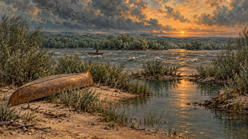           |
| [landing-mended.webp](landing-mended.webp)         | `landing.webp`                                                | Existing sunset; repaired canoe upright, paddle, rope and folded sheet                 | 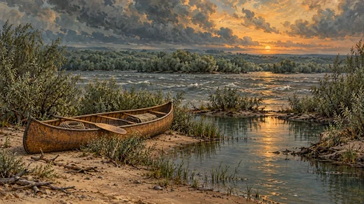               |
| [camp-closer.webp](camp-closer.webp)               | `camp.webp`, with `camp-lit-night.webp` as lighting reference | Night; willow ring nearer, campfire remains lit                                        | 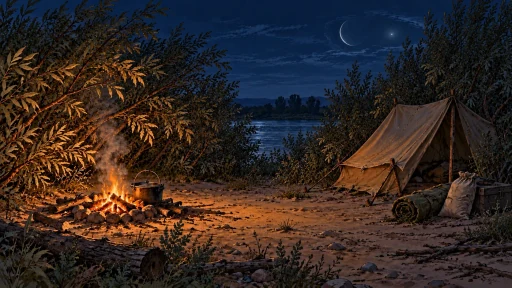       |
| [camp-tent-pressure.webp](camp-tent-pressure.webp) | `camp-lit-night.webp`                                         | Same lit night; canvas pressed inward, faint wet patter marks                          | 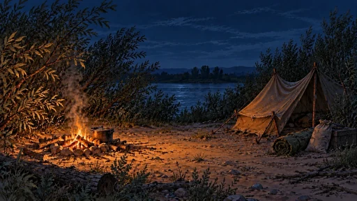   |
| [thicket-bronze.webp](thicket-bronze.webp)         | `thicket-night.webp`                                          | Cool night; dim fluid bronze forms ascend through the willow tops                      | 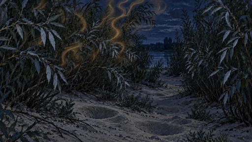              |
| [thicket-hollows.webp](thicket-hollows.webp)       | `thicket.webp`                                                | Existing evening light; additional smooth sand hollows; optional target supplied       | 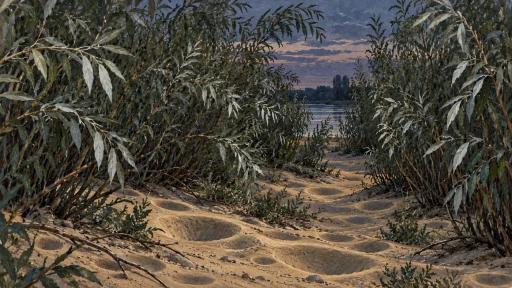              |
| [bank-humming.webp](bank-humming.webp)             | `bank.webp`                                                   | Existing dusk; faint distant shimmer and still water near the bank                     | 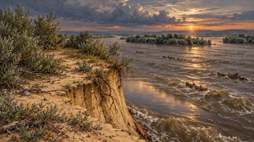 |
| [bank-roots.webp](bank-roots.webp)                 | `bank.webp`                                                   | Existing dusk; partial pale shape caught beneath the roots                             | 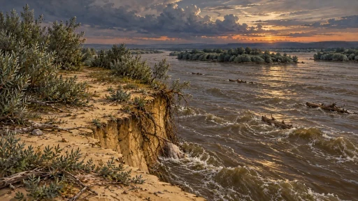     |
| [bank-drowned.webp](bank-drowned.webp)             | `bank-night.webp`                                             | Existing night; a face-up drowned man with smooth hollow marks, without graphic injury | 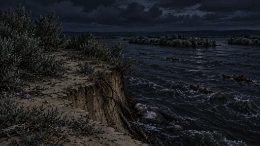 |

The campfire and portable lamp are separate. The camp paintings retain the
fixed lit fire and do not paint in a portable lamp. `camp-closer` follows the
owner's `camp (night)` direction: its geometry comes from `camp.webp`, including
that source's crescent, while its night exposure follows `camp-lit-night`.

## Notebook cards

All five source files are **1254 × 1254 transparent PNGs**, copied byte-for-byte
from the generated originals. The official builder preserves alpha in the
optimized stage and 512 × 512 card variants. `map.png` supplied the paper and
item style; `sheet.png` and `rope.png` supplied oilcloth and flax references.
Pages two and three edit the first finished page to keep a coherent family.

| File                                         | Distinguishing detail                                  | Preview                                                                                                     |
| -------------------------------------------- | ------------------------------------------------------ | ----------------------------------------------------------------------------------------------------------- |
| [notebook-page-1.png](notebook-page-1.png)   | Canoe on a sand spit, graphite field notes             | 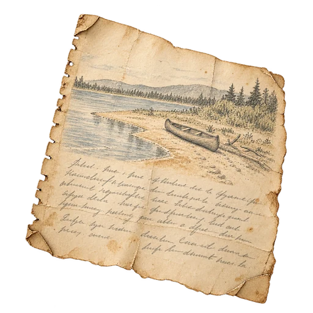        |
| [notebook-page-2.png](notebook-page-2.png)   | Willow tops against the sky, matching paper and pencil | 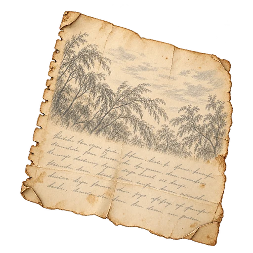       |
| [notebook-page-3.png](notebook-page-3.png)   | Round hollows in sand, matching paper and pencil       | 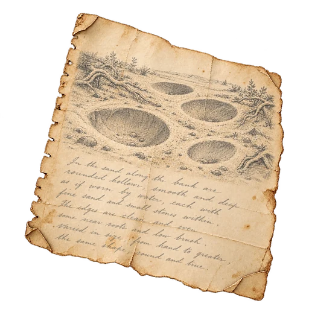      |
| [notebook-chapter.png](notebook-chapter.png) | Three leaves stitched with thread, river-damp edges    | 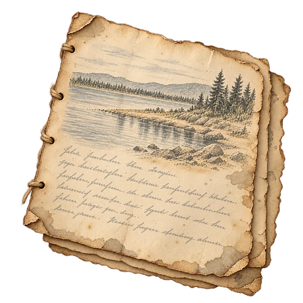 |
| [notebook-book.png](notebook-book.png)       | Closed worn oilcloth field notebook tied with string   | 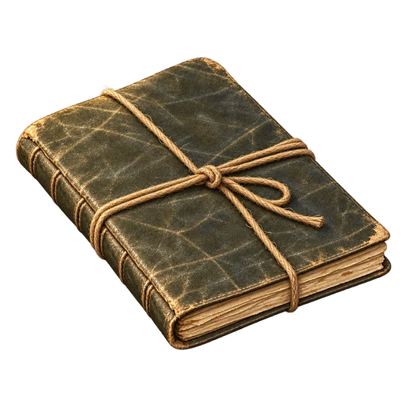         |

Pencil handwriting is illustrated surface texture. Readable canonical passages,
titles and assembly progress belong to the notebook content/UI.

## Integration and provenance

This art change registers the files and optimized variants. It does not add
Observe events, repair receipts, notebook assembly rules or display timers.
The Observe owner in [#1640](https://github.com/cenetex/cosyworld/pull/1640)
specifies that each sign painting holds while it is that place's newest sign;
there is no fixed six-second return. At `fca8307c`, the PR implements Observe
selection but does not yet implement that artwork selector. The owner kept the
willow thicket as a live road between camp and bank (2026-11-01), so its two
signs, the hollows and the bronze shapes, are Observed at the thicket and their
paintings are thicket `backdrops`. The later steps gate the mended canoe on the
kit at camp and give passing otter/boatman appearances seeded per-turn windows.
Those are content-owner integration tasks, not shipped behavior of this asset
PR. An unavailable alternate must retain its place's base painting and never
block play.

The owner's exact prompts and the state/timing handoff are in
`v2/content/willows/ART-BRIEF.md` and `ART-HANDOFF.md`. The four interim paintings
remain available: `thicket-uncanny`, `camp-uncanny`, `camp-dark-night` and
`bank-uncanny`; no substitute should silently change the scene's lighting.

### Framing handoff

Desktop and 390 × 844 stage checks preserve the full source compositions.
The otter and boatman were revised by moving only the added river subjects
within the existing narrow crop. The final subjects are visible beside Vale.
The other low scene details still need presentation work in the owner pilot:

- Camp's tent-pressure detail needs the same 82% horizontal focus on both the
  base and alternate, so the crossfade does not pan the scene.
- Roots, the drowned figure and many sand hollows sit beneath the player or
  card dock on a narrow phone. The drowned face also intersects Vale on desktop.
- The mended canoe's paddle and folded sheet are partly visible on a phone;
  its rope and full hull need a suitable reveal. Do not move the shore or crop
  the source painting to solve these stage-layout constraints.

All five notebook cards were checked in the real card layout. The thicket
paintings show while the player stands in the thicket, like any place.

[Initial and accepted revision prompts](sign-art-prompts.json) and
[provenance and file checks](sign-art-provenance.json) record the built-in tool,
generation IDs, source-reference hashes, original PNG hashes, output hashes and
encoding settings. Scene originals were encoded to WebP only; item originals
retain their generated RGBA data exactly.
