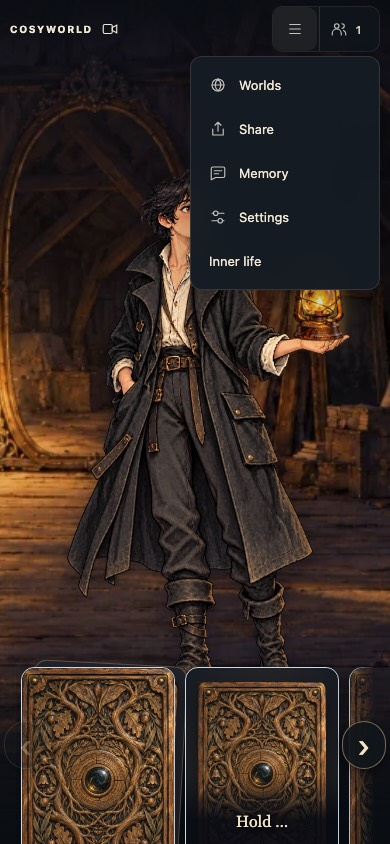
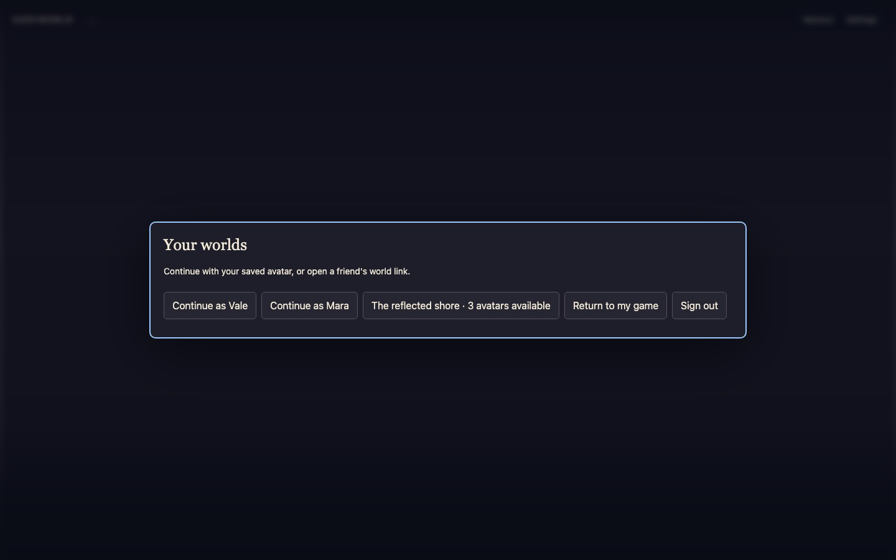
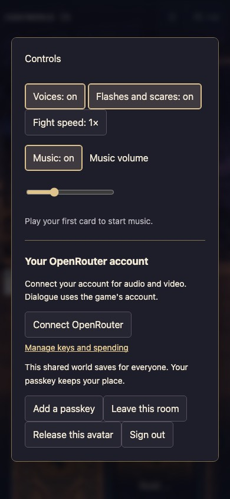
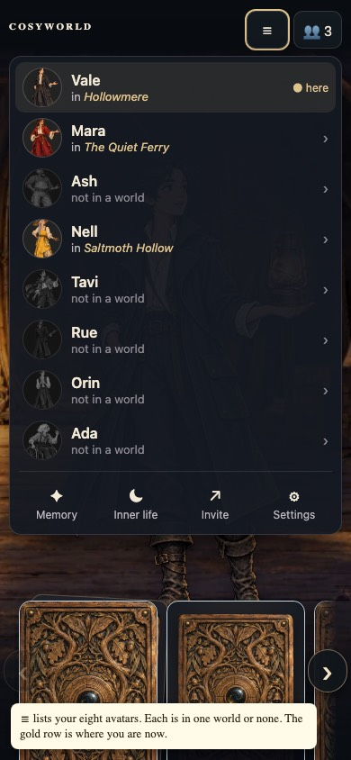
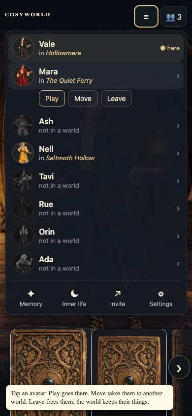
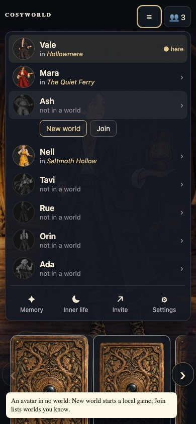
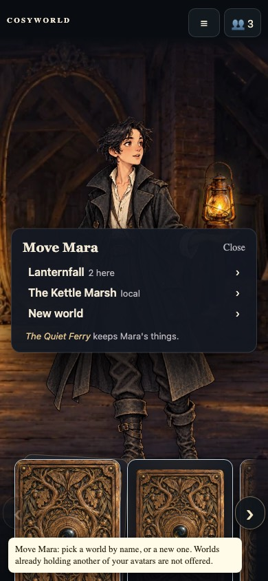
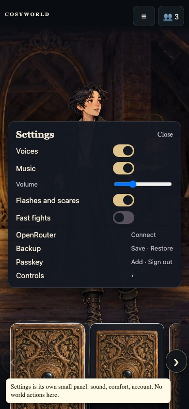
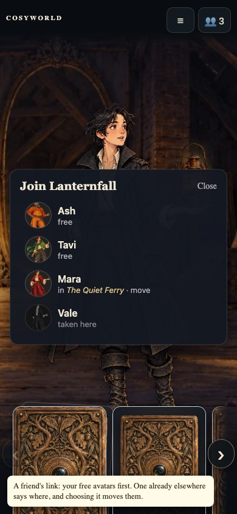
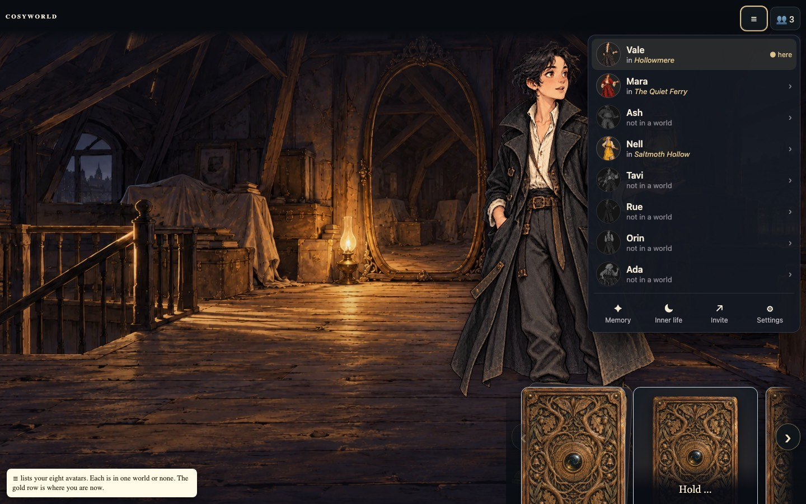

# Avatar menu and world names

Design for [#1737](https://github.com/cenetex/cosyworld/issues/1737). The menu
is organised around the player's avatars. Every world has a name.

## Today

| Screen | What the player sees |
| --- | --- |
| ☰ | Worlds · Share · Memory · Settings · Inner life |
| 👥 | "Players in this world", "Local play · Your world", "3 players online · This world" |
| Worlds (`/?shared=1`) | "Your worlds" with buttons "Continue as Vale", "Continue as Mara", "The reflected shore · 3 avatars available", "Return to my game", "Sign out" |
| Friend's link | "Choose your avatar", eight cards marked "Claimed" or with their pleasure, "Refresh avatars", "Your worlds" |
| Full room | "A place will open shortly", "Check for a place", "Release this avatar", "Your worlds" |
| Share | "Share this world … You will continue as Vale.", then "Invite someone", "Copy link" |
| Settings | Controls, Voices, Flashes and scares, Fight speed, Music and volume, OpenRouter, Local game backup, "Your game saves in this browser…", the `?table=` warning, **New game**; in a shared world also Add a passkey, Leave this room, Release this avatar, Sign out |
| New game | "Start a fresh world?", "This replaces this table's saved game. Its levels, quests and progress are lost, and there is no way back to it.", "Keep playing", "Start new game" |

World actions are spread over four places (☰ Worlds, Share, Settings, the
full-room screen). Worlds have no names, so the list names avatars instead.
"Leave this room" and "Release this avatar" sit beside the sound settings.

Earlier work: #1173 added shared worlds and the avatar picker, #1025 moved
account controls into Settings, #1215 collapsed the toolbar into ☰ and 👥.

## Model

- **A player owns one of each avatar**, shown by initial R·A·T·V·M·I·C·S:
  Rue, Ash, Tavi, Vale, Mara, Iris, Cass and Sage, just as each world has one
  of each (#1846). Iris, Cass and Sage were Nell, Orin and Ada; their ids
  (`nell`, `orin`, `ada`), art and seat indices are unchanged.
- **Each of a player's avatars is played in one world at a time**, local or
  shared. Moving to another shared world keeps the avatar the person took in
  the old one: their passkey is bound to it there, and they return as it
  (#1825).
- **Nobody takes over an avatar.** In a shared world an avatar belongs to the
  passkey that took it, even after Step away. A friend's link shows it
  "Taken"; a person bound there sees only "Return as *Mara*"; with all eight
  taken the world is full ("This world is full"). The world's owner can
  **Free *Mara*** from the Table, and the holder can **Release** their own
  avatar. Each asks with a second tap and starts that avatar over as a fresh
  level-1 starter that leaves everything where it stood
  ([avatar bindings](../../../docs/design/avatar-bindings.md)).
- **A player has at most one avatar in a world.** The server already enforces
  this (`card_members` holds one row per account and world). Two avatars of one
  person in one room would fill two of its four seats, would let one person
  trade with themselves past the consent rules, and would summon BoardyAI,
  who comes only for two people.
- A signed-out player owns the avatars in this browser. Shared worlds need a
  passkey; the menu asks for one when the player chooses a shared action.

## The ☰ menu

In a shared world ☰ opens on **the Table**: the world's eight avatars as
seats, with the world's name and "2 humans here now · 3 of 8 seats free".
Your seat is in colour and marked "You · Level 1". Another person's seat is
grey with their holder name and level ("Sable Swift · Level 1") and a green
dot while they are here now. An open seat is a card back. As the owner you
see **Free *Mara*** under each held seat; the first tap turns it red and says
"Free Mara: removes Sable Swift's hold and resets Mara." 👥 counts who is here
and opens the same ☰; the separate "Players in this world" dialog is gone.

Below the Table, ☰ lists your eight avatars. Each row shows the portrait,
the name and where the avatar is now: "in *Hollowmere*" or "not in a world".
The avatar you are playing is marked **here**. A tool row sits underneath:
Memory, Inner life, Invite, Settings.

Tapping a row opens its actions:

| Avatar | Actions |
| --- | --- |
| In a world | **Play** (go there), **Send to…**, **Step away**, **Delete world** (local) or **Release** (shared) |
| In no world | **New world**, **Join** |

- **Play** opens that world as that avatar.
- **Send to…** (was Move) lists the worlds you know by name (local, owned,
  joined) and **New world**. A world that already holds another of your
  avatars is not listed. "*The Quiet Ferry* keeps Mara's things." Sending an
  avatar out of a local world warns first: "*Hollowmere* will be lost, with
  Mara's level and quest there. There is no way back to it."
- **Step away** (was Leave) asks once. In a shared world: "Vale stays yours
  there, with Vale's things." It releases the claim and keeps the binding.
  In a local world it archives the save (`.bak`, as New game does today), and
  the menu offers no way back to it, so it asks with the same warning as
  Send to (#1825).
- **Release** gives a shared seat back. The first tap turns it red: "Release
  *Mara* from *Hollowmere*?" and "Mara's level and things in Hollowmere are
  lost, and anyone may take Mara there." The second tap resets Mara there.
- **Delete world** removes a local world's save and its backup. The button
  turns red on the first tap ("Delete *Hollowmere* and its progress?") and
  deletes on the second. The avatar is then not in a world. Deleting another
  avatar's world only removes it from the menu. Deleting the world being
  played stops its saves and opens a fresh world for the same avatar, as New
  game does, never another avatar's world (owner bug, 2026-11-01).
  `v2/scripts/smoke-card-delete-world.mjs` checks both.
- **New world** starts a local world for that avatar.
- **Join** lists named worlds you own or were invited to that have room, and
  worlds where this person returns as that avatar.

A friend's link opens "Join *Lanternfall*": your free avatars first, then
avatars that are elsewhere ("in *The Quiet Ferry* · move"), then avatars taken
in that world. Choosing one that is elsewhere moves it.

**Invite** shares the current world. For a local world it first moves the
world online (passkey), then shows the link.

**Settings** is a small separate panel: Voices, Music and volume, Flashes and
scares, Fast fights, OpenRouter, Backup (Save · Restore), Passkey (Add · Sign
out) and Controls. It holds no world actions.

The menu shows now, not a log: where each avatar is now. There is no list of
past worlds. Delete world (owner request, 2026-11-01) removes only local
saves. A world without your avatars is
reached only through Send to or Join.

Not built yet from the Table mockup: your hand under the Table with the
quest folded behind your avatar, and grey for the world's own cards on the
stage and in the hand.

### Mockups

Phone (390 × 844):

Desktop (1440 × 900):

### Words

Play, Send to…, Step away, Release, Free, Delete world, New world, Join,
here, You, in *Name*, not in a world, open seat, Memory, Inner life, Invite,
Settings. Gone: Worlds, Share, Your worlds, Continue as,
Return to my game, Release this avatar, Leave this room, Refresh avatars,
Move, Leave, Delete *Mara*, Avatars taken here, Players in this world,
Claimed, "The reflected shore · N avatars available", the `?table=` warning
and the "Your game saves in this browser" paragraph.

## World names

`v2/card-game/world-names.json` holds cosy, uncanny place names: whole names
("Hollowmere", "Lanternfall", "Saltmoth Hollow") and "The *word* *place*"
pairs ("The Quiet Ferry", "The Kettle Marsh"), about two thousand in all. A
world's name is entry `fnv1a32(seed) % count`, using 32-bit FNV-1a over the
decimal run seed (`world.run.seed`).

- Every world has one run seed. A local New game draws it; a shared world
  created from a save keeps the save's seed, and a world with none gets one
  derived from its id. So a local world keeps its name when it is shared, and
  every player sees the same name.
- The server's world list returns each world's seed, so the menu can name
  worlds it has not opened.
- The list is frozen once released: adding or reordering names would rename
  every world. A test pins several id-to-name pairs. A later list would need a
  new version recorded on each world.
- Two worlds may share a name. Two of one player's eight worlds share one
  less than one time in fifty; the avatar on each row tells them apart.
- The names are presentation. They are not in the shared rules bundle and
  never enter the journal.

## Mapping onto saves and shared worlds

This is a presentation and ownership layer. Journals, world ids, bundle
hashes and replay do not change.

- **Local saves.** Vale's local world stays in the existing slot,
  `cosyworld.reflected-shore.v1`, so current local games carry over. Each
  other avatar gets `cosyworld.reflected-shore.v1.avatar.<id>`, holding a
  save with `playerActorId` set. The rules already accept any human avatar
  as the player. `?table=` stays a developer slot outside the menu.
- **Shared worlds.** The avatar's world is the account's `card_members` row
  for that avatar. Today every Share claims Vale, so an account can hold Vale
  in several worlds. The newest is shown. The others stay untouched and are
  released only when the player next moves that avatar. Nothing disappears
  unexpectedly, and no journal row is written on upgrade.
- **Links.** Opening a world link while that avatar is in another world asks
  one line: "Move Vale here?"
- **Starts.** Vale's new local world opens in the attic. Every other avatar's
  new local world starts at that avatar's own home with their item, as in
  shared play. Vale waits in the attic there, and the lamp stays lit on the
  attic floor where the player can find it.
- **Local and shared together.** Moving an avatar into a shared world (Invite,
  Join or Move) archives that avatar's local save to `.bak`.
- **Move** is a release in the old world and a claim in the new one. Both
  are existing journal actions, so no rules or engine change is needed. The
  client can do this in two steps. The server makes it one transaction in the
  third PR, so a full room or a lost race cannot leave the avatar in no world.
- **Alpha saves.** Nothing is nuked. Old `.shared` links in local storage are
  read once to find Vale's shared world and then ignored.

## Plan

Small ready PRs under the 400-line budget, client first:

1. The world-name list, `worldName(seed)`, and the name in 👥 and the invite
   panel; the server's world list returns each seed (Rust CI dispatched).
2. The avatar ☰ menu, a slot per avatar, Play / Move / Leave / New world /
   Join with the existing `claim` and `release` commands, and the trimmed
   Settings panel.
3. Server: `claim` with `move` releases the account's other row for that
   avatar in the same transaction; Share takes the avatar, not always Vale;
   the world list returns rows by last visit. CI is dispatched, with no local
   cargo run.

## Decisions

The owner settled these on 2026-11-01 ([#1737](https://github.com/cenetex/cosyworld/issues/1737)):

1. Worlds are named by run seed, so a world keeps its name when shared.
2. A world link for an avatar that is elsewhere asks "Move Vale here?"
3. Non-Vale avatars start a local world at their own home.
4. Extra shared claims stay until the player next moves that avatar.
5. A player has at most one avatar in a world.
