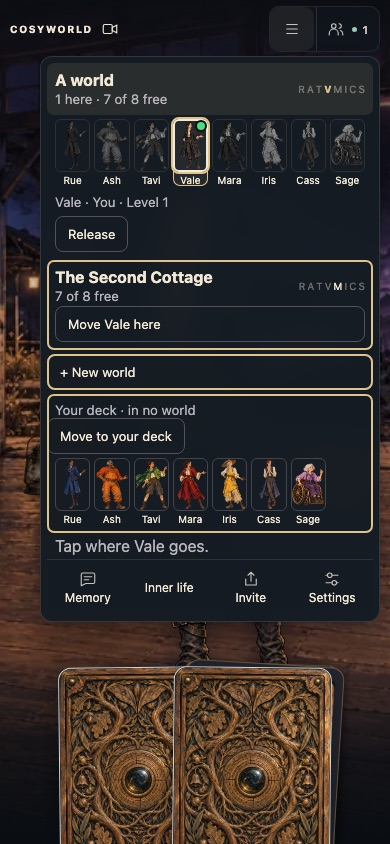
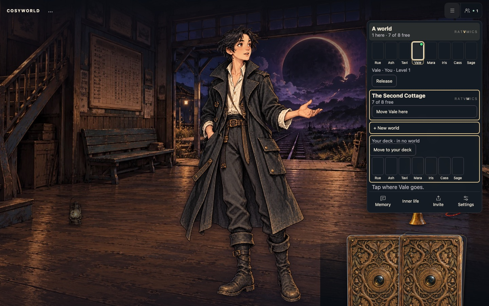

# Avatar menu and world names

Design for [#1737](https://github.com/cenetex/cosyworld/issues/1737). The menu
is organised around the player's avatars. Every world has a name.

## Before #1737

| Screen | What the player sees |
| --- | --- |
| ☰ | Worlds · Share · Memory · Settings · Inner life |
| 👥 | "Players in this world", "Local play · Your world", "3 players online · This world" |
| Worlds (`/?shared=1`) | "Your worlds" with buttons "Continue as Vale", "Continue as Mara", "The reflected shore · 3 avatars available", "Return to my game", "Sign out" |
| Friend's link | "Choose your avatar", eight cards marked "Claimed" or with their pleasure, "Refresh avatars", "Your worlds" |
| Full room | "A place will open shortly", "Check for a place", "Release this avatar", "Your worlds" |
| Share | "Share this world … You will continue as Vale.", then "Invite someone", "Copy link" |
| Settings | Controls, Voices, Flashes and scares, Fight speed, Music and volume, OpenRouter, Local game backup, "Your game saves in this browser…", the `?table=` warning, **New game**; in a shared world also Add a passkey, Leave this room, Release this avatar, Sign out |
| New game | "Start a fresh world?", "This replaces this table's saved game. Its levels, quests and progress are lost, and there is no way back to it.", "Keep playing", "Start new game" |

World actions are spread over four places (☰ Worlds, Share, Settings, the
full-room screen). Worlds have no names, so the list names avatars instead.
"Leave this room" and "Release this avatar" sit beside the sound settings.

Earlier work: #1173 added shared worlds and the avatar picker, #1025 moved
account controls into Settings, #1215 collapsed the toolbar into ☰ and 👥.

## Model

- **A player owns one of each avatar**, shown by initial R·A·T·V·M·I·C·S:
  Rue, Ash, Tavi, Vale, Mara, Iris, Cass and Sage, just as each world has one
  of each (#1846). Iris, Cass and Sage were Nell, Orin and Ada; their ids
  (`nell`, `orin`, `ada`), art and seat indices are unchanged.
- **Each of a player's avatars is played in one world at a time**, local or
  shared. Moving to another shared world keeps the avatar the person took in
  the old one: their passkey is bound to it there, and they return as it
  (#1825).
- **Nobody takes over an avatar.** In a shared world an avatar belongs to the
  passkey that took it, even after it steps away to the deck. Its seat there
  shows in colour for everyone else, and the person bound to it sees it free
  for that avatar only. With all eight taken nobody new can join. The world's
  owner can **Free *Mara*** and the holder can **Release** their own avatar.
  Each asks with a second tap and starts that avatar over as a fresh
  level-1 starter that leaves everything where it stood
  ([avatar bindings](../../../docs/design/avatar-bindings.md)).
- **A player has at most one avatar in a world.** The server already enforces
  this (`card_members` holds one row per account and world). Two avatars of one
  person in one room would fill two of its four seats, would let one person
  trade with themselves past the consent rules, and would summon BoardyAI,
  who comes only for two people.
- A signed-out player owns the avatars in this browser. Shared worlds need a
  passkey; the menu asks for one when the player chooses a shared action.

## The ☰ menu

Redesigned in [#1877](https://github.com/cenetex/cosyworld/issues/1877).
☰ (and 👥, which counts who is here) opens one accordion of **world slots**:

- **Signed in**, the slots are your shared worlds, up to eight per passkey
  (the server refuses a ninth: "You have 8 worlds."). A friend's world is
  listed, marked "a friend's world", only while one of your avatars sits
  there, and it does not use one of your eight. **Signed out**, the slots are
  your local worlds, one per avatar. Local play is its own passkey, so the
  two lists never mix. The world being played is always the first slot,
  open, even when it is local and you are signed in ("on this device").
- **Each slot** is a header (the name, "3 here · 4 of 8 free", and a letter
  strip R·A·T·V·M·I·C·S) and one line of its eight seats, as on the board:
  your one avatar there is marked yours, other humans are in colour with a
  green dot while here, and the residents of unheld seats are in grey. On a
  phone only one slot is open at a time, and the tools (Memory, Inner life,
  Invite, Settings) stay pinned at the bottom.
- **+ New world** follows the slots while one is free. Signed in it makes a
  shared world; signed out a local one. On the world being played locally,
  it is the table's own New game ("Start a fresh world?").
- **Your deck** lists your avatars that are in no world.

Each avatar appears once. **Tap one of your avatars** (in a slot or the deck)
and the places it can go light up: your deck ("Move to your deck"), every
slot whose seat for it is free and that holds none of your avatars ("Move
*Vale* here"), and + New world. Tap one to move it there. A claim anywhere
frees its old seat and carries its level (#1870). Moving out of a local
world asks with a second tap, because that world is lost: "*Hollowmere* will
be lost, with Mara's level and quest there. There is no way back to it."
Moving to the deck releases a shared seat and keeps the binding, or archives
a local save (`.bak`). When the avatar being played leaves, the bare address
opens with ☰ so the player picks what comes next.

The tapped seat also shows its own actions under the line of seats:

| Seat | Actions |
| --- | --- |
| Yours | **Play** (in another slot), **Release** (shared) or **Delete world** (local) |
| Another person's | its holder and level, and **Free** for the world's owner |
| A resident | none |

- **Release** gives a shared seat back. The first tap turns it red: "Release
  *Mara* from *Hollowmere*?" and "Mara keeps their level. Their things and
  quests stay in Hollowmere, and anyone may take Mara there."
- **Free** (owner) asks "Free Ash?" and says "Free Ash: removes Amber
  Heron's hold and resets Ash."
- **Delete world** removes a local world's save and its backup on a second
  tap ("Delete *Hollowmere* and its progress?"). Deleting another avatar's
  world only removes it from the menu. Deleting the world being played stops
  its saves and opens a fresh world for the same avatar, as New game does,
  never another avatar's world (owner bug, 2026-11-01).
  `v2/scripts/smoke-card-delete-world.mjs` checks both.

**A friend's link** (`/?world=…`) signs the person in, then opens their own
table with ☰ open and the linked world as an extra slot marked "invited",
with its seats. Tapping an avatar lights that slot when its seat is free (a
person bound there sees their own avatar's seat free). There are no separate
join, "Return as", full-world or full-room panels. A full room waits at the
table: "Your room is full. Your avatar and belongings are saved."

**Invite** shares the current world. For a local world it first moves the
world online (passkey), then shows the link.

**Settings** is a small separate panel: Voices, Music and volume, Flashes and
scares, Fast fights, OpenRouter, Backup (Save · Restore), Passkey (Add · Sign
out) and Controls. It holds no world actions.

The menu shows now, not a log: where each avatar is now. There is no list of
past or visited worlds. `v2/scripts/smoke-card-world-slots.mjs` taps an
avatar, checks the lit targets and moves it, at 390 and 1440 pixels.

Vale tapped in the world being played, with the deck, a free slot and + New
world lit:

### #1737 mockups (replaced by the slots above)

Phone (390 × 844):

Desktop (1440 × 900):

### Words

Play, Release, Free, Delete world, + New world, Your deck, Move to your
deck, Move *Vale* here, Tap where *Vale* goes, on this device, a friend's
world, invited, You, Memory, Inner life, Invite, Settings. Gone: Worlds,
Share, Your worlds (`/?shared=1` opens the table), Continue as, Continue
shared world, Return to my game, Send to…, Step away, Join, Choose your
avatar, Return as *Mara*, Move *Mara* here?, This world is full (panel), A
place will open shortly, Leave, Refresh avatars, the avatar list under the
seats, Release this avatar, Leave this room, Players in this world, Claimed,
open seat, "The reflected shore · N avatars available".

## Later: the cast ledger

Planning, not built (UI only, no engine change). An opt-in ☰ tool, beside
Memory: each pack's residents as silhouettes until your avatar has talked with
them, then as cards filled from journal facts the avatar witnessed: their want,
home and temperament. Each pack shows a count ("Greece · 7 of 19 met"). It
shows what is true now, not a log, and stays closed unless opened. A resident
you have not reached is a silhouette, not a hint to go there.

## World names

`v2/card-game/world-names.json` holds cosy, uncanny place names: whole names
("Hollowmere", "Lanternfall", "Saltmoth Hollow") and "The *word* *place*"
pairs ("The Quiet Ferry", "The Kettle Marsh"), about two thousand in all. A
world's name is entry `fnv1a32(seed) % count`, using 32-bit FNV-1a over the
decimal run seed (`world.run.seed`).

- Every world has one run seed. A local New game draws it; a shared world
  created from a save keeps the save's seed, and a world with none gets one
  derived from its id. So a local world keeps its name when it is shared, and
  every player sees the same name.
- The server's world list returns each world's seed, so the menu can name
  worlds it has not opened.
- The list is frozen once released: adding or reordering names would rename
  every world. A test pins several id-to-name pairs. A later list would need a
  new version recorded on each world.
- Two worlds may share a name. Two of one player's eight worlds share one
  less than one time in fifty; the avatar on each row tells them apart.
- The names are presentation. They are not in the shared rules bundle and
  never enter the journal.

## Mapping onto saves and shared worlds

This is a presentation and ownership layer. Journals, world ids, bundle
hashes and replay do not change.

- **Local saves.** Vale's local world stays in the existing slot,
  `cosyworld.reflected-shore.v1`, so current local games carry over. Each
  other avatar gets `cosyworld.reflected-shore.v1.avatar.<id>`, holding a
  save with `playerActorId` set. The rules already accept any human avatar
  as the player. `?table=` stays a developer slot outside the menu.
- **Shared worlds.** The avatar's world is the account's `card_members` row
  for that avatar. Today every Share claims Vale, so an account can hold Vale
  in several worlds. The newest is shown. The others stay untouched and are
  released only when the player next moves that avatar. Nothing disappears
  unexpectedly, and no journal row is written on upgrade.
- **Links.** A world link opens ☰ with that world as an invited slot; moving
  an avatar there frees its seat elsewhere (#1877).
- **Starts.** Vale's new local world opens in the attic. Every other avatar's
  new local world starts at that avatar's own home with their item, as in
  shared play. Vale waits in the attic there, and the lamp stays lit on the
  attic floor where the player can find it.
- **Local and shared together.** Moving an avatar into a shared world (Invite
  or a move in ☰) archives that avatar's local save to `.bak`.
- **Move** is a release in the old world and a claim in the new one. Both
  are existing journal actions, so no rules or engine change is needed. The
  client can do this in two steps. The server makes it one transaction in the
  third PR, so a full room or a lost race cannot leave the avatar in no world.
- **Alpha saves.** Nothing is nuked. Old `.shared` links in local storage are
  ignored; the account's world list is the only source (#1877).

## Plan

Small ready PRs under the 400-line budget, client first:

1. The world-name list, `worldName(seed)`, and the name in 👥 and the invite
   panel; the server's world list returns each seed (Rust CI dispatched).
2. The avatar ☰ menu, a slot per avatar, Play / Move / Leave / New world /
   Join with the existing `claim` and `release` commands, and the trimmed
   Settings panel.
3. Server: `claim` with `move` releases the account's other row for that
   avatar in the same transaction; Share takes the avatar, not always Vale;
   the world list returns rows by last visit. CI is dispatched, with no local
   cargo run.

## Decisions

The owner settled these on 2026-11-01 ([#1737](https://github.com/cenetex/cosyworld/issues/1737)):

1. Worlds are named by run seed, so a world keeps its name when shared.
2. A world link for an avatar that is elsewhere asks "Move Vale here?"
3. Non-Vale avatars start a local world at their own home.
4. Extra shared claims stay until the player next moves that avatar.
5. A player has at most one avatar in a world.
